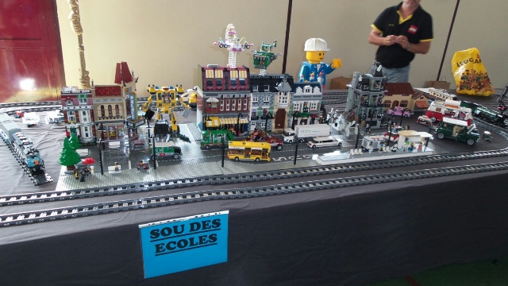
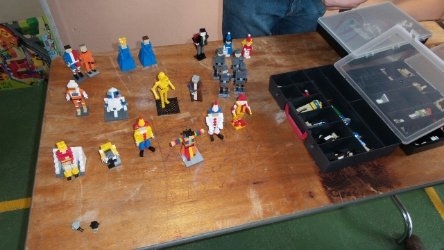
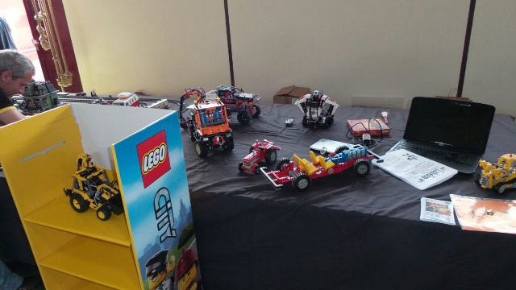
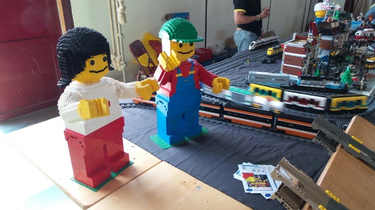
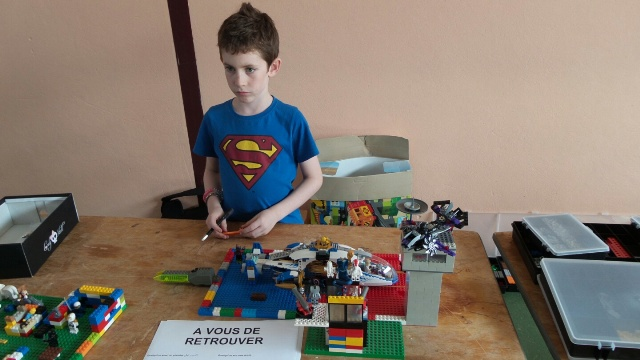
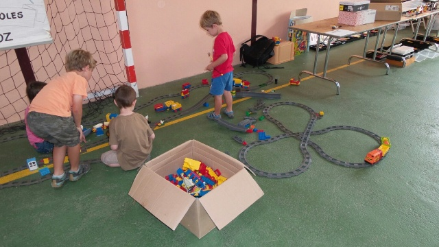
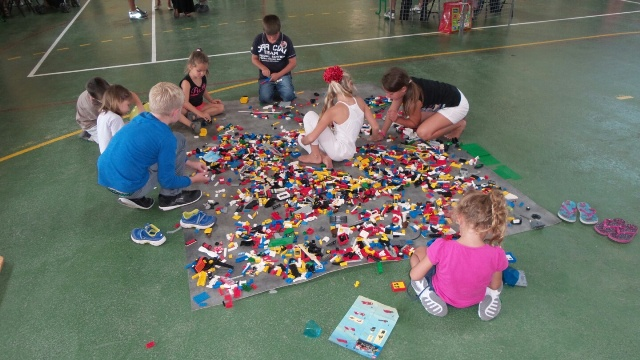
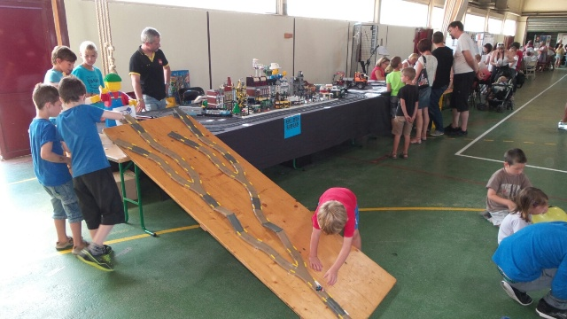
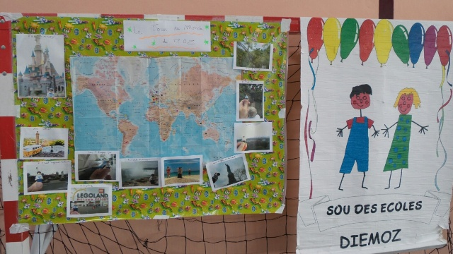
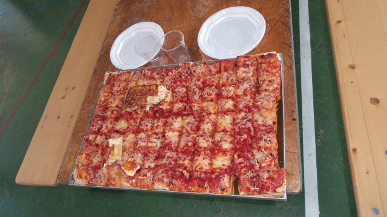

En 2012, nous étions 2 à exposer, l’an dernier 3, et cette année, c’est à 5 que nous avons proposé et animé le stand LEGO du Sou des écoles avec :

-   Un beau petit diorama City, avec trains, maisons et scénettes humoristiques réalisé par Chimère, Yannoch et Arnaud :

**Stand City**

-   Un stand animé par Didier et ses figurines :

**Les Figurines de Didier**

-   Un stand Technic aux côtés de l’association Ludodiem :

**Quelques Technic**

Jérôme s’est joint à nous cette année avec ses Maxifigs :

**Les Maxifigs de Jérômes**

Et nous avions même de jeunes moccers pour nous accompagner... peut être de futurs FreeLUGiens :

**Arthur présente ses créations**

-   Un gros stand de DUPLO, avec de quoi construire de grands réseaux de trains :

**Le train Duplo a toujours autant de succès**

-   Une animation "course" en prévision de la prochaine édition de la [BRIQU’Expo Diemoz](http://chezyannoch.com/briquexpodiemoz/). Les enfants devaient construire un véhicules avec les pièces mises à leur disposition :

**Construction du véhicule**

Et ils pouvaient ensuite placer le véhicule en haut de la piste. Le premier en bas remportait la victoire :

**La course**

Si vous avez des Systèmes track, merci de contacter les organisateur de l’expo qui en recherche pour leur future animation !

-   MOZ était bien sûr de la partie, et un stand complet lui était même dédié et retraçait son voyage à travers le monde :

**Le voyage de MOZ**

-   Enfin des vitrines (Friends, DUPLO) décoraient la salle et un concours a été organisé pour permettre aux enfants de gagner des boîtes LEGO.

Si le forum des associations n’est pas un évènement LEGO en soit, il reste une rencontre agréable entre des membres de FreeLUG et du Sou des écoles de Diémoz. Et comme pour toute rencontre agréable qui respecte, on ne peut échapper au traditionnel casse-croûte !

**Pause Casse-Croûte**

Rendez-vous l’année prochaine pour un nouveau forum qui aura lieu quelques jours avant la seconde édition de la [BRIQU’Expo Diemoz](http://chezyannoch.com/briquexpodiemoz/) !
