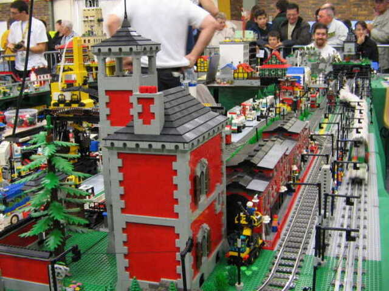
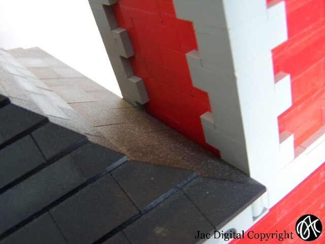
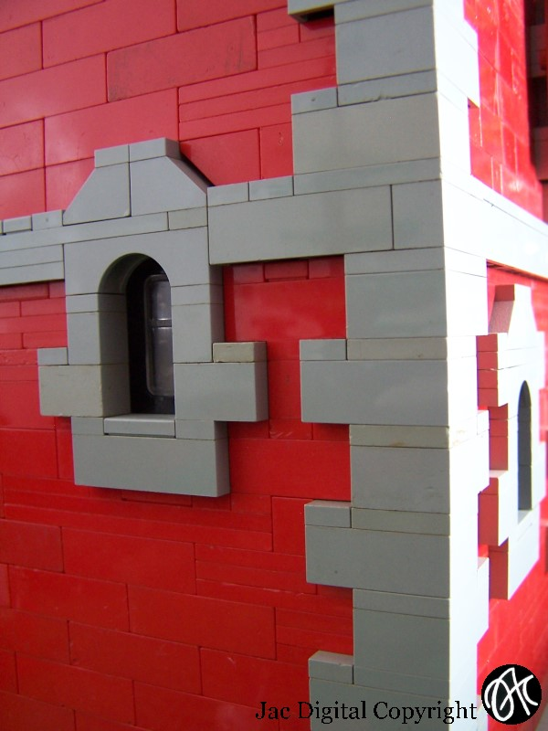
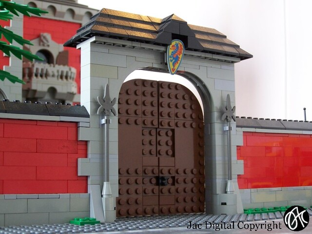
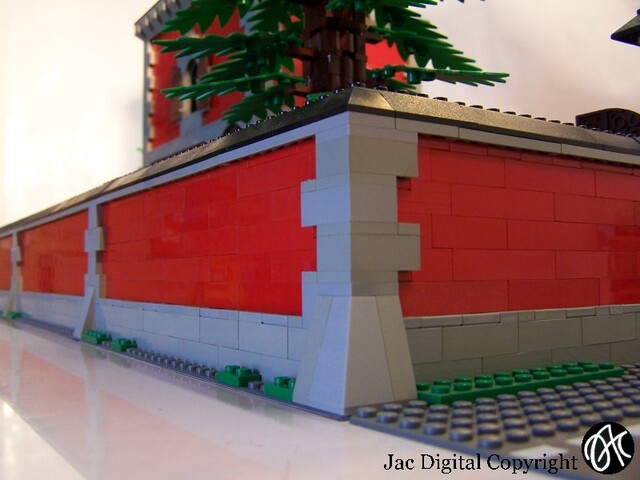
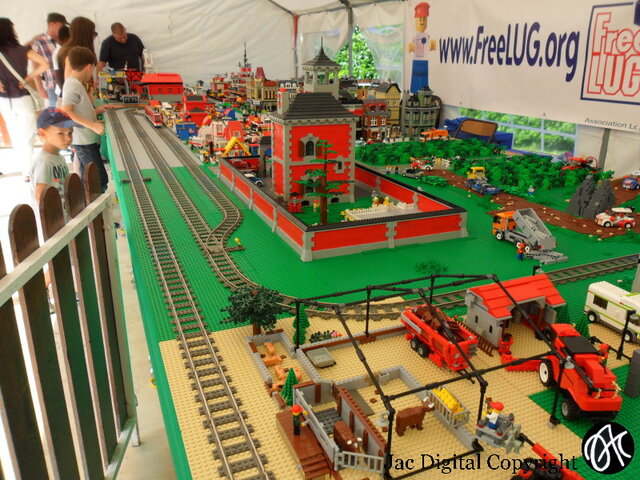

Je me rends compte que cette construction a plus de 10 ans maintenant, quand on aime ! Il est temps de faire un compte rendu, de détruire et de passer à d’autres choses... mais toujours en LEGO.

J’ai toujours été fasciné par ces grandes maisons, hautes et riches en détails sur les façades. C’est donc tout naturellement que je me suis lancé dans une telle construction, il y a une bonne dizaine d’année maintenant. Sa première présentation a été faite à notre première exposition au salon de [modélisme ferroviaire](http://www.brickshelf.com/cgi-bin/gallery.cgi?f=104768) de la ville d’Orléans en 2004.

Il n’y a aucun plan. Et oui, à cette époque et toujours maintenant les choses sont assez précises dans mes idées pour que la construction se fasse sans plan ni aucun croquis préalable. Je ne dis pas non plus qu’il n’y a pas eu des ratés avec des destructions pour amélioration, surtout que l’intérieur a été fait une fois la maison finie. Mais il était clair qu’il fallait une belle entrée sous un porche, une tour avec un point de vue accessible, une grande salle à manger avec la cheminée en conséquence, un grand escalier et des fenêtres arrondies sur le haut.

De nouvelles fenêtres disponibles dans la gamme LEGO allaient aussi me permettre une forme un peu particulière pour lier le haut et le bas avec une belle petite terrasse au premier étage.

Vint ensuite le problème des pierres d’angles et de l’entourage des ouvertures. Les décaler d’un tenon ça faisait trop et pas très beau. J’ai donc choisi de décaler les pierres d’un demi tenon. La construction avec ce procédé est un vrai casse tête sur certaines parties, car je voulais aussi conserver le croisement des briques. Mais le rendu final correspondait vraiment à ce que je voulais. Un petit test supplémentaire pour trouver les bonnes hauteurs des pierres apparentes et c’est parti...

J’avais en tête aussi une toiture noire à 2 pentes différentes. Cela m’a permis aussi de construire une frise entre le toit et les murs de façade pour enrichir les volumes. Les petites arches ont été idéales pour cette partie. En plus c’est tombé pile poil comme il faut du premier coup. Comme s’il fallait vraiment que je fasse comme ça. Quelques parties aussi ont été un peu casse tête, mais il n’y a pas de problème seulement des solution et ELTEP !!! (En LEGO Tout Est Possible)

Je trouvais certaines parties de la construction très réussies, il faut bien avoir un peu de satisfaction. Les petites fenêtres à l’emplacement des escaliers avec le décrochement de niveau dont voici une photo.

Pour finaliser le tout, j’ai clôturé le parc par un mur d’enceinte construit sur le même principe, avec un portail un peu magistral, pour marquer les choses. Le portail a reçu quelques modifications avant la version que je vous présente. Le mur de clôture a été adapté en fonction de l’espace disponible et aussi des pièces que j’avais en stock. La version exposée à Aubiére était l’une des plus aboutie mais pas la plus grande.

Dernière présentation à l’exposition "[La foire de la St loup](http://photos.freelug.org/main.php/v/JAC/Exposition/2014/Aubiere/)" à Aubière.

Aujourd’hui il existe d’autres moyens pour représenter cette particularité de certaines de nos maisons, notamment avec les briques à tenons sur le côté, beaucoup plus répandues en tailles et en couleurs aujourd’hui. Mais je reste fidèle à ce procédé de décalage qui permet aussi des montages sympa. Le principal étant de coller au mieux à ce que l’on a dans notre imagination, enfin pour moi.

Très passionné par cette construction, j’ai mis quelques années à me décider à m’en séparer. Aujourd’hui elle est de nouveau en vrac dans mon stock de briques. Mais en parlant de celui ci justement, il a évolué, grâce aux nouvelles pièces. J’ai donc vraiment dans l’idée de repartir sur le même genre de construction en améliorant encore des choses, sans pour autant faire plus grand.

Pour voir plus de photos de l’ensemble et de la destruction, c’est dans la [galerie correspondante](http://photos.freelug.org/main.php/v/JAC/MOC/Batiment/maison-immeuble/maison2maitre/).
