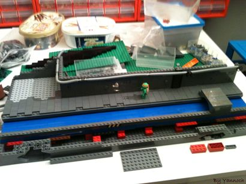
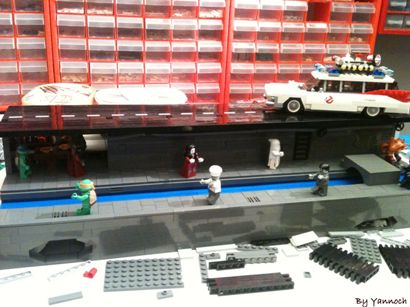
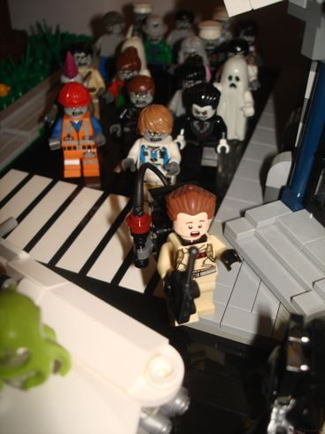
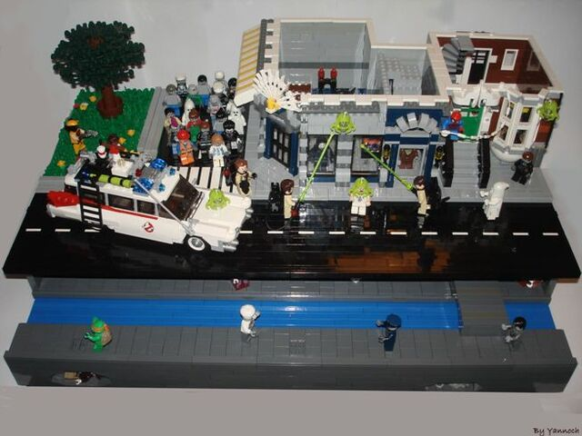
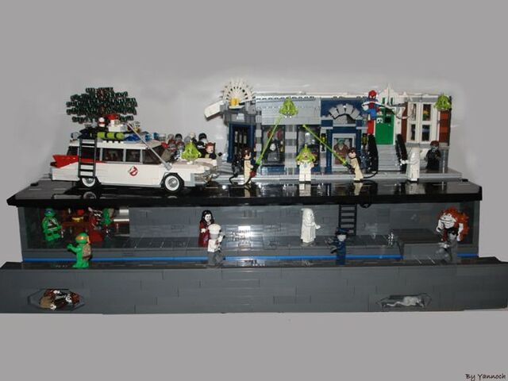
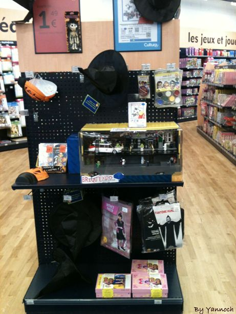

Dans le cadre du partenariat mis en place pour la [BRIQU’Expo Diemoz](http://chezyannoch.com/briquexpodiemoz/) avec le magasin Cultura de Bourgoin Jallieu, nous avons été sollicité pour réaliser une petite vitrine sur le thème d’Halloween.

La réalisation d’une vitrine à la taille standard des vitrines Lego n’est pas un exercice facile lorsqu’on est habitué à construire des dioramas à exposer, pour lesquels la taille est rarement la contrainte principale.

**Construction du diorama**

**Construction du diorama**

Il faut réussir à faire une scène assez petite mais suffisamment intéressante, drôle, pour qu’elle attire l’œil du passant. Pour cela, j’essaye toujours de caser un maximum d’humour ou de références qui parlent à la fois aux petits et aux grands. Reste à savoir si ce que je trouve drôle, l’est aussi pour les autres....

Quelques photos du diorama avant d’être mis en vitrine :

**L’attaque des Zombies**

Pour cette vitrine, je suis parti sur une mise en scène d’une intervention des Ghostbusters, avec fantômes et zombies. Et comme la vitrine était mise en place au moment de la sortie du nouveau film Tortues Ninja, j’ai ajouté le repaire des tortues dans les égouts.

**Le Diorama**

**Le Diorama**

Une fois le diorama terminé, il a fallu le faire rentrer non sans mal dans la vitrine, pour au final donner ceci :

**Vitrine dans le magasin**

Ce fut au final un exercice intéressant que j’aurais certainement l’occasion de refaire prochainement sur un autre thème.

Plus de photos sur la galerie [ici](https://www.flickr.com/photos/84107414@N03/sets/72157648541690438/).
