Pour promouvoir les [Briqu’Expo Diemoz](http://www.briquexpodiemoz.com/), nous avions dès 2013 proposé de mettre à disposition de certains magasins partenaires de notre événement une vitrine. Ceci est en général une occasion pour le magasin de faire un peu de buzz, en organisant un petit concours autour de la vitrine, et pour nous, de faire de la publicité.

Pour cela, nous utilisons en général  
**–** soit les vitrines officielles LEGO, petites vitrines souvent visibles en magasins et mettant en scène des sets officiels :

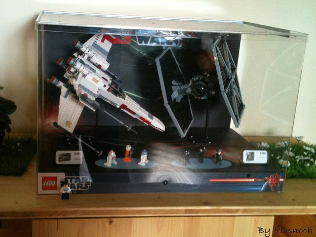

**Petite vitrine officielle Star Wars**

**–** soit des vitrines plus particulières conçues par LEGO pour des événements, comme cette vitrine Star Wars, animée.

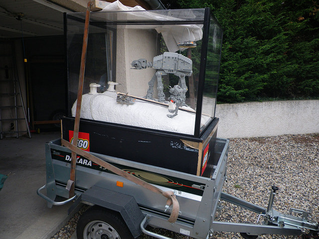

**Grande vitrine officielle Star Wars**

Mais ces vitrines sont bien sûr des modèles collés, et cela laisse peu de possibilité de customisation et d’utilisation plus personnelle.

Pour présenter des créations originales, il y a donc plusieurs possibilités :

Utiliser une vitrine LEGO en la vidant et en mettant à l’intérieur ses propres créations. C’est par exemple ce que nous avons fait à l’occasion d’Halloween avec une vitrine qui a été mise en place chez notre partenaire [Cultura](http://www.cultura.com/les-magasins/cultura-bourgoin-jallieu.html).

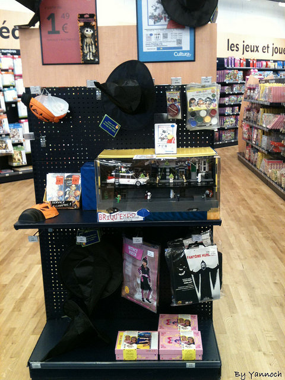

**Vitrine Personnalisée "Halloween"**

Ou lors du grand concours organisé lors de la Briqu’Expo Diemoz 2013 : _Que font les super héros lorsqu’ils ne sauvent pas le monde :_

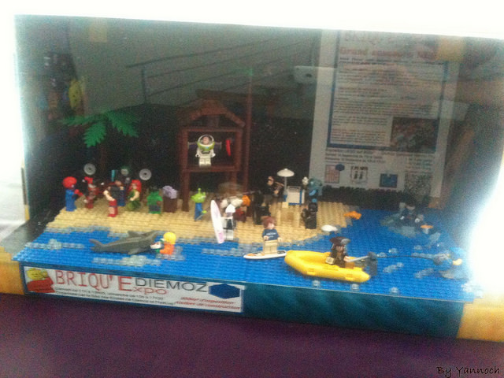

**Vitrine Personnalisée "Les Héros à la Plage"**

Ou avec ce mini diorama sur le thème de la rentrée :

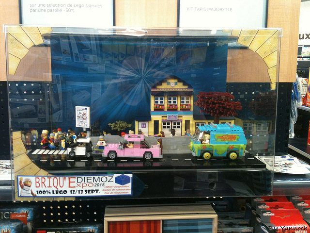

**Vitrine Personnalisée "La Rentrée"**

Mais voilà, la taille de ces vitrines reste très modeste, et elle ne permet pas d’exposer de grands dioramas. J’ai donc décidé de construire une vitrine un peu plus grande, qui permettrait de présenter des dioramas de 3x6 plaques de 32x32 tenons, soit 2 modules.... en tout cas, c’était l’objectif !

Pour construire cette vitrine, les objectifs initiaux étaient :  
**–** Pouvoir exposer 3x6 plaques de 32x32 tenons.  
**–** Etre facilement transportable (si possible dans une voiture et raisonnablement lourd pour être porté par deux personnes)  
**–** Ne pas être fragile (pas de verre)  
**–** Etre suffisamment propre pour pouvoir être présenté dans un lieu commercial  
**–** Rester dans un budget très acceptable

La première étape a donc consisté à trouver les matériaux, facilement trouvables et à prix raisonnables.  
Je suis donc parti sur :  
**–** des plaques PVC Rigide transparent 2mm d’épais  
**–** du mélaminé blanc 16mm d’épais pour la base  
**–** du profilé aluminium droit et en L pour fixer les plaques de PVC entre elles.

Première concession : j’ai dû revoir la taille de la vitrine légèrement à la baisse compte tenu des tailles de plaque PVC disponibles sur le marché (et en accord avec mon budget). La vitrine ne permettra finalement de mettre en place que des dioramas de **3x5.5** plaques de 32x32 tenons.

La construction peut maintenant commencer avec la réalisation du socle en mélaminé blanc :

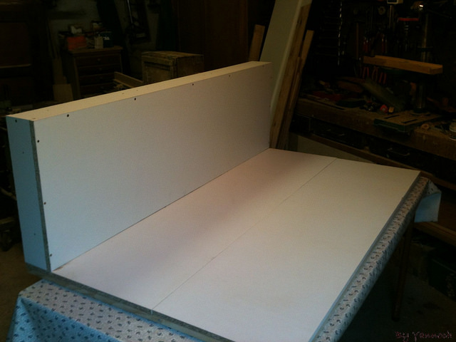

**Socle de la vitrine**

A noter que la base est constituée de 2 plaques vissées ensemble par en-dessous. Cela permet en théorie de les séparer. Cela avait été prévu à l’origine pour faciliter le déplacement de la vitrine mais se révèle au final assez inutile.

Sous la vitrine, des tasseaux ont été fixés et percés. Les trous permettront de fixer la structure PVC.

[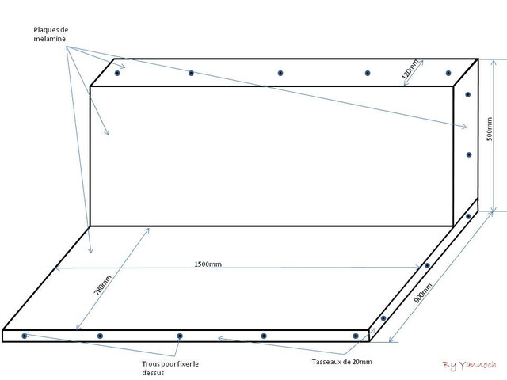](https://www.freelug.org/IMG/jpg/Vitrine_07.jpg)

**Plan et côtes de la vitrine**

Un caisson a été réalisé à l’arrière de la vitrine afin de faciliter l’accès à la visserie. Cela peut permettre également de cacher des choses que le public n’est pas sensé voir, comme des alimentations électriques.

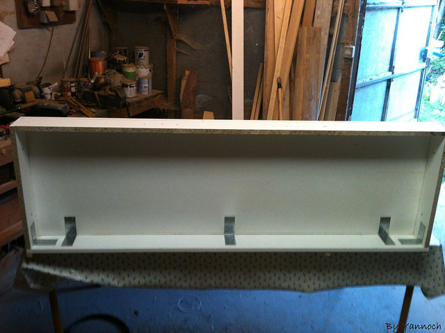

**Caisson à l’arrière de la vitrine**

Ensuite il a fallu réaliser la structure en PVC transparent :

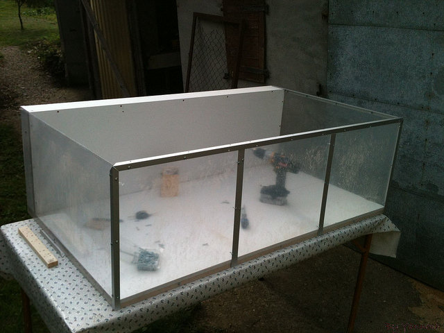

**La structure PVC**

Les côtés ont été réalisés avec 1 plaque de PVC, mais le devant a lui été réalisé avec 3 plaques de PVC fixées entre elles avec un profilé aluminium droit. Dans les angles, les plaques sont fixées entre elles avec du profilé aluminium en "L".

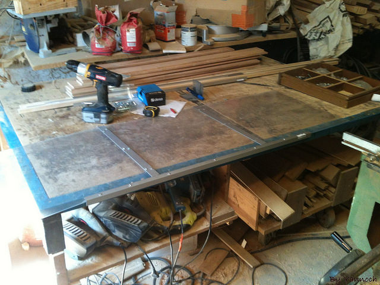

**Fixation des plaques de devant entre elles avec les plaques aluminium**

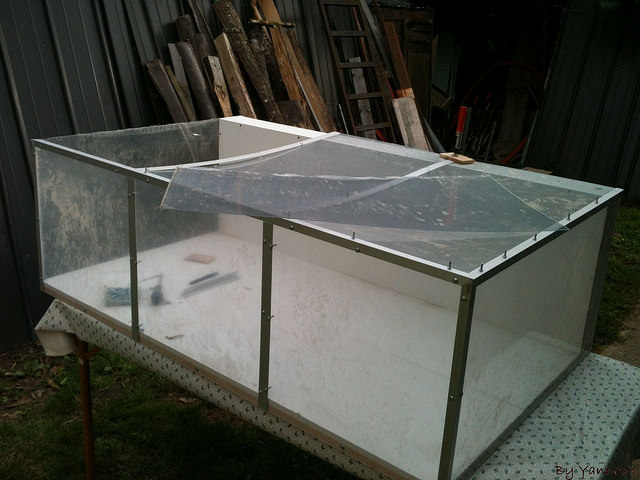

**Mise en place des plaques PVC du dessus**

Comme pour le devant, des profilés aluminium permettent de fixer les 3 plaques PVC entre elles. Il aurait cependant été préférable d’utiliser du profilé en "T", cela aurait permis de rigidifier la structure, car comme on peut le voir sur les photos, la structure a tendance à plier sous son propre poids. Les contraintes de serrage vont permettre d’atténuer ce phénomène, mais pas de le faire disparaître totalement.

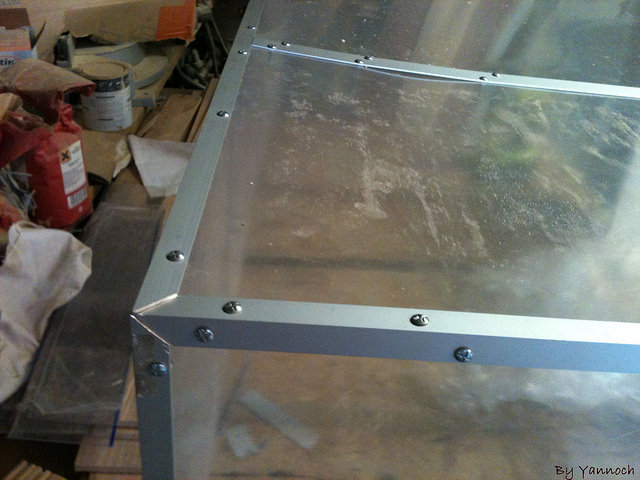

Et voilà, la vitrine est maintenant prête à partir en exposition.

Sa première sortie fut organisée dans un magasin de la [Grande Récré](http://www.lagranderecre.fr/magasin-jouets-la-grande-recre-saint-bonnet-de-mure-69720.html), à l’occasion du partenariat mis en place pour la Briqu’Expo Diemoz 2015 ! Un petit diorama collaboratif a pu être exposé :

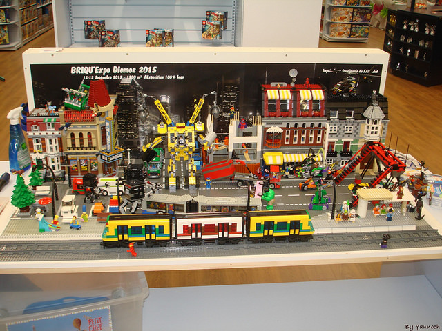

**Diorama collaboratif City**

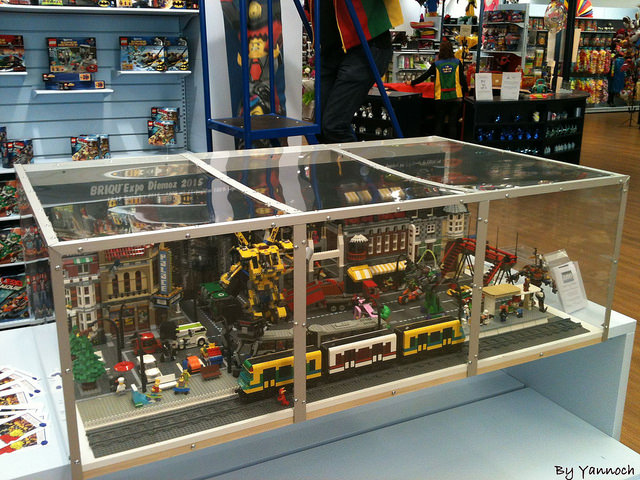

**Diorama collaboratif City**

Un second a ensuite été réalisé sur le thème de Star Wars :

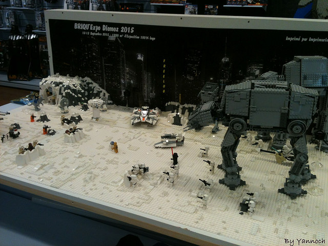

**Diorama collaboratif Star Wars**

et un troisième, plus "Girly" :

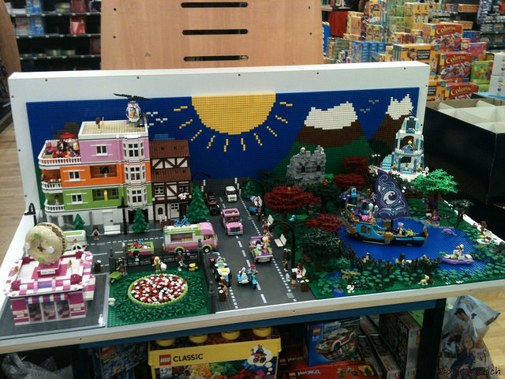

**Diorama collaboratif Girly**

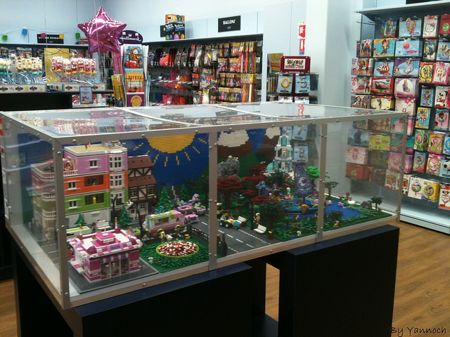

**Diorama collaboratif Girly**
