Il est courant de paver les trottoirs des villes LEGO en recouvrant les plaques de base à l’aide de plaques lisses (tiles), bien souvent de taille 2x2, comme par exemple dans le standard "Modular Buildings" (ci-dessous le Cafe Corner).

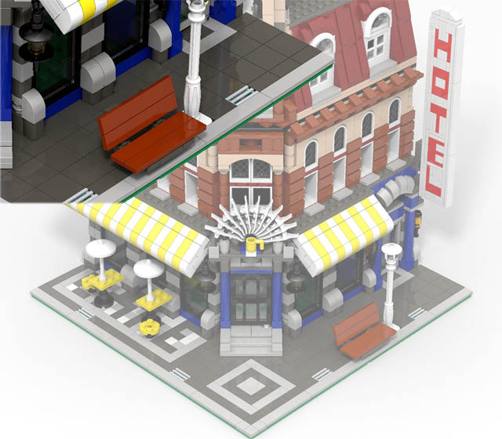

Ces pavages sont extrêmement réguliers, même si on peut par exemple décaler les rangées de tiles et varier leurs tailles et couleurs pour créer des motifs géométriques simples, par exemple ici sur cette terrasse d’un palais indien par Arthur Gugick.

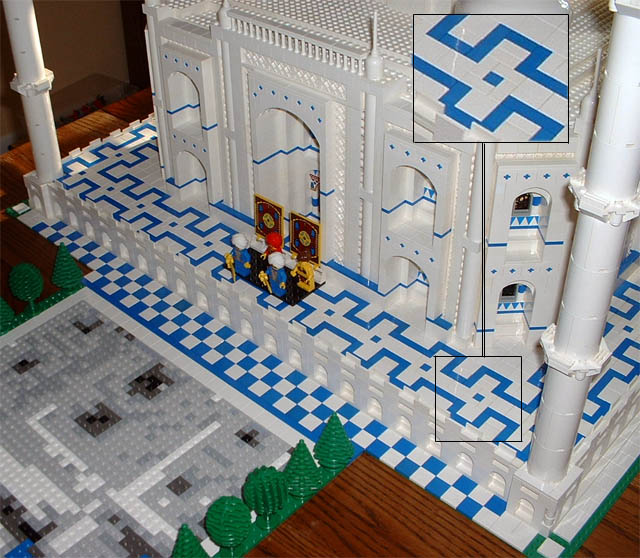

Mais une technique utilisant intensivement des pièces comme les "jumpers" [^1] permet de créer des pavages encore plus originaux, apportant de la fantaisie.

Ces pavages présentent des angles variés par rapport au cadre de référence ainsi que des décalages et espacement divers entre rangées.

Cette technique, qui fait partie de la technique SNIR (Studs Not In a Row) [^2], consiste à créer une matrice sous-jacente en diagonale.

En choisissant judicieusement la taille des mailles de cette matrice, on obtient un espacement du pavage voisin de 2 tenons, mais légèrement supérieur, permettant d’aligner des tiles 2x2 avec un effet de joint.

Voyons en détails ces différentes matrices et le pavage qui en résulte.

**La matrice 2 / 0.5**

_Pavage simple_

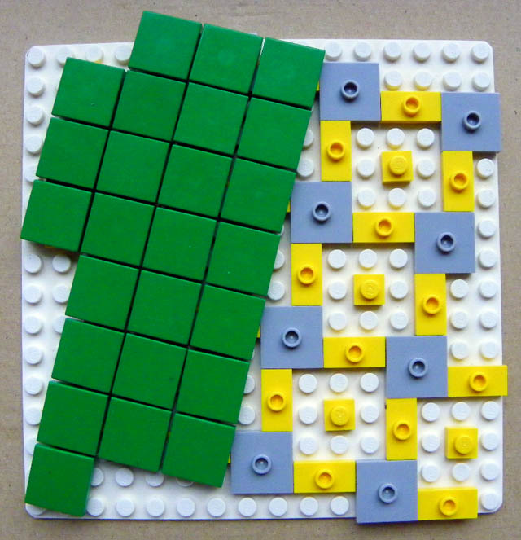

**Tessel2-05simple**

Angle : 14.0 degrés

Espacement : 0.06 tenons

Notez que vous pouvez remplacer les jumpers 2x2 (en gris) par des plaques 1x1 rondes à placer entre quatre tenons de la plaque de base.

Le pavage est aligné sans décalage mais rien n’interdit de tourner les pavés pour obtenir une variante avec décalages et effet de cabochons.

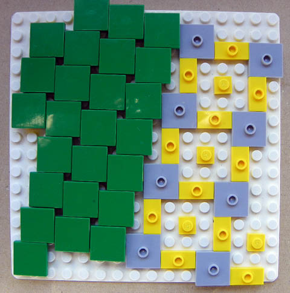

On obtient alors un pavage parfaitement aligné avec la plaque de base mais avec un décalage d’un demi de tenon.

**La matrice 2 / 1**

_Pavage simple_

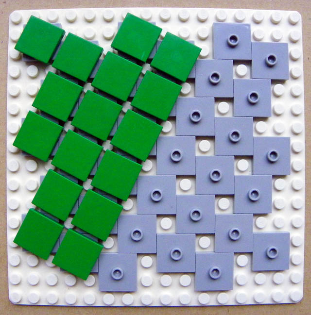

**Tessel2- simple**

Angle : 26.6 degrés

Espacement : 0.24 tenons

Décalage : nul

Le remplacement des jumpers 2x2 en gris par des plaques 1x1 est possible mais le pavage sera alors "bancal" - mieux vaudra le soutenir au prix de quelques pièces supplémentaires.

A cet angle, l’espacement est fort mais nous allons voir qu’il a du potentiel.

Notez que de la même façon que ce que nous avons vu précédemment, les pavés peuvent être tournés mais on risque fort de revenir à une solution comme présentée ci-dessous - triviale - qui n’apporte aucune amélioration puisque les pavés se retrouvent à un angle droit avec un décalage entier comme sur une plaque de base.

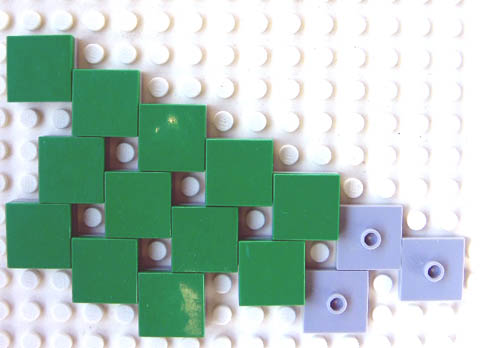

_Pavage décalé_

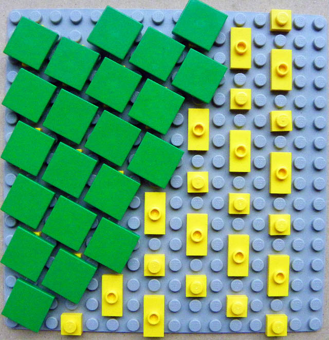

**Tessel2- decalage**

Angles : 26.6 et 36.9 degrés

Espacement : 0.24 tenons

Décalage : 50%

_Pavage composite_

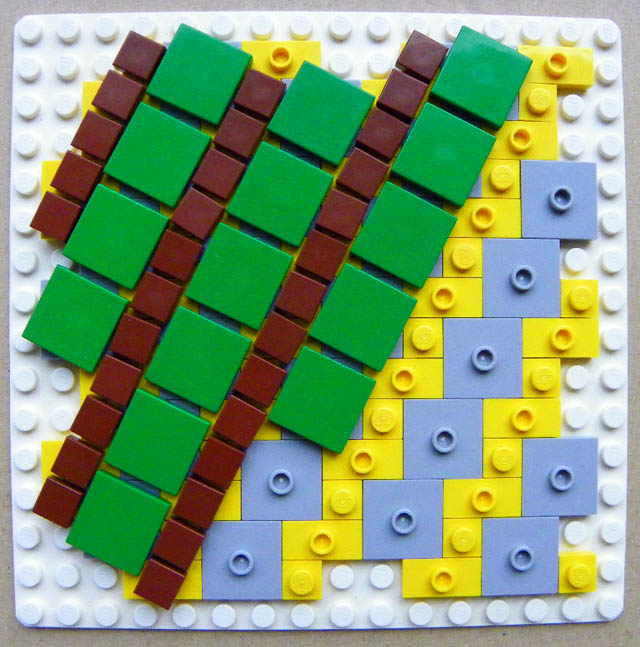

**Tessel2- decalagedouble**

Angles : 26.6 et 18.4 degrés

Espacements :  
0.24 (tile 2x2),  
0.12 tenons (tile 1x1) et  
0.08 tenons (tile 1x1 -> tile 1x2)

Décalage : 22%

Le pavage composite est présenté ici avec de tiles 1x1 mais il peut être mis en œuvre avec des tiles 1xn en général à la condition d’enlever quelques tenons de la matrice jaune.

**La matrice 1.5 / 1.5**

_Pavage simple_

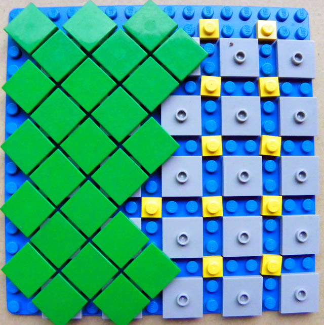

**Tessel 5- 5simpleA**

Angle : 45 degrés

Espacement : 0.12 tenons

Décalage : nul

La matrice peut être créée avec des jumpers 2x2 (décalage d’un demi tenon dans les deux directions) comme montré ci-dessus ou avec des jumpers 1x2 (décalage d’un demi tenon seulement dans une direction) montés alternativement à 90 degrés d’angle comme montré ci-dessous.

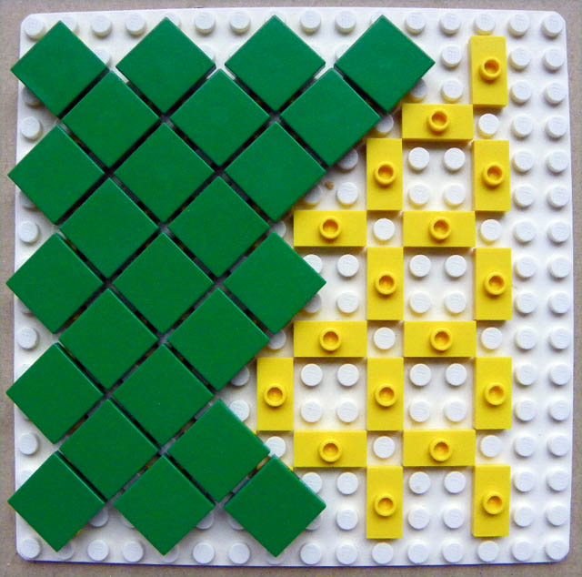

**Tessel 5- 5simpleB**

_Pavage décalé_

Angle : 45 degrés

Espacement : 0.12 tenons

Décalage : 33%

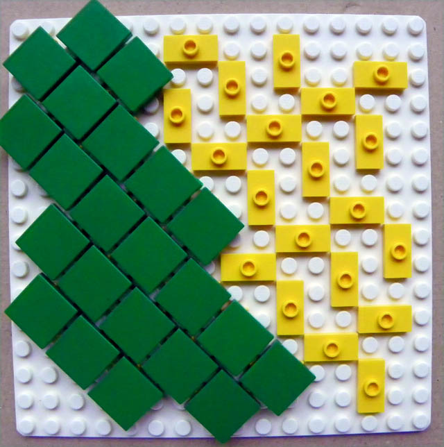

**Tessel 5- 5decalage**

Ces deux types de pavage (simple et décalé) peuvent être combiné sur un seul plan, permettant de passer sans transition de rangs alignés à des rangs décalés.

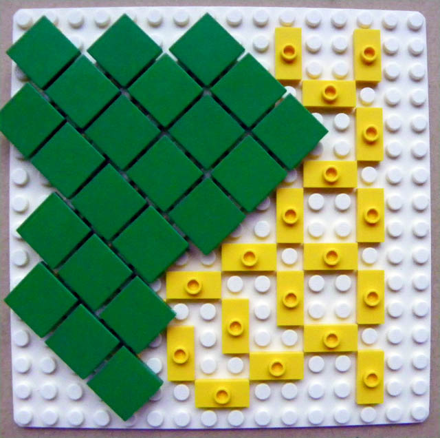

**Tessel 5- 5composite**

**La matrice 1.5 / 1**

_Pavage composite_

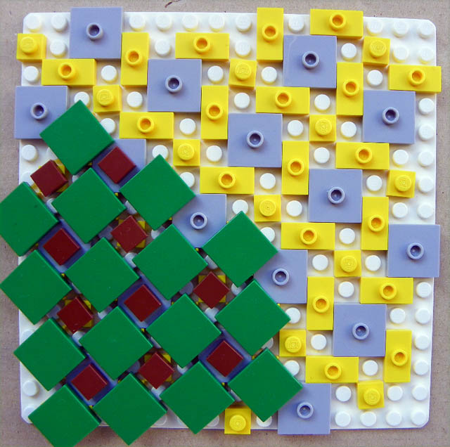

Angle : 11.3 et 33.7 degrés

Espacement : 0.3 tenon (tile 2x2->tile1x1)

Décalage : nul

Ce dernier montage composite de tile 2x2 et 1x1 présente des écartements importants pouvant nuire à l’effet de dallage. Toutefois avec un choix de couleur judicieux de la matrice (par exemple une couleur uniforme neutre ou au contraire une couleur identique au pavage), l’effet peut être visuellement réduit.

et n’hésitez pas une dernière fois à tourner les pavés pour un effet moins mathématiques et plus aléatoire

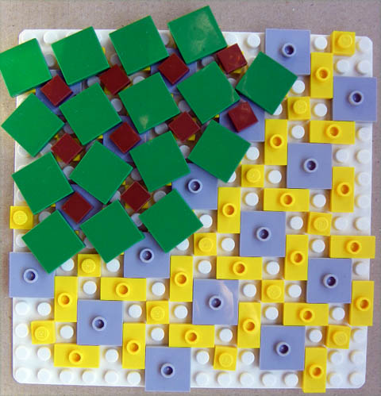

**Conclusion**

Cette technique de pavage SNIR est très grosse consommatrice de pièces. Elle nécessite de plus de l’espace aussi bien en épaisseur que sur les bords pour permettre de dissimuler les transitions avec les angles droits (à moins que vous soyez prêt à découper des tiles 2x2 à 14, 26.6 ou 45 degrés.

Toutefois, comme vous le voyez ci-dessous sur ce diorama Star Wars de [Markus](https://www.flickr.com/photos/71475401@N07/), cette technique de montage - combinée à d’autres techniques avancées - vous permettra d’améliorer l’effet de vos créations sur le spectateur.

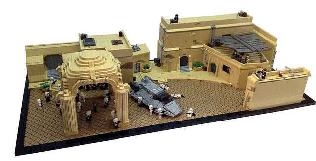

N’hésitez pas à expérimenter vous même de nouvelles compositions - je n’ai dans cet article aucune prétention à l’exhaustivité [^3].

Les décalages présentés ici à l’aide des jumpers - des multiples de 1/2 tenons - ne sont pas les seuls que l’on puisse employer. Par exemple, je pense que le pavage peut aussi concerner des façades ou des pignons aveugles et les décalages verticaux peuvent alors impliquer des hauteurs de plaques (multiples de 0.4 tenons).

Et enfin, pour plus d’inspiration dans le monde réel à propos du pavage du plan, vous pouvez "googler" les travaux d’Escher ou de Penrose.

Bonnes constructions.

Ajout de dernière minute.

Sylvain "wagaboonga" me fait part d’un exemple très intéressant de pavage en arceaux réalisé à l’aide de la technique de pavage SNIR que je viens de vous présenter. Cet exemple nous est proposé par [steve5010](https://www.flickr.com/photos/the_kirschte/).

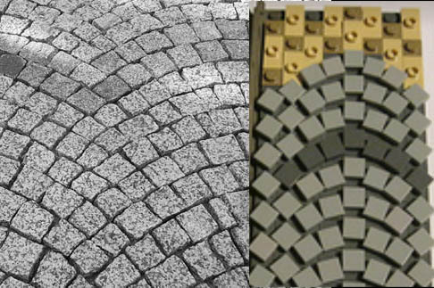

[^1]: Les jumpers sont des plaques de taille 1x2 et 2x2, ne présentant qu’un seul tenon centré - elles permettent ainsi d’effectuer des décalages d’un demi-tenon

[^2]: Pour plus d’information sur le SNIR, consultez [cet article](http://www.freelug.org/spip.php?article1438)

[^3]: Je vous encourage aussi à étudier les [pavages mosaïques](http://www.freelug.org/spip.php?article1505) de Katie Walker
