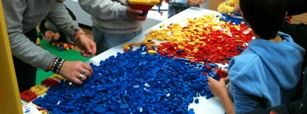
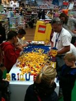
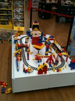
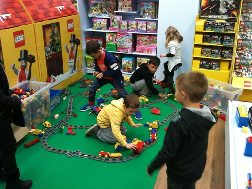
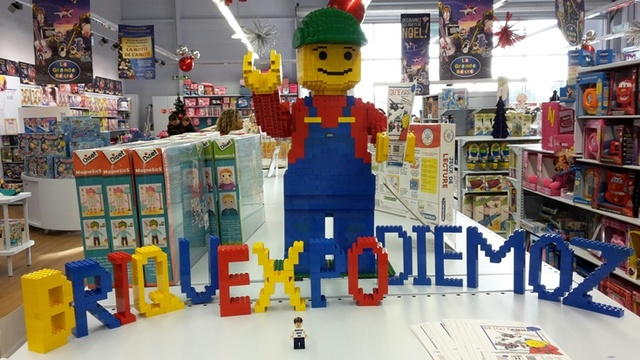

Le samedi 08 novembre 2014, toute l’équipe [BRIQU’Expo Diemoz](http://chezyannoch.com/briquexpodiemoz/) s’était donnée rendez vous à St Bonnet de Mûre, à côté de Lyon pour assurer une animation dans le magasin [La Grande Récré](http://www.lagranderecre.fr/magasin-jouets-la-grande-recre/saint-bonnet-de-mure/saint%20bonnet%20de%20mure/69720.html), partenaire de notre exposition pour 2015.

**Animation à La Grande Récré**

Les membres de FreeLUG et du Sou des Ecoles de Diemoz ont une fois encore répondu présents. Après avoir présenté une [vitrine](/articles/1887/) en août dernier, nous avons été sollicités par le magasin pour organiser une animation construction.

**Plein de briques**

A cette occasion, nous avions proposé aux enfants de construire un décor pour la petite ligne de train rapidement improvisée.

**La Maxifig de Jérôme**

**Atelier construction**

**Constructions des enfants**

Bien sûr, il y avait aussi des Duplo pour les petits :

**Stand Duplo pour les plus petits**

Notre mascotte MOZ était bien sûr présente :

**MOZ à la Grande Récré**

Une journée de partage agréable.  
Nous vous donnons rendez vous le samedi 21 février 2015 toujours à la Grande Récré de St Bonnet de Mûre pour une grande animation Star Wars !

Plus de photos sur la galerie accessible [ici](https://www.flickr.com/photos/84107414@N03/sets/72157646704887836/).
