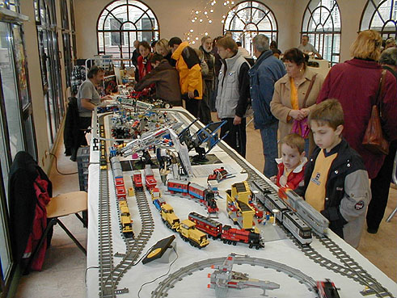
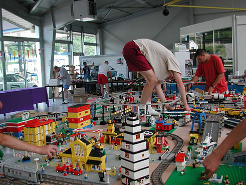
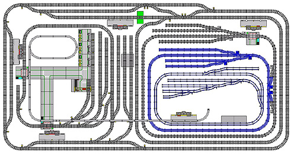
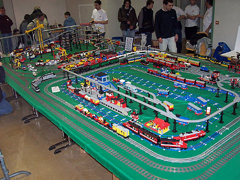
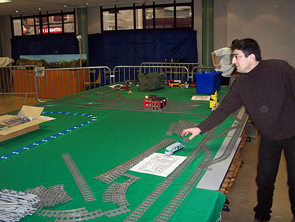
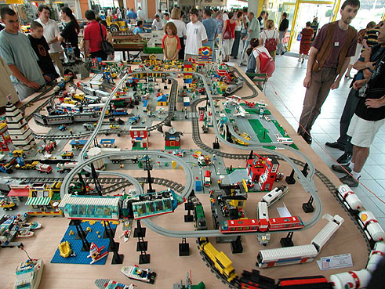

Cet article a pour but de donner "brut de fonderie" un petit retour d’expérience suite aux expositions faites par les Freelugiens de Rhône-Alpes (communément surnommé Ralug ...) ces 18 derniers mois.

Depuis la naissance de FreeLUG, plusieurs expositions importantes ont été faites par FreeLUG sur la région Rhone-Alpes :

Les "réflexions" qui suivent sont issues, sans aucune prétention, de l’expérience vécue lors de ces expositions.

**Le contact avec les organisateurs.**

Pour les convaincre de vous accueillir dans une exposition, il est intéressant de développer les points suivants :

**–** sensible à l’argument : "Le LEGO fait le lien entre le jouet et le modélisme"  
**–** le fait de penser que la présence de LEGO va attirer un public de tous les âges et pas seulement les férus de modélisme  
**–** les constructions en LEGO sont une forme de modélisme onirique.

Le seul véritable problème c’est la surface de table que nous demandons : ça les surprend toujours un peu au début.

Afin d’obtenir "gain de cause", le mieux est de pouvoir leur présenter quelques photos d’une autre exposition pour qu’ils se rendent mieux compte de ce que nous présentons et donc que cela demande de la surface pour être attractif.

**La première expo à Bourgoin Jallieux**

Tout en vrac ... C’était en 2002.

**La surface d’exposition**

Pour faire quelque chose de correct par exemple pour un stand ville/train assez complet, une surface utile de 3mx5m (15m2) semble un minimum.

Il ne faut pas plus de 3m de large car cela devient très difficile d’accéder au milieu de la table, sinon il faut prévoir un "trou" au milieu.

La surface de 15m2 peut être agencée de différentes façons :

**–** moins large et plus long  
**–** en U  
**–** en L  
**–** etc....

Mais attention, cela ne sert à rien de demander (et d’obtenir) 30m2 de table si vous ne pouvez en remplir correctement que la moitié : le résultat sera désastreux...

**La table trop grande ...**

**Les thèmes**

ELTEP : En LEGO Tout Est Possible.  
Mais bon, pour une exposition, il faut penser au public qui n’est pas forcement initié aux subtilités de la rareté d’une pièce LEGO. Donc il faut plutôt penser "spectacle" afin d’être attractif.

Le thème ville + train est l’un des plus facile à concevoir (du moins dans les grandes lignes) et permet une infinie variété de mises en scène. Avec ce thème, il est possible de peaufiner les détails, et à la fin, c’est finalement ce qui fait la différence et l’attrait pour le visiteur.

Les gros modèles Technic sont assez plaisants à exposer ; mais aussi les bateaux (pirates en particulier), les vaisseaux StarWars, etc.

Bref, en fait tous les thèmes sont bons dans la mesure où la présentation est faite avec un minimum de mise en scène.

**Se regrouper pour faire une exposition**

Un belle table d’exposition demande beaucoup de modèles variés (en particulier une table ville-train).

Alors, même si vous avez peu de modèles, vous pouvez quand même rêver et faire une exposition en vous regroupant à plusieurs, chacun apportant une partie de l’ensemble.

D’ailleurs, FreeLUG permet ces rencontres entre fans, et sans FreeLUG, il est certain qu’il n’y aurait pas encore eu d’exposition LEGO en Rhône Alpes à cette heure !

Mais attention, pour que cela se passe bien le jour de l’exposition, il faut la préparer avant.

**Préparer une exposition**

Lors de notre première exposition ; chacun est arrivé avec ses cartons ; et nous avons tout installé au mieux !  
Finalement cela a été ; mais il a fallut plus de 4h et l’ensemble faisait pour le moins un peu "désordonné"...

Donc la 2ème fois, on a fait un plan avant en utilisant TrackDesigner (pratique pour dessiner le réseau de train) ; un "chef" étant chargé de maintenir le plan à jour au fur et à mesure des propositions des participants : une église, une caserne de pompier, un TruckStop, une usine, un jardin public, une gare, etc...

Au début, c’est facile vu qu’il n’y a rien ; mais plus le projet avance, plus cela devient difficile de caser toutes les propositions en gardant la cohérence générale du projet d’exposition (comme une ville par exemple).

Bref, c’est un rôle difficile et qui demande du temps, de la patience (et de la diplomatie) pour finaliser le plan. Mais ce travail est indispensable pour que le jour de l’exposition le montage soit rapide et le résultat spectaculaire ! :-)

**Plan de table**

Expo de Bourgoin Jallieux en novenbre 2003

**La conception par module**

Le plus simple est que chaque participant prenne en charge une partie du layout via un (ou plusieurs) modules.  
FreeLUG, pour ses expositions, a opté comme taille d’un module standard pour 3x3 plaques 32x32 (ou toute autres combinaisons de plaques donnant au final 96x96 tenons.

Pour plus de détails consultez l’article [Construction modulaire](https://www.freelug.org/spip.php?article142).

Mais les modules ne règlent pas tout ; car il faut qu’une fois assemblés, le résultat soit cohérent : il faut donc bien réfléchir à la concordance de la disposition des modules.  
C’est la que le plan du layout joue pleinement son rôle de guide pour arriver à coordonner l’ensemble.

**Expo de Bourgoin.**

Le plan en vrai ...

**Précaution**

Dans un projet avec beaucoup de participant venant d’un peu partout, il est important d’avoir une "roue de secours", c’est à dire quelques sets montés en plus afin de boucher les trous si au dernier moment il y a un désistement. Si si, cela arrive, et un gros vide dans une ville c’est pas très joli !

**Quelques jours avant le jour J**

Finir de monter les sets

Marquer les éléments qui pourraient être mélangés : rails, plaques de base, wagons ou véhicules, etc...

Emballer et caler les sets pour le transport (il vaut mieux plusieurs petits cartons qu’un seul gros carton)

Tout regrouper au même endroit pour ne rien oublier dans la fièvre du départ pour se rendre à l’exposition.

**La veille du jour J**

Si cela est possible, il est souvent très utile de pouvoir aller déjà faire un tour à la salle d’exposition. Cela permet :

**–** de vérifier avec l’organisateur qu’il y a bien la surface de table prévue ...  
**–** de déjà monter et positionner ses tables en sélectionnant celles qui ne sont pas bancales, qui se raccordent à niveau, etc...  
**–** de repérer les prises de courant (pour les trains etc) et ainsi être sur d’avoir assez de rallonges et de multiprises pour l’installation.  
**–** de récupérer les (souvent trop rares) barrières de protection des tables si besoin.

Bref, en un mot, d’occuper le terrain pour ne pas avoir de mauvaises surprises au dernier moment...

**Le jour J**

Le jour J est là. L’installation commence.

Ne pas confondre vitesse et précipitation.

Suivre exactement le plan dessiné à l’avance.  
Commencer par poser les rails (dans le cas d’une table train-ville).

Se répartir le travail de façon précise et ordonnée car sinon, dès qu’on est cinq ou plus à exposer cela devient vite le B.....

Lorsque la table est très large (du style un carré de 5x5m est à déconseiller) commencer à installer le milieu avant les bords :-)

Les gros modules s’installent avant les petits modules.  
Un train monorail s’installe en dernier.

**D’abord les rails.**

**Barrières de protection**

Pour ou contre ?

Ca dépend déjà du type d’exposition et du public attendu.

Par exemple pour une petite exposition (quelques m2 de tables) avec peu de public, les barrières ne semblent pas utiles.  
Par contre, si il s’agit d’un grande exposition (15, 20 m2 ou plus) et avec beaucoup de public, les barrières sont indispensables :  
**–** en ménageant un espace entre le public et la table, cela permet aux exposants d’intervenir facilement en cas de problèmes (trains...)  
**–** évidemment, cela évite les accrochages malheureux et aussi le vol.  
**–** les enfant peuvent "monter" sur les barrières, et donc mieux voir.

**Les choses qui tuent**

**–** Laisser en vrac les cartons de transport et autres emballage à la vue de tous (à mettre sous les tables)  
**–** Se servir de la table d’exposition comme bar.  
**–** Se servir de la table d’exposition comme aire de pic-nique.  
**–** Laisser son stand avec personne pour répondre aux visiteurs  
**–** Présenter des modèles sales  
**–** Faire et présenter des MOCs constitués de briques en mauvais état (ce qui ne veut pas dire qu’il ne faut utiliser que des briques neuves)

**En guise de conclusion**

Faire une exposition, c’est vraiment de très bon moments. Alors, n’hésitez plus, lancez-vous.

* * *

Grand merci à Brickerik pour son aide pour mener à bien cet article.

* * *
