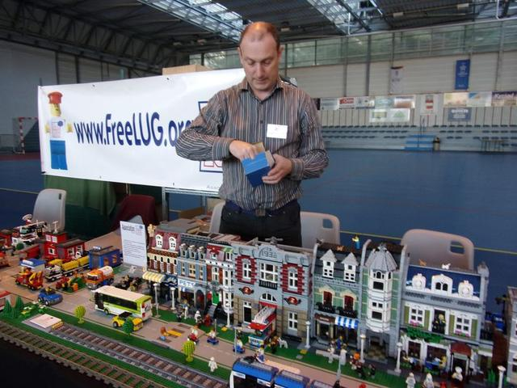

A Chamalières les 25 et 26 octobre 2014, à la demande du Club Arverne Ferroviaire Miniature, nous avons participé à l’expo "MAQUETTISME AU PIED DES VOLCANS".

Nous étions deux : Franck Loiseau et Mamy Danny et cette année il n’y avait que du train, exposition de circuits, bourse d’échange et vente.

Un réseau à l’échelle 1/450e dans une Lanterne authentique, de beaux paysages à l’échelle 1/250e, du circuit N (1/160) avec quelques tronçons de la ligne Royat-Chamalières vers le viaduc des Fades et un circuit thème Farwest sur ligne Ho (1/87). Enfin le circuit que j’admire le plus, en HO, la ligne Clermont Ferrand - Vichy par la Limagne, soit un circuit de 20m x 12m en 62 caissons transportables, avec des supers décors, des scénettes réalistes, un fond en trompe l’oeil et perspectives recherchés. Un vrai régal.

Notre stand FreeLUG était composé à l’intérieur du circuit TGV de Franck, avec sa ville Legoland, qui cette fois encore a ravivé pleins de souvenirs aux grands et une partie de la ville modular de Mamy Danny avec scénettes Halloween (enfants déguisés et groupe de rock machiavélique). Hors circuit on pouvait contempler la cité médiévale de Franck. Notre stand (un des deux seuls à hauteur d’enfants) a vu défiler tous les jeunes visiteurs, certains sont restés le temps de la visite par leurs parents de l’expo, et comme dit Franck "notre stand FreeLUG fonctionne comme un aspirateur à enfants." Beaucoup d’adultes ont emporté des cartes de l’association.

Deux jours sympathiques pendant lesquels notre stand fut une fois de plus une belle vitrine pour cette grande firme aux petites briques.

Galerie photo :

-   [Les photos de Danielle](http://photos.freelug.org/main.php/v/dannylou/expos/Chamalieres+2014/)
