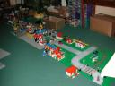
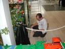
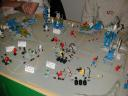

Nous sommes venus, on a tout deballé, montré, fait tourner les trains et finalement tout rangé, mais en se promettant de revenir.

Une dizaine de membres de FreeLUG ce sont retrouvés pour cette exposition. Avec une table centrale de 5m sur 3m, on s’est amusés comme des p’tits fous avec les trains pour notre plaisir et surtout celui du public nombreux.

La mairie de Betton (35 - Ille & Vilaine) avait contacté FreeLUG pour faire partie des exposants pour la 19ième édition du Salon du Jouet Ancien avec pour thème principal, les jeux de constructions.

Après avoir défini l’espace de chacun à l’aide de Track-designer ([voir plan](http://betton2003.perso.freelug.org/images/betton-zones.jpg) ) il ne restait plus qu’à tout mettre en place.

Un début de ce que pouvait donner 5m\*3m a été réalisé dans le salon.

Dès le vendredi après-midi, Gael et Fran commencaient à installer la table centrale. Cette installation a continué le samedi matin avec l’arrivée de Pascal, Erik, Etienne, Ronan et tardivement de Pascal et Mederick. En parallèle la vitrine a également été remplie avec des modèles anciens (merci Pascal et Erik).

Dès l’ouvertue à 14h, une foule nombreuse envahit la salle d’exposition. Les trains qui tournent attirent trés vite les regards. Petits et grands sont émerveillés et restent scotchés devant, surtout les plus jeunes ;).

Pascal ayant eu la bonne idée de cacher 10 minifigs de StormTroopers dans le decor, on voit les yeux qui se mettent à scruter le moindre detail. "Ah la y’a le 3ieme, caché derrière la maison".. "et la encore un dans la forêt".

Nombreux adultes s’arretent pour discuter avec nous sur notre stand à côté de la grande table et regardent les Space-Classic en disant "celui la je l’avais" ... mais aucun n’a voulu nous les donner ... Les mamans des grands enfants les gardent pour leur petits enfants :)

Dimanche rebelotte de visiteurs, avec cette fois un commentaire, "ma mère est venue hier et nous a tout de suite téléphoné pour que l’on vienne voir avec les enfants". Effectivement le salon de Betton est connu pour ses poupées, et la présence de LEGO a plu aux grands parents qui se sont empressés de prevenir leur famille.

Côté organisation, rien à redire, un animateur fort sympathique mettait de l’ambiance et s’est également beaucoup amusé sur notre stand ;) Merci également aux personnes qui ont organisé les repas.

Bref un trés bon week end.

Les [photos](http://photos.freelug.org/main.php/v/FreeLUG/Expositions_parcs/Betton_2003/) sur FreeLUG
