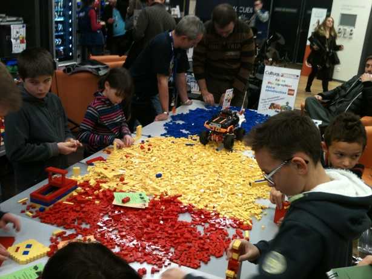
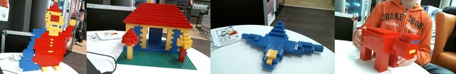
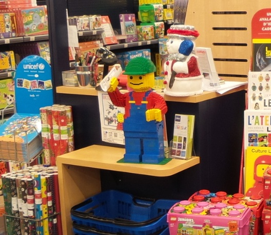
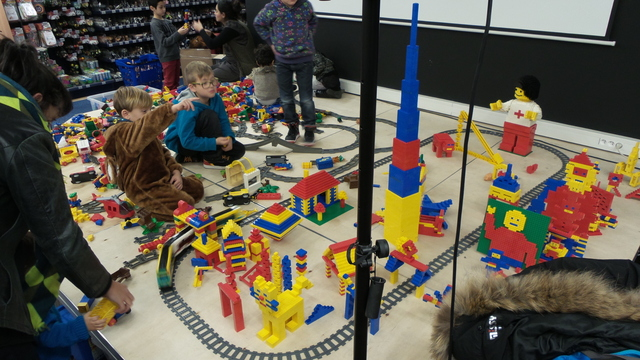

En décembre dernier, l’équipe [Briqu’Expo Diemoz](http://www.briquexpodiemoz.com/) a organisé sa première animation dans le magasin [Cultura](http://www.cultura.com/les-magasins/cultura-bourgoin-jallieu.html) .

A cette occasion, toute l’équipe a mis en place les ateliers habituels :

**Atelier construction**

**–** Stand de briques. Pour l’occasion, les enfants pouvaient proposer des constructions pour un grand concours. En fin de journée, un jury allait élire et récompenser les plus belles constructions par tranche d’âge.

**Construction des enfants**

**–** Un gros stand de Duplo, qui a toujours du succès auprès des plus jeunes.

Cette animation était également l’occasion de présenter en avant-première le teaser pour la prochaine [BRIQU’Expo Diemoz](http://www.briquexpodiemoz.com/)

J’aime particulièrement ce genre d’animations, qui permettent de rencontrer un nouveau public, pas forcément Afol, mais souvent passionné tout de même par nos chères petites briques. Et bien sûr, cela reste toujours une belle occasion de se retrouver entre Afols de la région. Et la région Rhône-Alpes est décidément très active !

Vivement la prochaine !

Yannoch

* * *

L’équipe au grand complet était là !

Ça créait, ça jouait : le bonheur, quoi...

Jérôme (jivé69)

* * *
