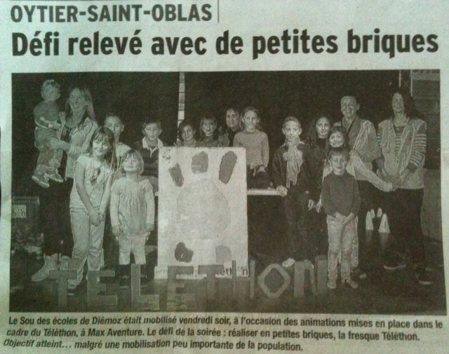
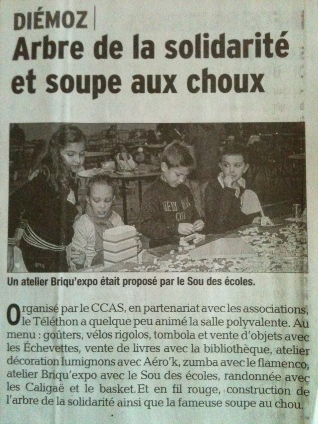

A l’occasion du Téléthon, tout le Sou des Ecoles de Diemoz s’est mobilisé aux côtés de quelques Afols pour proposer 2 animations LEGO, une bonne occasion de promouvoir la prochaine [Briqu’Expo DIEMOZ](http://chezyannoch.com/briquexpodiemoz/briquexpo_diemoz2015.php) :

**–** Construction d’une mosaïque représentant le logo du Téléthon, et un atelier Duplo chez notre [partenaire MAX Aventure (de Oytier)](http://www.maxaventure.fr/parc/oytier-st-oblas)

**–** Un atelier LEGO lors de la soirée Téléthon organisée par la mairie de Diemoz

Ces animations ont rencontré un franc succès, et permis aux petits et grands de se retrouver pour défendre une bonne cause et s’amuser autour de nos chères petites briques.
