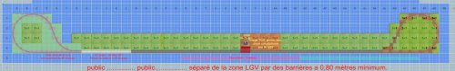
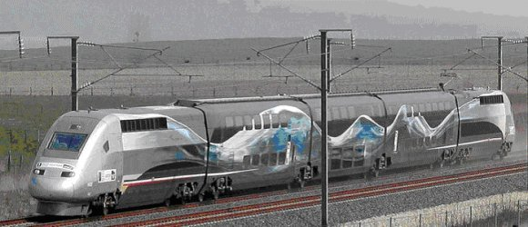

La 10 ème édition de l’exposition française 100% LEGO à ne pas manquer. FreeLUG y participe. Venez exposer sur la LGV et jouer avec vos trains grande vitesse.

**Lieu**

Salle des fêtes - 10 , Rue de l’Eglise - 67560 ROSHEIM  
du vendredi 26 juin 2015 au dimanche 28 juin 2015

La date limite d’inscription des exposants est le 31 mars 2015  
l’inscription doit impérativement être faite sur le [site de Fanabriques](http://expo.fanabriques.fr/fr/register/)

Avec toutes les explications : [Les info Fana](http://expo.fanabriques.fr/fr/20)

Le thème est le Western.

**La LGV :**

Dans ce cadre général, BàB participe avec la LGV V2b dont ce sera la 1ère sortie en 2015. Et comme les autres fois, l’ensemble des tables de la zone LGV sont mises à la disposition de FreeLUG et autres associations pour un diorama géant train ville et western.

Le thème principal de l’exposition est Le western . Même s’il est recommandé de privilégier ce thème au sens large, il n’est pas exclusif et tous les modules pouvant s’intégrer dans un ’train-ville’ et paysages sont bien sûr acceptés.

La salle sera mise à disposition dès le vendredi 26 au matin (afin d’installer entre autre la LGV). Toutes les installations doivent être terminées pour l’ouverture au public le vendredi 26/06 à 18h30.

**Exposer sur la LGV ? :**

Tout d’abord votre inscription doit impérativement être faite sur le [site de Fanabriques](http://expo.fanabriques.fr/fr/register/)

Et ensuite vous faire connaitre auprès du coordinateur FreeLUG pour la LGV (CDHD) sur le wiki :

[Inscription sur la LGV](http://wiki.freelug.org/Fanabriques+2015+%3A+layout+LVG+etc+...)

## Quelques indications pratiques pour ce layout

La disposition des voies sur ce layout a été choisie pour permettre à un maximum de personnes de venir exposer avec leur(s) module(s).

Le fait de se regrouper sur un seul layout doit aussi permettre que chacun puisse profiter au maximum des autres exposants tout en restant proche de sa réalisation et du public.

Il est bien sûr possible, voire indispensable de faire un maximum de petits sous-réseaux : tram, train 12V, train 4,5V, PFS, western, monorail, etc.

Vous pouvez aussi vous coordonner à plusieurs pour un méga sous-module sur un thème qui vous plait, etc.

La LGV sera bien sûr ouverte aux exposants du layout pour y faire rouler (et donc conduire) leurs trains : soit pour tenter le record de vitesse ou tout simplement pour s’amuser en allant un peu plus vite que sur une voie 9V LEGO.

Nota : lors de cette exposition la priorité sera donnée aux séquences de run pour battre les différents records.

Si vous décidez de participer sur ce layout :

**Le Layout :**

Toutes les zones vertes sont pour vos modules. Coordination générale : cdhd (Denis H)

De la place pour tous : pas de limitation dans le cadre général train/ville/travaux/campagne/etc. (ELTEP) de la plaque 32x32 au décatuple module standard LGV ( 1 module standard LGV = 3x5 plaques 32x32).

Tous les modules train 9V devront être au gabarit 8 tenons minimum (Un module train 9V est un module où passe une voie 9V).

N’ hésitez pas à poser vos questions si vous en avez.

[Plan de base de la LGV](http://photos.freelug.org/main.php/v/dhuot/Dossier_LGV/PlanBase/)

**Vous voulez battre le record :**

[Règlement V3 : record du monde de vitesse d’un train LEGO](https://www.freelug.org/spip.php?article1687)

**Les dernières LGV :**

[Diemoz 2013 - Le TGV](http://youtu.be/8-h-BKMfpGU)

[Diemoz 2013 - Le Layout](http://youtu.be/TsqM8cv_cYA)

