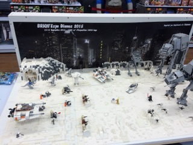
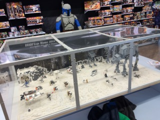
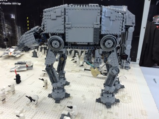

L’équipe d’Afols de [BRIQU’Expo DIEMOZ](http://chezyannoch.com/briquexpodiemoz/) mettent les bouchées doubles pendant les vacances de Février pour faire le Buzz chez son partenaire La Grande Récré de St Bonnet de Mûre.

Samedi 14, une vitrine Star Wars sur le thème de Hoth a été mise en place : Au programme, la caverne du Wampa, l’attaque des AT-AT.

**Diorama Hoth**

**Vitrine dans le magasin**

**AT-AT à l’attaque**

Pour l’occasion, un intrus a été caché dans le diorama, et le retrouver vous permettra de participer à un petit concours et ainsi peut être gagné une boite !

**Qui s’est caché dans le Diorama Hoth ?**

La vitrine restera en place jusqu’au samedi 21, journée durant laquelle nous vous donnons rendez-vous (avec plusieurs membres de FreeLUG) pour une [animation](https://www.freelug.org/spip.php?article1983), avec au programme, des dioramas, des ateliers de constructions pour petits et grands, des lots à gagner, des jeux, de la bonne humeur !

**Bref, Rdv le 21 Février.**
