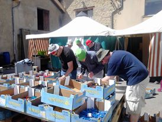
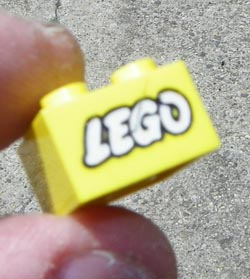
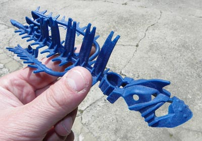

En 2013, pour la première édition de la BRIQU’Expo Diémoz, nous étions fiers d’avoir à nos côtés la [communauté d’Emmaüs](http://www.emmaus-bourgoin.org/).

Nous poursuivons le partenariat avec eux et vous les retrouverez lors de nos différentes expositions en Rhône-Alpes.

Afin de préparer au mieux leur venue, nous avons passé une très belle journée avec eux - sous le soleil - pour les aider à trier leurs caisses de vrac afin de leur permettre de reconstituer plus facilement des modèles qu’ils mettent en vente lors des expositions et ventes spéciales.

Lors du tri, certains ont pu poser des questions sur des pièces anciennes et oubliées ou récentes et encore méconnues. Comment reconnaître les pièces LEGO parmi les Megablocks et autres Cobi ?

Comme un grand spécialiste présent a pu le faire remarquer et le prouver immédiatement,

**"si c’est LEGO, c’est marqué dessus"**

Soulignons que si "c’est - souvent - marqué dessus", c’est généralement marqué sur les tenons ou sous les pièces en tout petit.

Rarement en gros sur le côté de la pièce.

Reconnaître à coup sûr une pièce LEGO est difficile dans la jungle des clones. Le doute est donc, parfois, permis. Et ce même spécialiste de déclarer de façon péremptoire :

**"c’est pas du LEGO mais LEGO l’a quand même produit"**

On lui laisse le soin de s’expliquer auprès des fans de Bionicle.

Pour conclure, nous remercions Emmaüs pour leur accueil sensationnel (on a l’impression d’être à la maison, ils ont fait attention à nous éviter l’insolation ou la déshydratation) et l’ensemble des participants-trieurs avec une mention particulière pour Nicolas, membre parisien, venu pour la journée et qui a fourni les pièces manquantes à la reconstitution par Emmaüs d’un set monorail.
