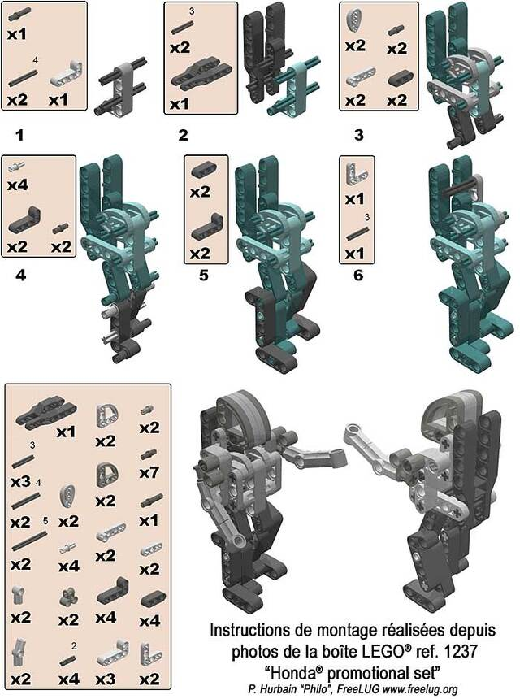
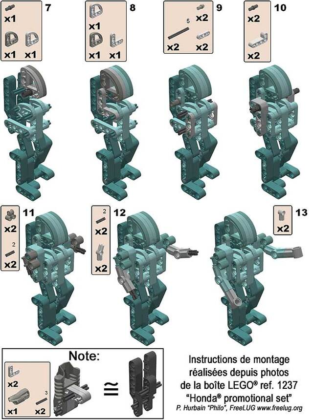

|  |
| --- |
|  Voici la fiche de montage, reconstituée à partir de photos de la boîte [LEGO® 1237](http://guide.lugnet.com/set/1237) (Honda Promotional Set), elle-même inspirée du [robot ASIMO© de Honda®.](http://world.honda.com/ASIMO/)      \- Photos du robot, par [Joe Nagata](http://member.nifty.ne.jp/mindstorms/gallery/k074e.html) et [Gonta](http://gonta21.hp.infoseek.co.jp/asimo.html)      \- Télécharger le fichier LDraw ou LeoCAD :  |
|  |
|  |
