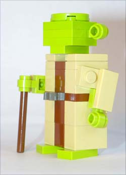
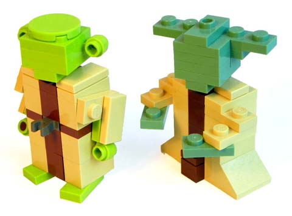
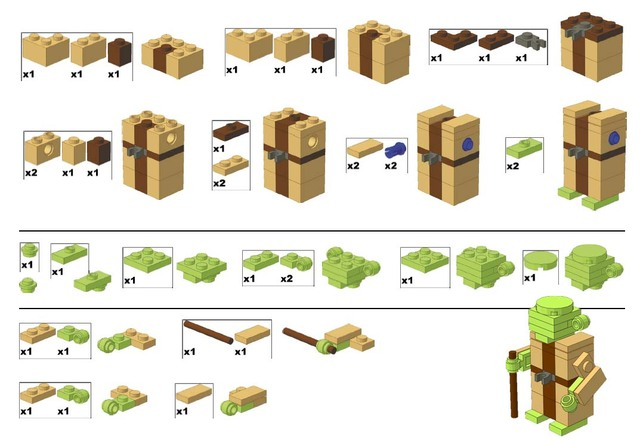
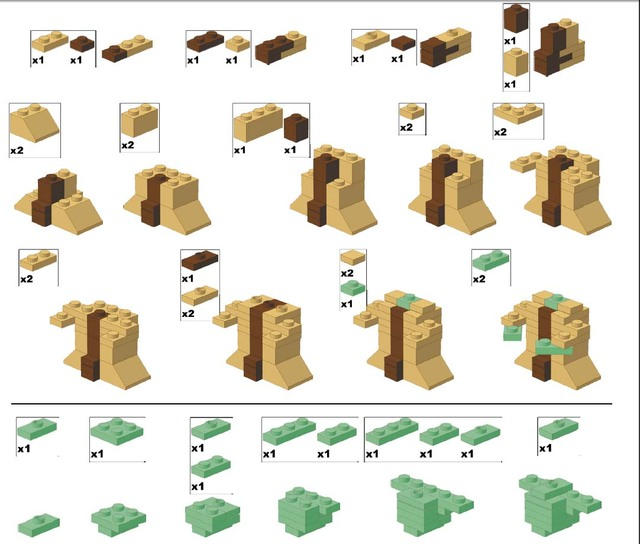

Les constructions qui vous sont proposées ici sont recréés à partir de modèles présentés dans les parcs LEGOLAND ou les LEGO Stores. Elles sont notamment adaptées pour être plus solides et en utilisant des pièces abordables et non modifiées.

Connaître son sujet est important quand on fait du modélisme. Les personnages MINILAND ne font pas exception, même si à cette échelle (environ 1:18) vous ne parviendrez pas à reproduire les détails mais devrez plutôt vous focaliser sur l’aspect et le ressenti global. En font partie les dimensions (taille, proportions), les couleurs (peau, vêtements) et les accessoires (couvre-chefs, outils).

Selon une encyclopédie en ligne StarWars (Wookieepedia), Yoda mesure 66cm. A l’échelle le modèle devrait faire 4 briques de haut. Un personnage aussi petit sera mal proportionné en LEGO, nous le ferons donc en 6 briques de haut (1.08m) - ce qui reste petit pour un si grand maître.

Une peau verte le maître a. Le meilleur compromis avec les couleurs LEGO est sans doute le "sand green" (que l’on traduit improprement "vert sable" à défaut d’une meilleure proposition) mais c’est une pièce relativement rare. La couleur "lime" (couleur citron vert) est un choix de compromis car la disponibilité de pièces est bien meilleure. Mais la créativité des designers est telle que nous allons pouvoir utiliser ces deux couleurs dans deux modèles différents.

Yoda est associé à deux outils : le célèbre sabre laser (pour lui en vert bien sûr) et une canne brune pour ses vieux jours (Yoda est mort à l’âge de 900 ans !). Le détail amusant est que, dans les deux cas, c’est la barre 4L qui est la pièce de choix pour représenter ces accessoires.

Ces modèles (lime et sand green) sont constitués respectivement de 37 et 38 pièces et vous coûteront respectivement environ 2 et 15 euros à construire ([guide des prix BrickLink](http://www.bricklink.com/catalogPG.asp)).

Que le construction soit avec vous !

Yoda "lime"

Yoda "sand green"

