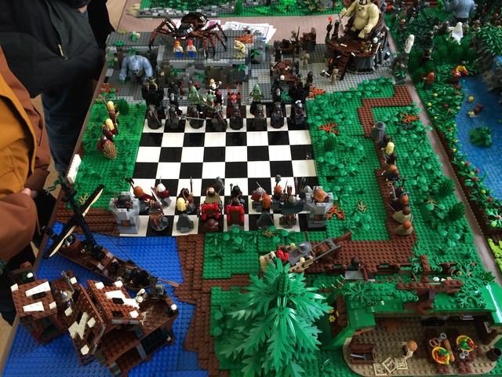
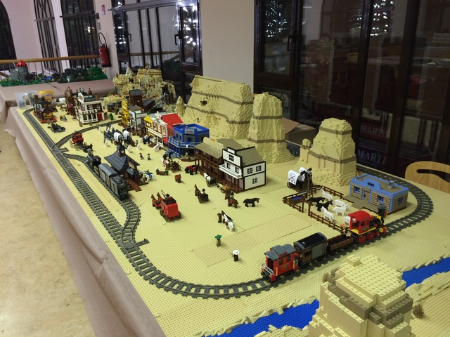
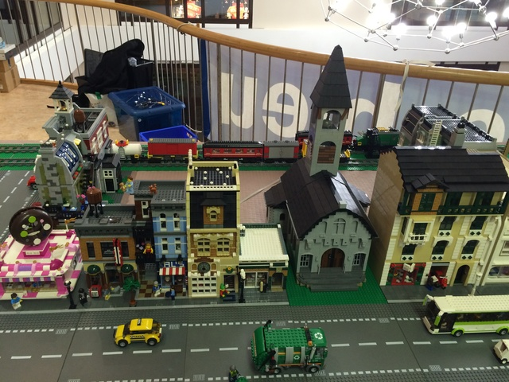
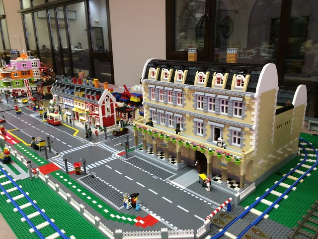
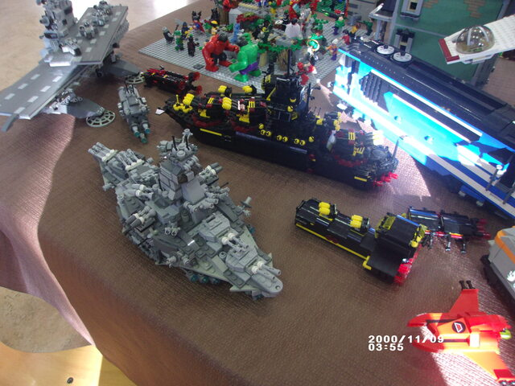
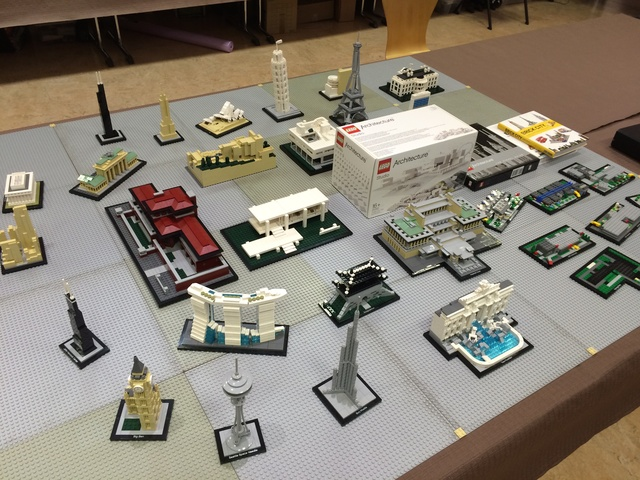
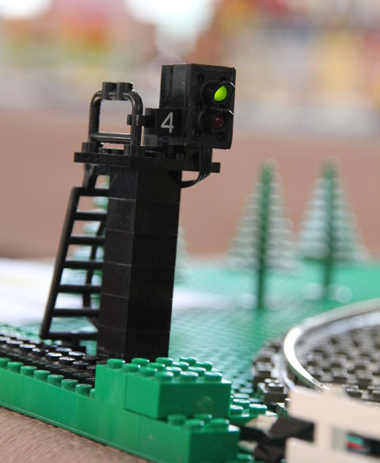
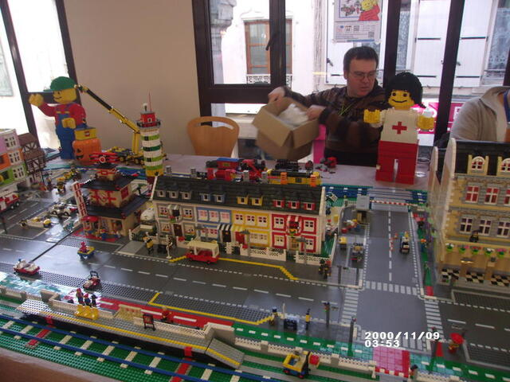

Et donc pour ce dimanche 25 janvier 2015, soit une seule journée d’exposition, nous nous sommes retrouvés une quinzaine de membres FreeLUG et BrickPirate. Notre expo était organisée autour de trois thèmes, médiéval, far west et city, plus une quatrième table "libre".

La table "médiéval" était proposée par Yannick et Mathieu, avec notamment un superbe jeu d’échec "Hobbit".

L’espace far west était organisé par deux spécialistes du genre, Jean Yves et Xavier, où on retrouvait les désormais célèbres crottes de mammouth.

Bien sûr, la table "City" était la plus grande. Ils étaient sept. Au niveau des constructions, on peut dire qu’il y avait 90% de MOCs, et de très belles choses ! L’intérêt de ces petites expos tranquilles, c’est l’intégration de nouveaux exposants. Ils étaient quatre à se lancer, et ils ont même réussi à s’adapter au raccourcissement de la table en dernière minute. Bravo à eux, et je les encourage à continuer ainsi !!

Enfin, au centre de la salle, une quatrième table permettait de présenter tout ce que l’on voulait. Denis nous a sorti les sets Architecture, tandis que nos amis de BrickPirate ont exposé une série de MOCs comme ils savent les faire !

Pour ma part, je suis passé en mode "Gentil Organisateur" pour gérer cette joyeuse bande. Un petit entrainement pour préparer la Briqu’Expo Diemoz 2015....

Loys/Chimère

* * *

Comme d’habitude, je profite de cette expo d’un jour pour présenter des choses que je ne sors pas d’habitude.  
Donc cette année je me suis fait plaisir en aérant pour la première fois la collection complète de tous les sets LEGO architecture ’du commerce’ plus d’autres en sortie limitée (uniquement pour le personnel LEGO) et que j’ai donc reproduit.

Cela a donné une table finalement assez grande et je me suis fait bien plaisir.

Après, coté public, c’est sûr que les trains ou la LGV ont beaucoup, beaucoup, beaucoup plus de succès.

Cdhd

* * *

Pour cette édition, mon apport fût limité au train 9v avec une automatisation par cantons construite autour d’un NXT. A cette occasion, j’ai réalisé à l’aide de l’article [Un feu de signalisation de train](http://www.freelug.org/spip.php?article512) une série de feux bicolores pouvant être alimentés par une logique PCF8574. Pour les curieux, le fonctionnement autour du NXT est puisé dans le livre de Philo **Extreme NXT** au chapitre 13 **i2C Bus Communication**.  
Les capteurs optiques permettant de détecter la présence des trains ont été capricieux le matin, dérangés par le jeu des nuages et du soleil. L’après-midi le fonctionnement était rodé et le dispositif a pu fonctionner plus d’une demie-heure sans intervention.  
Merci à Didier, Philo et Xavier qui m’ont aidé directement ou indirectement dans cette réalisation.

Nicolas (CoLego)

* * *

Et voilà, ce fut ma 3ème participation à cette exposition, qui a une saveur particulière, puisqu’il y a 6 ans, cela marquait officiellement mon entrée dans le monde Afol, avec ma première exposition. Depuis, difficile de passer à côté de ce sympathique événement à quelques km de chez moi.

Un grand bravo aux organisateurs et nombreux exposants qui ont répondu présent et ont proposé du contenu très varié et de qualité. Je vous donne à tous rendez-vous dans 6 mois à Diemoz !

Yannick/Yannoch06

* * *

J’ai adoré cette expo ! Très bon accueil par Omnibus et un lieu extra avec une belle lumière.

J’ai certes un peu stressé lors de l’installation de mon dio City-rails-bleus mais c’est parce que j’avais vu (trop ?) grand et que le temps passe vite. Une bonne leçon !

Jérôme (jivé69)

* * *

Première exposition de l’année 2015. Toujours une joie de revoir les amis Freelugiens de la région Rhône-Alpes. Encore un bon moment passé à parler LEGO. On s’est bien amusé comme d’habitude. Grand merci à Omnibus pour leur accueil chaleureux et un grand merci à mon grand pour l’organisation de l’espace LEGO.

Arnaud (nano69)

* * *

Après un premier test en expo l’année dernière, c’était la première exposition où je sortais les modulars en les mettant en situation. Bref une très belle journée et comme le dit Arnaud, très sympa de se retrouver. Plein d’échanges et de conseil sur mon début de MOC, il faut bien débuter. Merci à tous

Michel (mcrbe)

* * *

En résumé : +1

+1 exposition, ma deuxième à Bourgoin

+1 pour remercier l’organisation d’Omnibus et de Loys

+1 pour le plaisir de se retrouver

+1 pour souhaiter la bienvenue à nos nouveaux exposants très prometteurs !

ok, ça fait +4 :p

Laurent

* * *

Première expo FreeLUG pour moi  
(deuxième expo de ma vie)

Super accueil de tous et de la conviviale équipe d’Omnibus.  
Lieu très lumineux et de taille idéale pour présenter ses jouets comme dans un écrin. L’ambiance très famille permet d’échanger.

Passé les sueurs froides de l’installation teintée d’impro-pragmatiquo-systemD, de la gestion du temps de montage, j’ai adoré participer à un stand city collaboratif. Une fois installé, que du bonheur.

Merci à Loys pour son invitation et merci à Arnaud pour l’adaptabilité à mon plan transports en commun ;)  
Rencontrer des Freelugiens confirmés fut très sympa et ne fait que confirmer mon envie de continuer les expos.

Enfin ce qui me tient le plus à cœur :  
Toutes ces briques sont construites pour rencontrer le public et de ce point de vue-là, l’énergie et les nombreux sourires reçus par plaques de 32x32 nous donnent une grande récompense.

Donc si tu es un AFOL et que tu n’as jamais exposé, juste fais-le aussi !

ps : rdv à Vileurbanne et Diemoz

Thierry / Lejigabou  
(un traineux légotique)

* * *

Première Expo à Bourgoin,  
Maintenant c’est sûr les petites expo c’est vraiment sympa, beaucoup plus de contact entre AFOL, et même avec le public,  
Merci à Loys pour son organisation et sa disponibilité,  
Bref super expo où je me suis bien amusé avec les trains de mon illustre voisin Xavier, pour ne pas le nommer....  
Vivement la prochaine !

JY Brot

* * *

**–** [photos de Loys/Chimere](http://photos.freelug.org/main.php/v/Chimere/Bourgoin+2015/)  
**–** [Vidéo de cdhd](http://www.youtube.com/attribution_link?a=97RQhCtUu44&u=/watch%3Fv%3DlgyYD9eNCTs%26feature%3Dem-share_video_user)

[http://www.youtube.com/attribution\_link?a=97RQhCtUu44&u=/watch%3Fv%3DlgyYD9eNCTs%26feature%3Dem-share\_video\_user](http://www.youtube.com/attribution_link?a=97RQhCtUu44&u=/watch%3Fv%3DlgyYD9eNCTs%26feature%3Dem-share_video_user)

[https://youtu.be/R5PUqc-iIl8](https://youtu.be/R5PUqc-iIl8)
