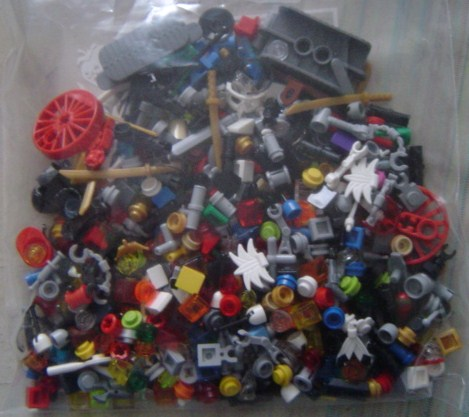
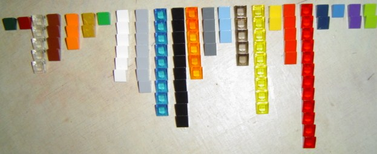
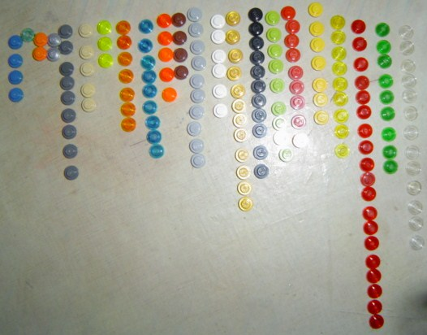
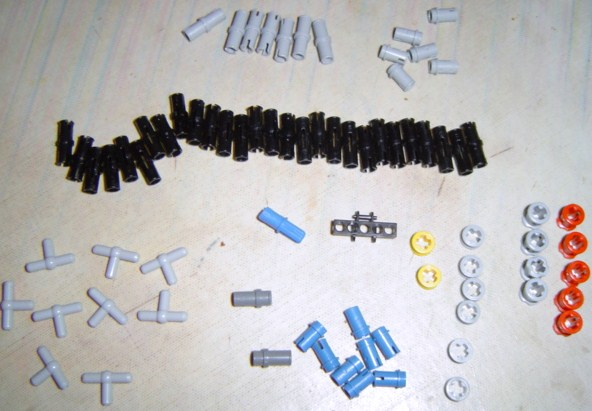
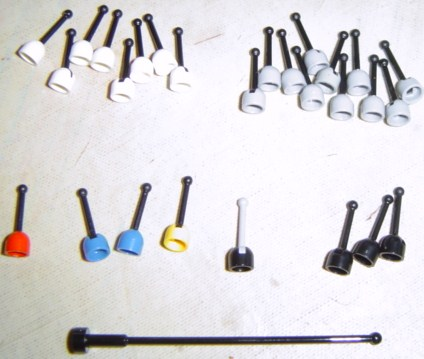
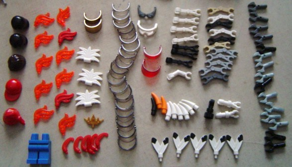
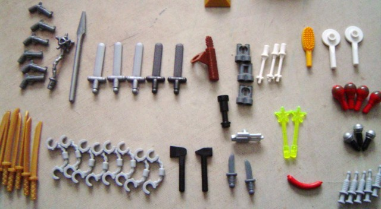
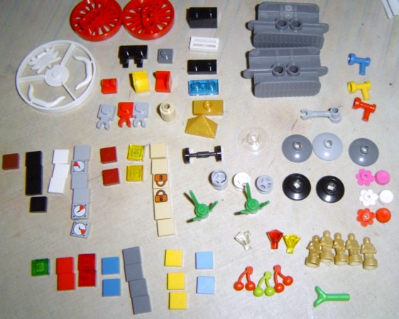

Commencé le premier janvier 2010, j’ai mis de coté toutes les extra-parts des modèles que j’ai montés au cours des 365 jours passés !

Le fameux sac zip alimenté avec patience :

Et les photos des extra-parts :

Les habituelles pièces en surplus :

Avec les minifigures et autres boites, beaucoup de pièces pour les personnages :

Il y a également un bras de squelette NinjaGo monté quelques jours avant Noël ! Et des jambes de Minifig trouvé en plus dans une boite d’avion 3181 !

Et d’autres beaucoup plus inattendues :

