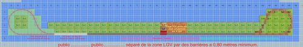
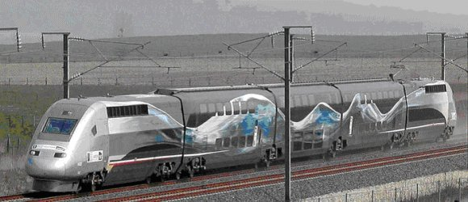

La 2 ème édition de l’exposition Briqu’Expo Diemoz 100% LEGO à ne pas manquer. Venez exposer sur la LGV et jouer avec vos trains grande vitesse... ou pas.

**Lieu**

C’est à Diemoz...  
La seconde édition de la Briqu’Expo Diemoz aura lieu les 12-13 Septembre 2015.

Installation à partir du Vendredi 11 Septembre 2015

Ouverture au public :  
**–** Samedi 12 Septembre de 11h00 à 19h00  
**–** Dimanche 13 Septembre de 10h00 à 17h30

Le thème est les bolides.

**La LGV :**

Dans ce cadre général, BàB participe avec la LGV dernière version dont ce sera la 1ère sortie en 2015. Et comme les autres fois, l’ensemble des tables de la zone LGV sont mises à la disposition de FreeLUG et autres associations pour un diorama super géant train ville et bolides.

Le thème principal de l’exposition est ’’Les bolides’’ . Même s’il est recommandé de privilégier ce thème au sens large, il n’est pas exclusif et tous les modules pouvant s’intégrer dans un ’train-ville’ et paysages sont bien sûr acceptés.

La salle sera mise à disposition dès le vendredi 11 au matin (afin d’installer entre autre la LGV). Toutes les installations doivent être terminées pour l’ouverture au public le Samedi 12 Septembre de 11h00. La LGV elles même fonctionnera à partir de vendredi après midi.

**Exposer sur la LGV ? :**

Tout d’abord votre inscription doit impérativement être faite auprès des organisateurs de l’exposition [Diemoz- bulletin d’inscription à télécharger](http://www.chezyannoch.com/briquexpodiemoz/2015/formulaires/BE%20Diemoz%20-%20Formulaire%20inscription%202015.doc)

vous y trouverez toutes les infos nécessaires, ainsi que mon adresse mail.

Et ensuite vous faire connaitre auprès du coordinateur FreeLUG pour la LGV (CDHD) sur le wiki : [Inscription sur la LGV](http://wiki.freelug.org/Briqu%27expo+Diemoz+2015+%3A+layout+LVG+...)

## Quelques indications pratiques pour ce layout

La disposition des voies sur ce layout a été choisie pour permettre à un maximum de personnes de venir exposer avec leur(s) module(s).

Le fait de se regrouper sur un seul layout doit aussi permettre que chacun puisse profiter au maximum des autres exposants tout en restant proche de sa réalisation et du public.

Il est bien sûr possible, voire indispensable de faire un maximum de petits sous-réseaux : tram, train 12V, train 4,5V, PFS, western, monorail, etc.

Vous pouvez aussi vous coordonner à plusieurs pour un méga sous-module sur un thème qui vous plait, etc.

La LGV sera bien sûr ouverte aux exposants du layout pour y faire rouler (et donc conduire) leurs trains : soit pour tenter le record de vitesse ou tout simplement pour s’amuser en allant un peu plus vite que sur une voie 9V LEGO.

Nota : lors de cette exposition la priorité sera donnée aux séquences de run pour battre les différents records.

Si vous décidez de participer sur ce layout :

**Le Layout :**

Toutes les zones vertes sont pour vos modules. Coordination générale : cdhd (Denis H)

De la place pour tous : pas de limitation dans le cadre général train/ville/travaux/campagne/etc. (ELTEP) de la plaque 32x32 au décatuple module standard LGV ( 1 module standard LGV = 3x5 plaques 32x32).

Tous les modules train 9V devront être au gabarit 10 tenons minimum (Un module train 9V est un module où passe une voie 9V).

N’ hésitez pas à poser vos questions si vous en avez.

[Plan de base de la LGV](http://photos.freelug.org/main.php/v/dhuot/Dossier_LGV/PlanBase/)

**Vous voulez battre le record :**

[Règlement V3 : record du monde de vitesse d’un train LEGO](/articles/1687/)

**Les dernières LGV :**

[Diemoz 2013 - Le TGV](http://youtu.be/8-h-BKMfpGU)

[Diemoz 2013 - Le Layout](http://youtu.be/TsqM8cv_cYA)

[Ajout d’un petit Teaser, pour annoncer l’arrivée des bolides](http://youtu.be/580BaIFJwuQ)
