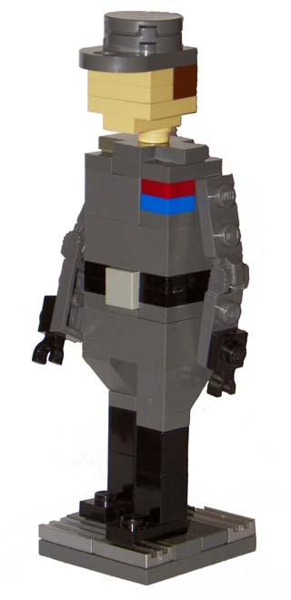
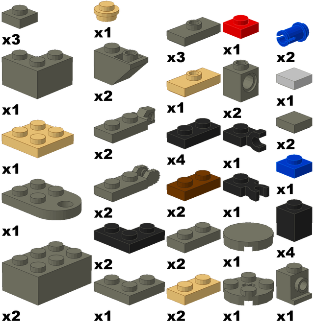
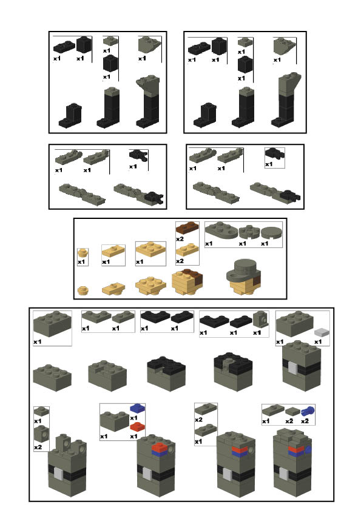
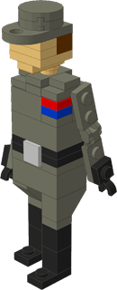
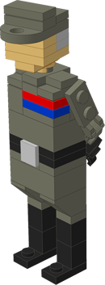

Les constructions qui vous sont proposées ici sont recréés à partir de modèles présentés dans les parcs LEGOLAND ou les LEGO Stores. Elles sont notamment adaptées pour être plus solides et en utilisant des pièces abordables et non modifiées.

Après vous avoir présenté [Yoda](http://www.freelug.org/spip.php?article2001) et [C-3PO](http://www.freelug.org/spip.php?article2005), nous vous proposons aujourd’hui de reproduire un officier de l’empire Star Wars.

C’est un personnage au costume sombre, le gris foncé et le noir vont être de la partie. A l’image de Tarkin (Grand Moff), Jerjerrod (Moff Impérial) ou de Piett et Motti (Amiraux), c’est un personnage humain, personnage d’environ 1m90. A l’échelle Miniland, 10.6cm pour 11 briques de haut.

Il vous faudra 50 pièces pour un coût d’environ 2.50 euros selon le [Guide des prix BrickLink](http://www.bricklink.com/catalogPG.asp).

Le montage est classique et modulaire - 2 jambes, 2 bras, 1 tête sur un torse - dans l’univers Star Wars, ce n’est pas toujours évident !

Je trouve la barrette de grade un peu trop flashy, vous pouvez opter pour du dark red et du dark blue (rouge foncé et bleu foncé).

Une petite modification d’une jambe, les mains jointes dans le dos, des cheveux grisonnants, une barrette de grade un peu plus garnie et une casquette modifiée et voilà un Amiral de Flotte qui supervise la revue de troupe !

