Qu’est ce qu’une technique de montage avancée ?

Par contraste, on pourrait dire qu’une technique avancée est une technique de montage autre que celles qui consistent à empiler des pièces de façon usuelle. Mais la question est alors simplement déplacée : qu’est-ce qu’un montage usuel ?

Une technique avancée peut aussi être définie comme une technique qui n’apparaît pas ou peu ou que récemment dans les instructions officielles LEGO et particulièrement dans les gammes destinées aux adultes (Modular Building, Architecture, UCS...). La plupart de ces techniques ont été découvertes et développées par des utilisateurs adultes de LEGO (AFOLs, Designers).

**A quoi servent les techniques de montage avancées ?**

Ces techniques aboutissent en général à une large palette de designs et de détails qui n’étaient pas réalisables avant avec la méthode de construction classique des pièces LEGO. Jake McKee précise, dans son livre Getting started with LEGO trains (débuter avec les trains LEGO), que les techniques avancées de construction « permettent non seulement la création de formes et d’angles spéciaux, mais aussi de plusieurs dimensions non-standards » et que cela « ajoute une grande richesse \[...\] de designs. »

Le SNOT fait partie de ces techniques, même si le SNOT se généralise et se popularise. Citons d’autres techniques avancées comme le lettrage, le greebling [^1], le weathering [^2], la discrétisation, les NPUs [^3], les micro-bandes...

Les techniques avancées dont je veux vous parler aujourd’hui font partie au sens large des techniques SNIR, c.à.d des techniques permettant de construire en dehors de l’orthogonalité, ce que Jake McKee appelle « créer des angles spéciaux ».

En effet le jeu LEGO se base principalement sur une construction orthogonale – construire en diagonale ou, mieux, construire des cercles – n’est pas, dans ce système, naturel. Il existe plusieurs techniques que nous allons détailler ici.

**Les triplets pythagoriciens**

Les triplets pythagoriciens sont des triplets x,y,z d’entiers (naturels non nuls) vérifiant x²+y²=z². D’un point de vue géométrique, les triplets pythagoriciens permettent de construire un triangle rectangle dont l’hypoténuse est de longueur entière. En LEGO, ils vont donc permettre de construire cette hypoténuse qui est une diagonale.

Malheureusement, les triplets pythagoriciens utile en construction LEGO sont réduits. La technique n’a à ma connaissance pas été employé dans un modèle officiel LEGO jusqu’à cette année avec le set Simpson "Kwik-e-Mart".

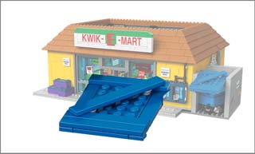

Les triplets pythagoriciens peuvent aussi être utile à la vertical, en utilisant la relation "5 pour 2" , pour créer l’entretoisement de structure comme des grues, ponts, etc.

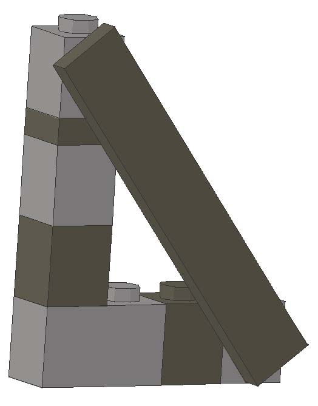

**La diagonale double**

Une pièce parallélépipédique possède deux diagonales de même longueur. Ainsi les pièces de taille mxn avec m différent de n et supérieur à 1 (2x4 par exemple) peuvent se placer suivant deux positions différentes par rapport à la matrice orthogonale qui sert de support de référence : parallèlement ou suivant un angle égal à l’angle que font entre elles ces deux diagonales.

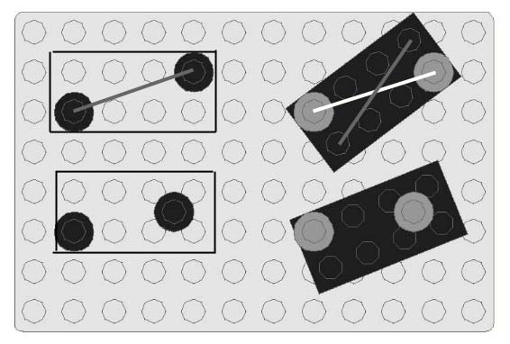

Cette technique réclame simplement une épaisseur d’une plaque pour être mise en œuvre. La compréhension de cette technique permet aussi de mieux comprendre l’emploi des briques charnières (brick hinges) qui suivent exactement la loi de la diagonale double pour les pièces 1xn.

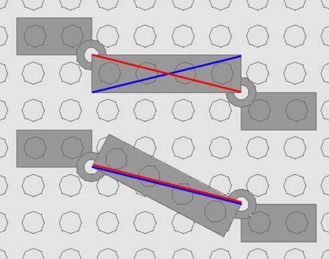

**Les ailes de Poulsom** [^4]

En grandissant avec les pièces LEGO, on prend pour acquis – une règle sacrée – que les pièces doivent être PARFAITEMENT emboîtées. Mais les règles doivent parfois être brisées.

La technique consiste à utiliser des pièces de grandes longueurs et de les emboîter à partir d’une extrémité sans poursuivre l’emboitement sur toute la longueur, en intercalant par exemple une pièce de petite dimension (plaque 1x1, cheese slope, etc.) à l’autre extrémité.

Thomas Poulsom, l’initiateur du set LEGO Ideas "Les oiseaux" est grand amateur de cette technique, technique qui malgré ce que l’on pourrait penser, n’est pas si fragile que cela et qui est très "aérienne".

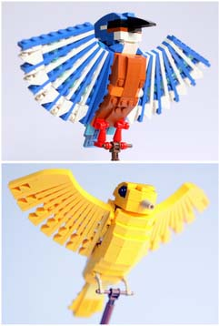

On peut utiliser cette technique avec des pièces plus courtes mais pour conserver une solidité suffisante, l’angle doit être plus fermé et la courbe résultante possède un rayon de courbure bien plus grand.

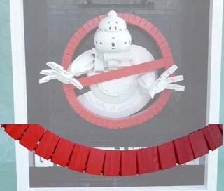

**Le pavage SNIR**

Le pavage SNIR permet de créer une nouvelle matrice orthogonale à partir de la matrice originale de la plaque de base par rotation et homothétie.

C’est une technique SNIR parce qu’elle apporte la notion d’angle spécial mais elle amène aussi à des espacements de dimensions non entières. Cela permet de créer des joints larges. J’ai repris ici des éléments présentés dans l’article ["Pavage"](http://www.freelug.org/spip.php?article1935), qui illustrent deux angles différents.

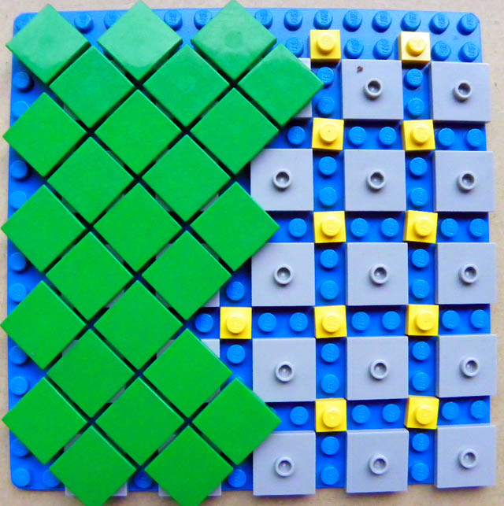

**Tessel 5- 5simpleA**

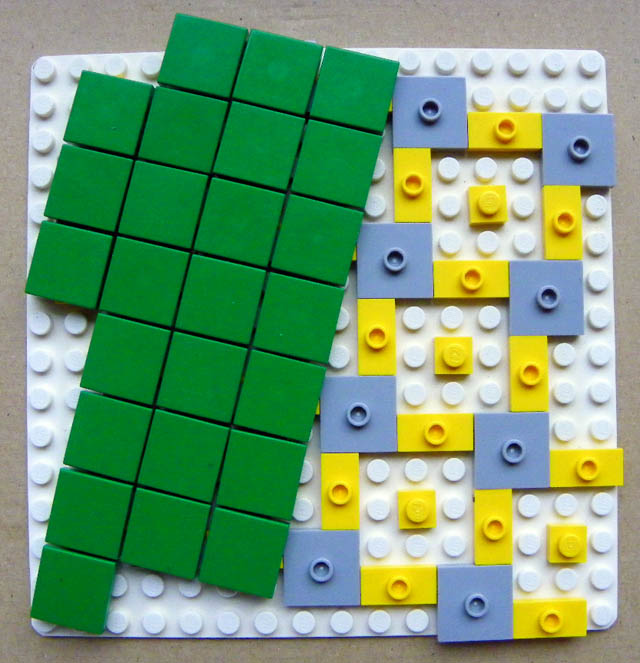

**Tessel2-05simple**

Comme le montre cet exemple de dallage en arceau, les éléments de bases peuvent, grâce aux écartements importants, être placés en entrelacs de courbes plutôt que d’être aligné.

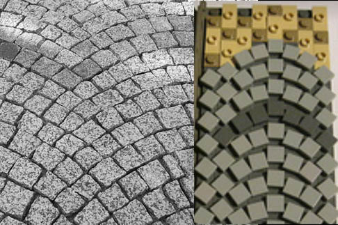

L’usage de cette technique par Grant Davis dans l’exemple qui suit est à la fois imposante par sa taille et ingénieuse : notez les plantes qui profite des joints entre les dalles pour s’insinuer vers la lumière.

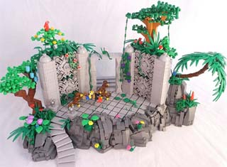

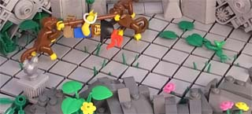

**Le SNIR Erickéen**

Le SNIR Erikéen se base sur la même idée de base que le pavage SNIR et a été élaboré par Erik Amzallag. (tout à fait indépendamment de la technique de Pavage SNIR)

Le SNIR Erikéen exploite une matrice diagonale à 45° dont l’espacement est suffisant pour intercaler des plaques lisses.

Il exploite aussi le fait que la hauteur d’une brique correspond à la hauteur d’une plaque lisse plus l’épaisseur du tenon.

Théorie

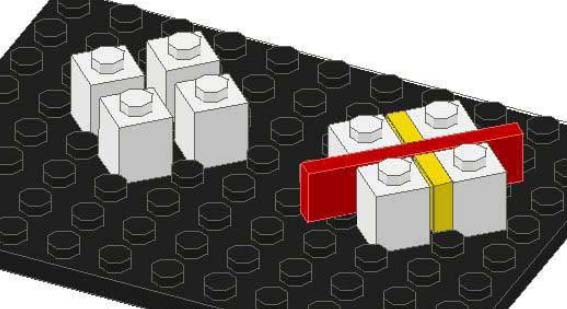

Exemple

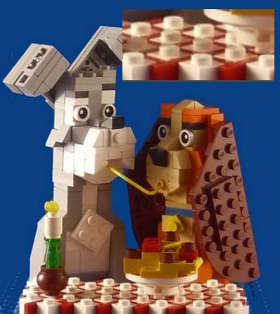

Belle exemple de SNIR Erikéen par Nicolas Picot avec cette nappe "Vichy" dans cette création de la Belle et Le Clochard.

Erik a employé des éléments translucides et placé l’ensemble verticalement pour obtenir cet effet de fenêtre à petits carreaux - A votre santé !

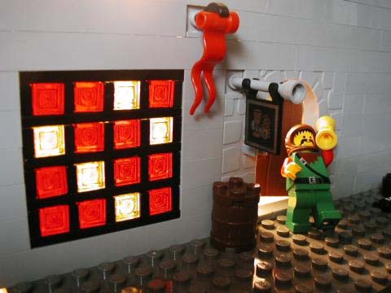

**Les cercles sous contraintes...ou pas**

Quand vous montez un mur, vous utilisez des briques.

En LEGO - c’est pareil. Et d’ailleurs comme dans la réalité, vous allez décaler les joints. La rangée supérieure est décalé d’un tenon. (dans la réalité, le décalage est généralement d’au moins un tiers de la longueur de la brique)

Dans la réalité, si vous souhaitez avoir un mur avec un léger rayon de courbure, vous pouvez le faire en jouant sur les joints. En LEGO c’est presque pareil, car vous allez créer des contraintes relativement importante (et oui, vous ne décidez pas de la taille des joints - la tolérance).

Mais comme vous pouvez le voir sur cet exemple de Paul Vermeesch, si les pièces sont petites (1x2) et que le cercle est grand, cela fonctionne très bien.

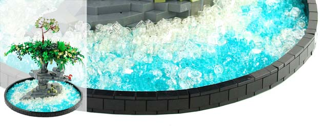

Pour réduire les tensions, utilisez un mélange de pièces 1x2 et de pièce 1x1 ronde. Les pièces rondes apportent de l’espace et le joint est plus grand. Les tensions sont réduites et les rayons de courbures peuvent être réduits au minimum.

Rizière par Disco86

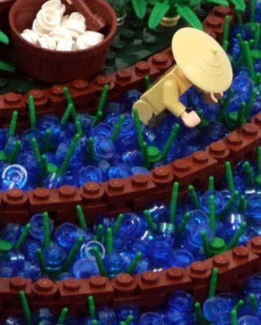

L’emploi de briques structurées permet de réduire l’écart visuel avec les briques rondes 1x1 comme nous le montre ici Joshua.

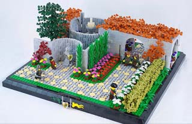

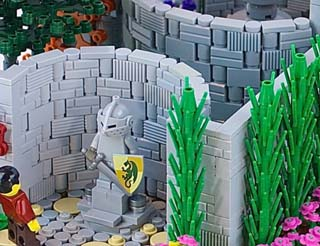

Notez que les briques 1x2 "log" sont aussi des briques rondes qui peuvent être employés pour mettre en œuvre cette technique.

**Le tubing**

Je dois le dire, cette technique est de loin celle qui me plaît le moins mais elle est particulièrement populaire.

Elle me plait moins car elle "triche" en employant les pièces flexibles que sont les "hoses" (tuyaux). Ils existent en toutes tailles (puisqu’on peut les couper), certains avec des points d’attaches aux extrémités, d’autres très flexibles ( pneumatique). Ils sont tous compatibles avec les "clips" mais aussi avec les trous (de cheville ou d’axe), ce qui permet donc de les utiliser en tant que squelette. C’est donc une technique versatile à utiliser avec soin et parcimonie si l’on veut vraiment impressionner.

Ici, Gabe Umland en fait un usage délicat dans la reconstitution d’une arche (en ogive ?) pour cette porte.

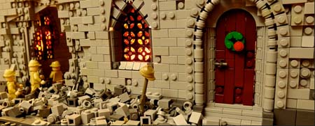

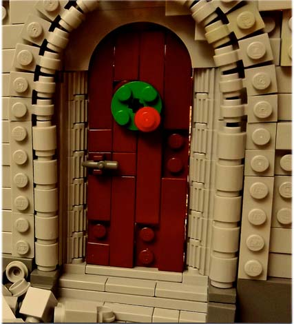

Et ce superbe rod dog par Lucius Sweet met en œuvre le tubing non pas en utilisant des "clips" mais les trous d’axe des plaques rondes 2x2 pour réaliser cette saucisse.

**Conclusion**

Pour conclure, je voudrais dire que construire en diagonal ou en arc de cercle ne demande pas l’emploi de pièces spécifiques. L’écrasante majorité des exemples cités ne font appel qu’à des briques et plaques, rondes ou lisses, non modifiées.

Afin de construire des exemples impressionnants, il faut bien sûr des nombreuses pièces, mais ce sont des pièces généralement largement disponibles et pas très coûteuses. En bref pas besoin d’acheter des sets Star Wars pour faire du SNIR, les sets Creator font très bien l’affaire.

Je veux insister aussi sur le fait qu’il existe d’autres techniques que l’on pourrait qualifier de SNIR mais je n’ai pas la prétention à l’exhaustivité. De plus, le jeu LEGO est en perpétuel évolution avec de nouvelles pièces qui apparaissent régulièrement, offrant de nouvelles possibilités de SNIR.

La gamme Technic par exemple est riche de possibilité, je pense par exemple aux chenilles qui offrent à la fois de bonnes possibilités de construire des structures cylindriques et plus généralement courbes et des possibilités de connexions avec des pièces System (à tenon).

Et pour terminer, je vous laisse avec une "FreeLUGographie" (liste d’articles sur FreeLUG) sur les techniques avancées :

-   [Le guide non officiel des techniques avancées de construction LEGO](https://www.freelug.org/spip.php?article1438)
-   [La technique du lettrage : Application aux trains LEGO](https://www.freelug.org/spip.php?article409)
-   [Trains LEGO et motifs de décoration : Les motifs diagonaux](https://www.freelug.org/spip.php?article390)
-   [Pavage](https://www.freelug.org/spip.php?article1935)
-   [Les mosaïques "Cheese Slope"](https://www.freelug.org/spip.php?article1505)
-   [Techniques de montage utilisées pour la locomotive Climax](https://www.freelug.org/spip.php?article555)
-   [Design éprouvant d’un canon](https://www.freelug.org/spip.php?article553)
-   [Des balles avec des briques. Partie I : les dômes](https://www.freelug.org/spip.php?article1487)

[^1]: l’ajout de détails fins sur une surface

[^2]: L’imitation des effets du temps et du temps comme la rouille - l’érosion au sens large

[^3]: Nice Part Usage - Utilisation Inhabituelle de Pièces

[^4]: J’ai nommé ainsi cette technique plutôt que "montage bâclé"
