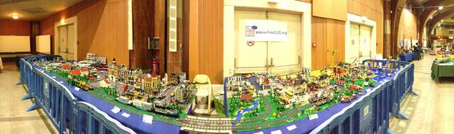
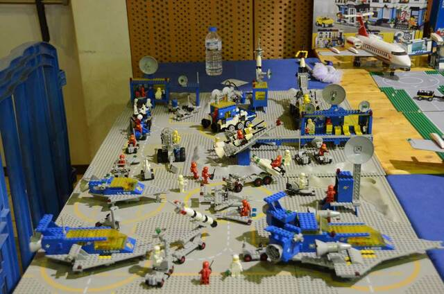
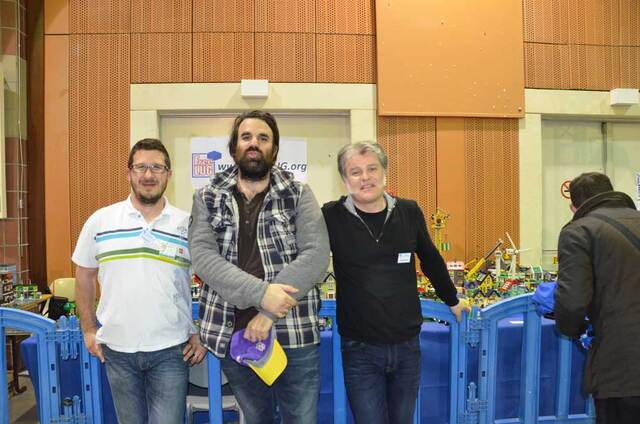

Le salon de la maquette de L’UNION se tient tous les 2 ans. Pour cette édition 2015, le rendez vous était pris.

Nous avons participé pour la 1ère fois au salon de la maquette de L’UNION qui regroupait une centaine de modélistes et maquettistes en tous genres.

Notre stand FreeLUG était composé d’un diorama City avec trains, maisons, port, zone en construction, aéroport et autres bizarreries puis d’une partie classic space pour les plus nostalgiques.  
Après quelques heures de mise en place, nous voilà prêt pour démarrer le week end et l’accueil des 1ères questions des enfants et des parents.

**Vue panoramique**

**Space classic**

Malgré un temps capricieux, il y a eu pas mal de monde tout au long du week-end sur le salon (un peu plus de 1200 entrées payantes).  
Ce week-end, nous a permis d’échanger avec enfants et parents, passionnés et novices, partager des moments avec nos camarades maquettistes et modélistes ainsi que replonger certains adultes dans l’envie de refaire du LEGO.  
A l’issue de leur visite, les visiteurs pouvaient voter pour leur stand préféré. A la fin du salon, nous avons eu la surprise et la joie de recevoir le 3ème prix du stand préféré.

**La fine équipe ;-)**

Nous remercions les membres de l’[AMU31](https://www.amu31.com/) pour leur excellent accueil et leur bonne humeur ce qui nous a permis de passer un très bon week-end dans un bonne ambiance.

Rendez-vous en 2017 ? Très probablement ! ;-)

[Galerie](http://photos.freelug.org/main.php/v/Vic/LUNION+2015/)
