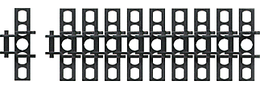
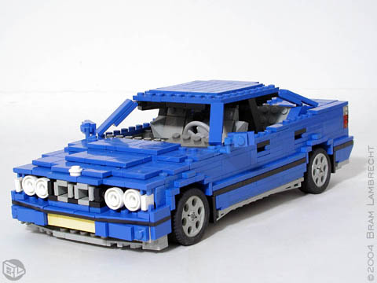
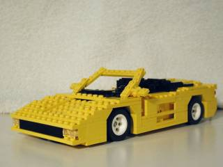

Ce genre d’article aura pour but de vous tenir informé en Français de l’actualité de la communauté LEGO. Les liens pointent vers la source de l’info (anglais) ou vers des sites contenant de nombreuses photos donc accessible à tous.

**Technique**

C’est avec plaisir que nous apprenons (n’est-ce pas philo ;-)) par [Jim Hughes](http://news.lugnet.com/technic/?n=11899) le retour de [Technica](http://isodomos.com/technica/technica.html)

Ce site web tente de retracer l’évolution du Thème Technic&reg (déjà plus de 25 ans). Un site de référence très clair avec une iconographie originale.

**Modèles grandes échelles**

La dernière création de [Bram Lambrecht](http://news.lugnet.com/announce/moc/?n=1725) est une maquette de BMW. Vous pouvez vous jeter sur les photos de cette réalisation sur le site [bldesign](http://lego.bldesign.org/models/?n=97)

En passant, attarder vous aussi sur les nombreux autres superbes modèles de Bram comme par exemple cette [Ferrari](http://lego.bldesign.org/models/?n=29)

Vous avouerez que ce concept de modélisme LEGO&copy, entre le Technic&reg et le Model Team&reg reste rare.

**Communautée**

Comme vous le savez, La société LEGO a décidé de stopper la production des pièces en gris et gris foncé au profit de deux nouveaux gris. Après des débats houleux,les discussions sont relancées par [Jake MCKee](http://news.lugnet.com/lego/?n=672) dans un esprit constructif. Rappelons que Jake est "Community Development Manager" chez LEGO. Jake précise qu’il n’est pas question de revenir sur cette decision. Il souhaite juste discuter à froid de ce que les fans considèrent comme une erreur pour pouvoir en rendre compte correctement auprès de la société LEGO...

...et il ne vas pas etre déçu, en l’espace de 5 heures il à déjà reçu 10 réponses. Nous noterons :

\-certains se demandent pourquoi LEGO n’a pas fait de publicité autour de ce changement de couleur, d’autant plus que la société LEGO à prétendu par la voix de Jake que ce changement est marketing et destiné à plaire au public. Si vous savez lire entre les lignes, vous comprendrez que l’on soupçonne que la réduction des coûts soit la véritable raison de ce changement.

\- que le gris est "tolérable" mais que le gris foncé est vraiment trop bleu

\- que d’autres fans aiment ces nouvelles couleurs !

\- que ce qui est regrettable est l’abandon des anciens gris, et que la création de nouvelles couleurs n’est, bien entendu, pas en cause

\- que les nouveaux gris seront parfaits pour des creations "mécaniques" (robots, voitures, engins..) mais ne correspondent pas à du béton, de la pierre, etc pour les chateaux par exemple.

...to be continued
