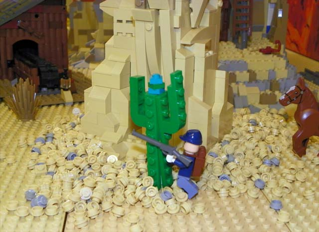
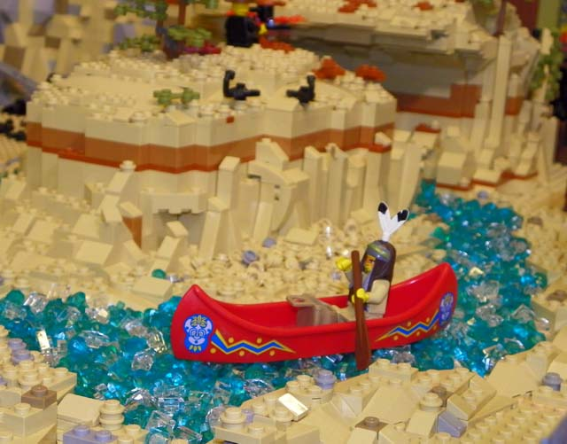
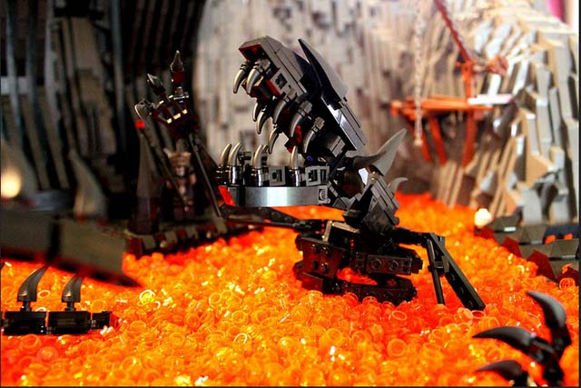
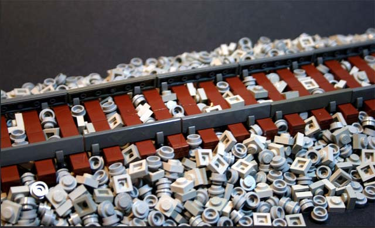

Cette technique de montage avancée a été baptisée du nom de SJIRRFL (par souci de simplification, prononcez Chnirfleuh). Pourquoi ? Je suppose que c’est pour moquer les cryptiques SNOT [^1], AZMEP et autre SNIR, mais c’est plus sûrement Denis qui pourrait vous l’expliquer.

Pour ma part, SJIRRFL signifie "**S**tuds and **J**ewels **I**nstalled **R**andomly to get **R**ocks, **F**luids and **L**iquids"

Avant d’entrer dans le fond du sujet, disons-le, cette technique, n’est pas une technique de montage car les pièces n’y sont pas connectées les unes aux autres. [^2] C’est une technique de mise en vrac.

Elle consiste à utiliser des pièces en grand nombre et en vrac. Et c’est de là que la technique prend son qualificatif d’avancée. En effet, ce n’est pas une technique que la société LEGO peut employer pour un set officiel. Les sets officiels doivent être économiquement attractifs (un set avec des milliers de plaques rondes 1x1 pour faire une rivière serait trop cher) et les modèles doivent être stables (et des pièces posées en vrac ne sont pas stables).

Cette technique ne peut donc être pleinement exploitée que dans des dioramas, par exemple par des fans dans des expositions. Rajoutons que cette technique combine à la fois l’AZMEP, le SNIR et le SNOT car elle propose à la fois des dimensions non standards, des angles spéciaux et des orientations multiples.

Ces pièces sont généralement des pièces non modifiées (plaques, plaques rondes, plaques lisses, cheese slope, [cristaux](http://www.bricklink.com/catalogItem.asp?P=30153)) et de petites tailles (1x1).

L’effet consiste donc à utiliser des pièces similaires, pas forcément de couleurs identiques mais de nuances proches afin de représenter des phénomènes naturels, de nature chaotique ou aléatoire, comme l’écume des vagues ou la lave, les éboulements de terre et de pierres ou la mise en place du ballast entre les rails de chemin de fer...

L’utilisation d’un grand nombre de pièces de petites tailles, placées suivant une disposition aléatoire, permet de tromper l’œil et, par l’effet d’échelle et grâce à la distance, donne l’impression à la fois du détail et de la fluidité. [^3]

Pour l’écume on utilise généralement les couleurs transparentes bleues ou blanches, le rouge et l’orange pour la lave, les couleurs beiges (tan) ou marron (brown) pour les éboulements et les gris pour le ballast.

Voici deux exemples issus d’un décor de BrickFilm par Jean-Yves :

Un éboulement avec des plates 1x1 rondes tan et grises.

Une rivière de canyon avec des plates 1x1 trans-clear (transparente blanche) et des cristaux trans-light-blue (transparent bleu clair).

Un lac de lave avec son squelette de dragon, création de Patrick Massey, avec des plates rondes 1x1 trans-(neon)-orange.

Et enfin le ballast par Eldeeem avec un mélange de plates et de rondes 1x1 en gris.

Cette technique a pu se développer grâce notamment aux murs de briques présents dans les LEGO Store (magasins LEGO) qui permettent de remplir des gobelets complets de ces petites pièces à prix raisonnables (plusieurs milliers de pièces pour 10 euros).

Un programme informatique est en cours de développement chez GELO pour modéliser la création de modèles originaux à partir d’une sous technique particulière du SJIRRFL, je veux parler du ViRaGo (Vidage Rapide du Gobelet).

Cette idée vient du service marketing de GELO qui semble-t-il chercherait un relais de croissance pour ses Pickabrick qui ont du mal à écouler certaines pièces.

Nous avons passé sous silence une autre technique moderne : le Déconstructivisme Massif de Renversement Brutal (le fameux DMRB mais néanmoins très largement ignoré) que l’on peut rapprocher de son homologue américain, le "Swooshability Failure" qui consiste à lancer un Millenium Falcon du haut de l’escalier pour se rendre compte que, finalement, non, l’hyperdrive n’a pas été réparé. [^4]

Ceux plus particulièrement intéressés par les mathématiques du SJIRRFL s’intéresseront à la théorie du chaos à travers le [système d’équations différentielles de Lorenz](http://fr.wikipedia.org/wiki/Attracteur_de_Lorenz) et détermineront eux-mêmes la [dimension de Hausdorff](http://fr.wikipedia.org/wiki/Dimension_de_Hausdorff) de leur gros tas de briques (Gros big up à Cantor et Sierpinski au passage).

Pour terminer, ajoutons que cet article est une parodie des articles et présentations autour des techniques de montage avancées en LEGO. Après tout, chacun a le droit de se prendre au sérieux puis de prendre le parti d’en sourire.

[^1]: Snot signifie « morve » en angais

[^2]: En fait, nous ne sommes pas vraiment certains qu’il s’agisse d’une technique avancée non plus.

[^3]: Notons bien qu’un amoncellement de pneus suivant cette technique fait aussi un très bel effet dans l’arrière-cour d’une casse automobile

[^4]: Chewie, we’re home
