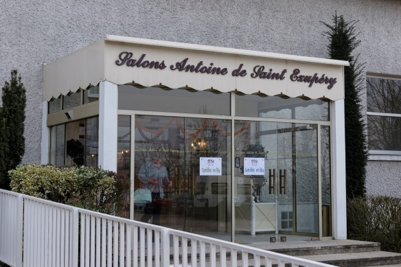
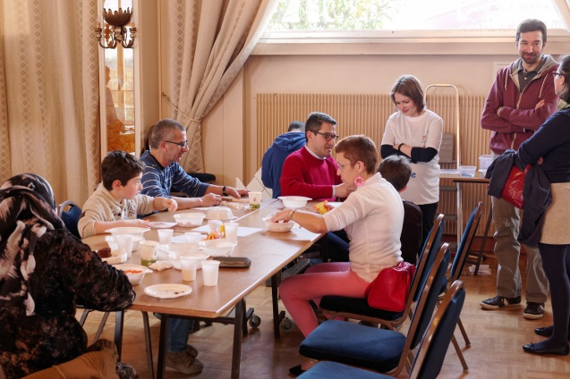
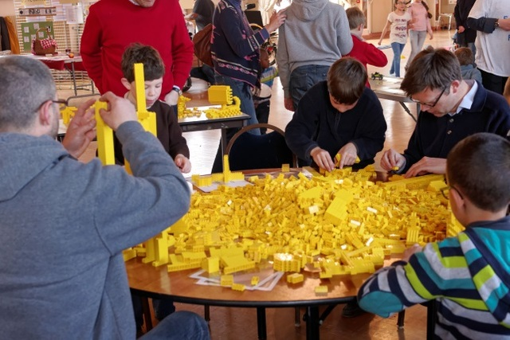
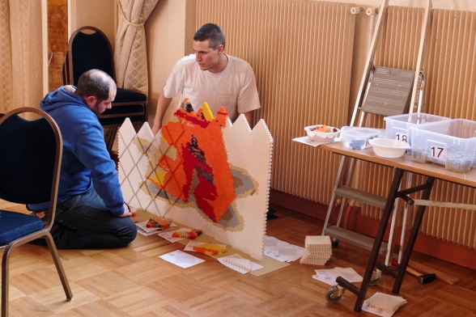
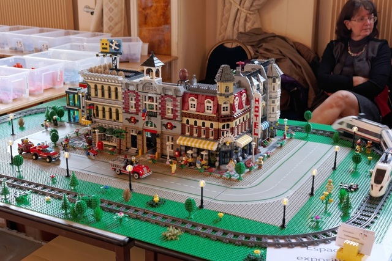

Familles en fête, Coignières le 14 mars 2015

Cette animation demandée par l’APAJH78 (Association Pour Adultes et Jeunes Handicapés sur le département des Yvelines), nous a permis de rencontrer des jeunes handicapés. Pour cette journée, nous nous somme intégrés à la fête des familles. Cette grande fête annuelle a eu lieu cette année à la salle Antoine de St Exupéry à Coignères.

Cette animation a été réalisée grâce la participation de BRISY (association LEGO local).

Durant l’après-midi, nous avons proposés 4 activités accessibles à tous :

-   Une mosaïque,
-   Un montage libre,
-   Un jeu de société maison,
-   Une exposition City.

La mosaïque, qui représentait Emmet (15200 briques) et les briques jaunes ont été prises d’assaut, les places libres étaient très rares et vite comblées.

**Mosaïque**

**Montage de la mosaïque**

**Montage libre**

**Montage libre**

Hélas, il nous manquera 1h pour finir la mosaïque.

**Assemblage de la mosaïque**

Le jeu de société consistait en un jeu de dés type petits chevaux, mais avec des voitures sur une piste. Ce jeu était en libre accès.

La partie exposition a eu également beaucoup de succès. Elle représentait une rue à base de bâtiments type modulaire autour desquels tournaient alternativement 2 trains.

**Diorama**

**Diorama / exposition**

Une belle journée qui est très vite passée, avec beaucoup de rencontres et d’échanges. Très peu de casse (juste une des 5 voitures du jeu de société) et aucune perte de brique.

Un grand merci aux associations LEGO qui nous ont permises de réaliser cette animation.

[D’autres photos sur le site de Brisy](http://brisy.free.fr/brisyjournal.html)
