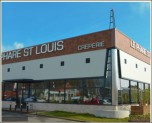
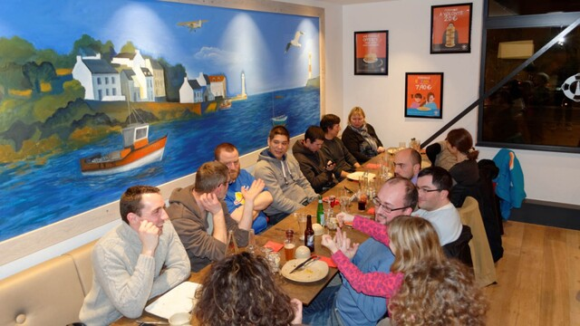

Coignières (78) - le Phare Saint Louis

Le vendredi 23 janvier 2015, les AFOLs du sud parisien se sont donnés rendez-vous pour un LEGOCrêpe à Coignières.

Pour cette édition, ce n’est pas moins de 18 AFOLs qui se sont retrouvés au restaurant « Le phare St Louis » pour cette soirée autour d’un repas convivial.  
Certains sont venus avec leurs énigmes à résoudre (problèmes de pignon ?), d’autres avec leur bonne humeur, ont permis de trouver des solutions.

La soirée très animée en discussion est passée très vite et a fini par un gros trafic de cartons sur le parking.

Pour cette soirée, était au rendez-vous des membres de différentes associations : Brique Mulsanne, Brisy et bien sûr FreeLUG.

