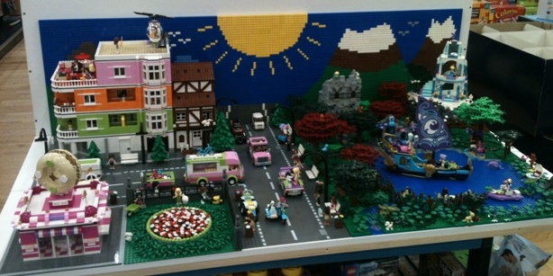

En attendant la grande animation qui aura lieu samedi 25 avril dans le magasin [Cultura de Bourgoin Jallieu](http://www.cultura.com/les-magasins/cultura-bourgoin-jallieu.html) , la petite équipe lyonnaise a mis en place une vitrine très Girly dans le magasin afin de promouvoir la sortie de la nouvelle gamme Elves et d’attirer une fois encore l’attention du publique sur la prochaines [Briqu’Expo Diemoz](http://chezyannoch.com/briquexpodiemoz/briquexpo_diemoz2015.php) !

Un travail collaboratif qui met en lumière des gammes peu présentes en exposition : Friends, Princess, Elves, etc. avec un décors très coloré !

_Rendez-vous le [25 avril dans le Magasin Cultura pour la prochaine animation](https://www.freelug.org/spip.php?article2047)._
