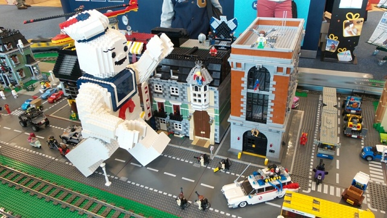
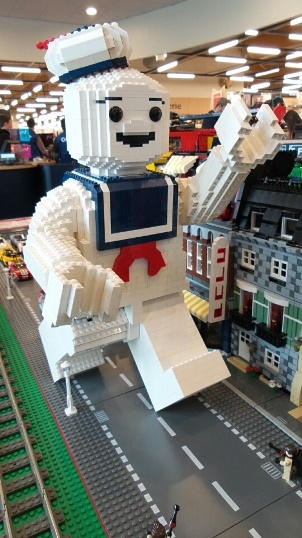
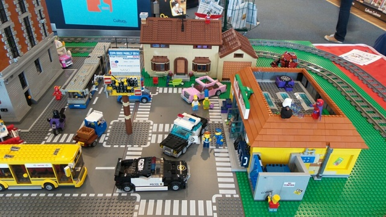
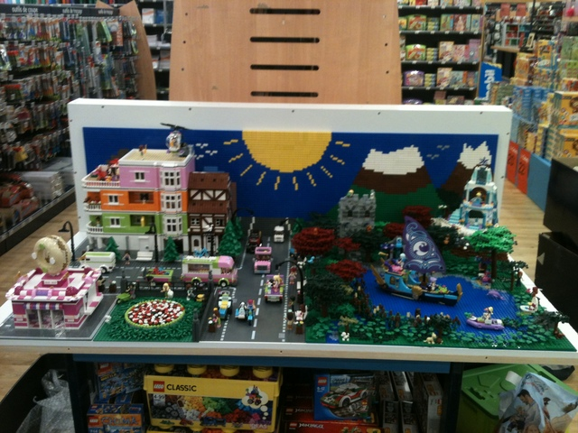
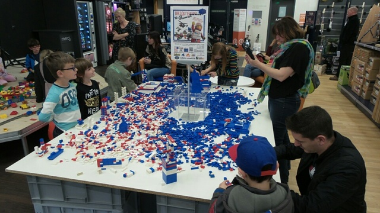

A quelques semaines de la mise en pré-vente des entrées chez [Cultura](http://www.cultura.com/les-magasins/cultura-bourgoin-jallieu.html), [Briqu’Expo](http://briquexpodiemoz.com/) continue sa promotion en assurant l’animation dans le magasin à l’occasion du mois des enfants.

**BRIQU’Expo Diemoz à l’honneur chez Cultura**

A cette occasion, de nombreuses animations étaient proposées :

Dès l’entrée dans le magasin, les visiteurs pouvaient apercevoir un petit diorama mettant en scène Simpsons, Super héros, train, City et une superbe mise en scène Ghostbusters !

**Les Ghostbusters**

**Bibendum version Maxifig**

**Les Simpsons**

A l’autre bout du magasin, la vitrine Girly était toujours présente, avec des gammes plutôt destinées à un public féminin : Château de la Reine des Neiges, Friends, Elves, et quelques Mocs bien colorées mis en valeur par un joli fond brickbuildé !

**Vitrine Girly**

Bien sûr, les enfants pouvaient jouer autours des briques, avec :  
**–** un stand de briques destiné à de la construction libre

**Atelier construction**

**–** un stand de Duplo pour les plus petits

**–** un atelier "mini mosaïques"

**–** un atelier stop motion, l’occasion pour les enfants de s’improviser réalisateurs.

[Vidéo de la publication d’origine](https://www.youtube.com/embed/gbNTxrugnv4)

Plus de photo sur la galerie [ici](https://www.flickr.com/photos/84107414@N03/sets/72157651865963976/).

Yannoch

* * *

C’est encore avec une grande joie que nous avons exposé chez notre partenaire [Cultura](http://www.cultura.com/les-magasins/cultura-bourgoin-jallieu.html) à Bourgoin-Jallieu. Nous avons passé une très bonne journée. Placés à l’entrée du magasin, nous ne passions pas inaperçus et tous les enfants sont restés de longues minutes à regarder ce diorama. Les Simpsons et les super-héros ont encore fait un carton. Les parents ont adoré les Ghostbusters et surtout la maxifig de Jérôme qui a fait un tabac.

Arnaud (nano69)

* * *

Merci les aminches, je transmettrai vos compliments à Maxibibi quand il sortira de sa boîte.  
J’adore les animations de ce genre, notamment pour le rapport avec les gens car il est manifeste qu’on leur donne du bonheur. Et puis, mine de rien, il y a un petit groupe de fans qui vient à chaque fois. C’est rigolo et très agréable.  
Je me suis encore éclaté à l’atelier construction à raconter des âneries aux parents amusés et aux enfants souvent consternés de voir un grand s’amuser autant en construisant des trucs inutiles (vaisseau spatial de l’espace, éléphant à baskets, détecteur de bidules, etc...) Donnez des LEGO aux enfants et voyez ce que ça donne quand ils ont bien grandi... ;-)

Vivement la prochaine ! Car comme je vous aime, je reprendrai le train...

Jérôme (jive69)
