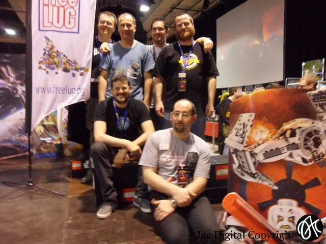
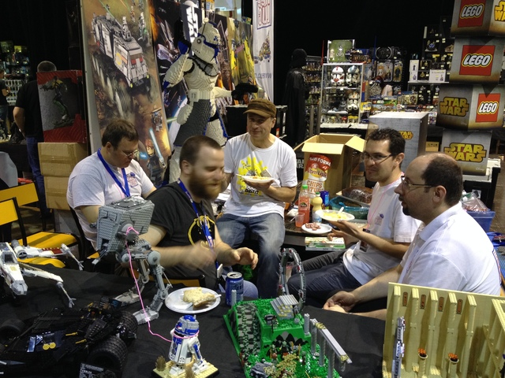
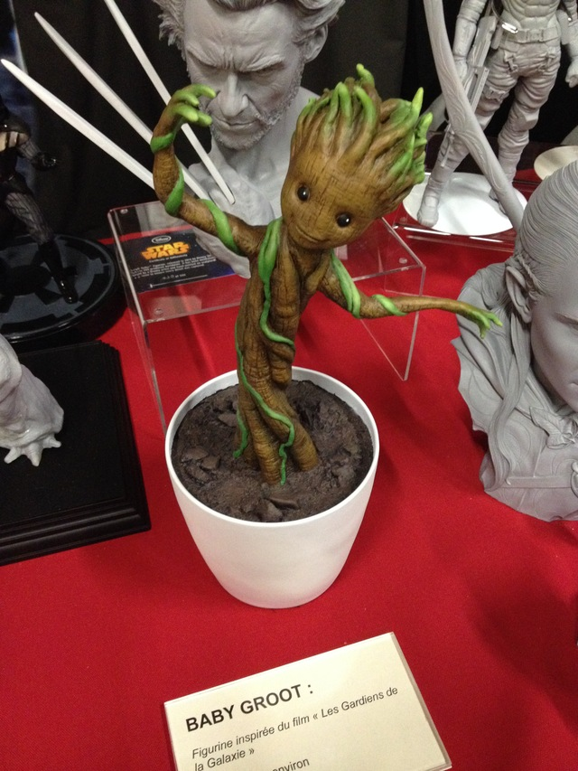
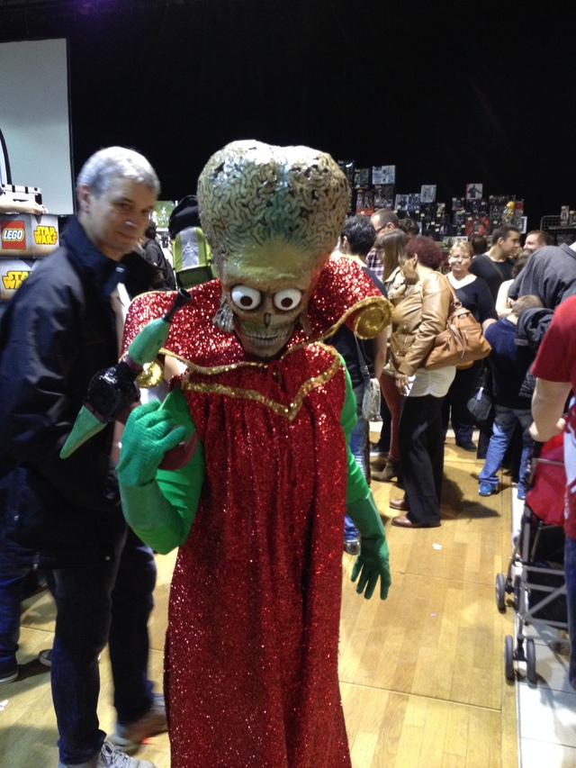
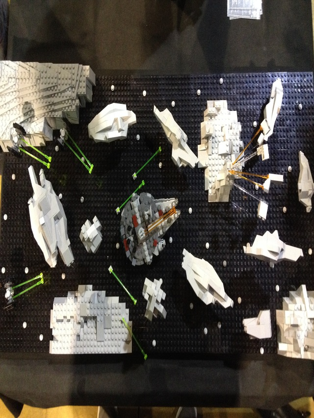
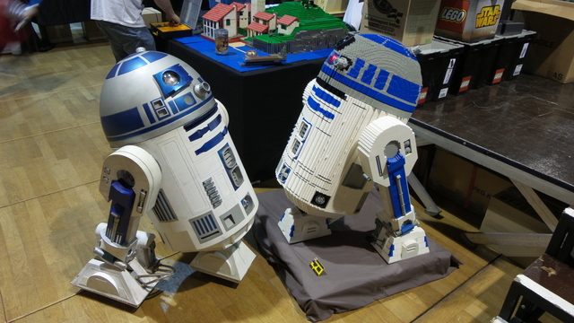

L’association FreeLUG était à nouveau invitée à cette 17e édition pour présenter des constructions en briques LEGO sur un stand.

On pourrait croire l’organisation de cette exposition bien rodée au bout de 17 fois. Il n’en est rien car d’une part nous n’avons pas participé au 17 éditions et d’autre part, nous faisons en sorte de renouveler au maximum ce que nous présentons. Bon, sauf pour quelques trucs : le stand presque toujours au même endroit et les pizzas misent en place depuis quelques années pour le Samedi soir.

En tous les cas, cette nouvelle participation ne déroge pas à la règle avec du jeu de l’amusement et beaucoup de visiteurs (plus de 10000 d’après les dernières infos).

Merci à tous pour votre participation et rendez vous l’année prochaine si vous le voulez bien.

_JAC_

* * *

Et bien une de plus et encore un grand bonheur de participer !  
Même la chaleur de la salle ne nous atteint pas, nous sommes tellement pris par le public, les cosplay qui passent, les autres stand qui proposent de plus en plus de jolies choses...

Et puis le rendez vous du samedi soir commence à devenir la soirée VIP du week end !  
 ;-)

Un grand merci aux Héritiers de leur accueil...  
et aussi à Jac, Séverine et Sélène pour leur patience....

_PierroLego_

* * *

De nouveau présent à Cusset cette année. J’aime bien cette expo qui me permet de sortir de mes constructions habituelles, même si cette année, je n’ai pas été très inspiré. Cela n’enlève rien à ce très bon week-end passé en bonne compagnie à construire un gros Darth Vader dans une chaleur quelque peu éprouvante...

Merci à Jac, Séverine, Alain et Mamie Danny pour l’accueil et les pizza :)

Je suis partant pour 2016 !

_Laurent_

* * *

Super expo, comme l’année dernière, pour un peu je signerais presque pour l’année prochaine, même s’il n’y a rien de sûr. Parce que l’accueil est tellement bon que l’on voudrait ne jamais repartir. Merci à Jérôme et Séverine pour l’organisation et la logistique, on a juste à glisser les pieds sous la table et pour ça vous êtes à remercier.

La partie LEGO était vraiment sympa comme l’année dernière, mais j’ai beaucoup apprécier les artistes qui étaient relégués dans la salle du fond. Si vous les avez ratés, tant pis pour vous ;-) mais bon je vous met la photo du mini groot pour vous faire saliver.

Bon Jérôme si tu arrives à me soudoyer, je pense que je vais être obligé de revenir l’année prochaine ;-)  
Je vous ai mis la photo aussi du plus beau cosplay à mon gout.

Et une image de mon petit diorama, pas toucher !!!! (private joke, les intéressés se reconnaitront)

_Xaviator_

* * *

Le côté gros délire de cette convention m’avais déjà bien plu l’année passée, en tant que visiteur. Cette année, du coup, j’ai amené Grodédeu ! Bon il y avait de la concurrence, mais il en faut plus que ça pour l’inquiéter.

Très bonne ambiance au stand LEGO malgré la chaleur importante dûe à la quantité impressionnante de gens présents dans cette salle. Quoique la construction (et déconstruction !) du Vador géant n’est pas étrangère à ma métamorphose finalement assez rapide en serpillière humaine... J’aurais dû mettre un distille frémen, comme ça, après, j’aurais pu arroser les plantes !

Mais on a bien rigolé !  
Merci à tous !

_Jérôme (jivé69)_

* * *

Cette 17eme convention SW a été encore une mega réussite, de plus en plus de monde, de costumes. Pour notre stand cette année en plus de nos dioramas et présentation d’UCS, il y avait une construction d’un immense Dark Vador par tous les enfants visiteurs. De plus Jérôme Vannier avait amené son super R2D2 baptisé (un peu péjorativement à mon gout) grosD2.

Il a eu un immense succès, serrant de la pince à tous les visiteurs ébahis Jérôme devant même l’ouvrir pour montrer l’intérieur aux incrédules et il en plus il parle !!!!

Samedi soir nous avons fait une soirée pizzas très sympa, à cette occasion notre pizzaïolo Alain et son aide Séverine ont inventé de nouveaux mélanges, adoptés. Merci à eux, et à JAC et Séverine pour l’accueil et la logistique.

_Mamy danny_

* * *

C’était super !  
Je reviendrais :)

_Pierre / Tribolego_

* * *

## Galerie photos

**–** [JAC](http://photos.freelug.org/main.php/v/JAC/Exposition/2015/Cusset/)  
**–** [Mamy danny](http://photos.freelug.org/main.php/v/dannylou/expos/expos_001_002/)
