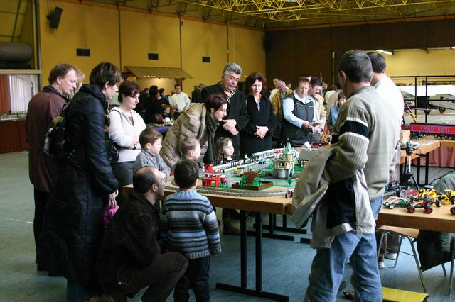
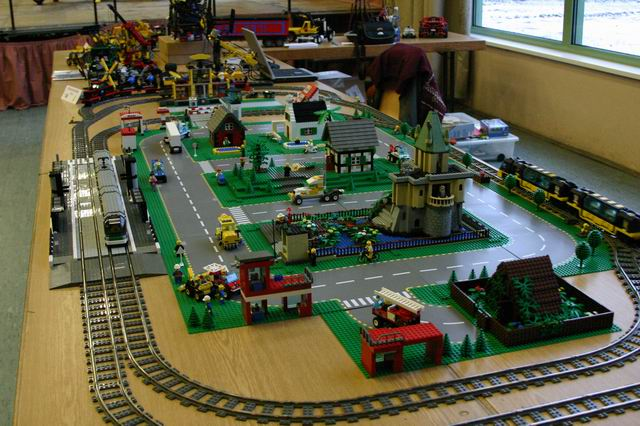
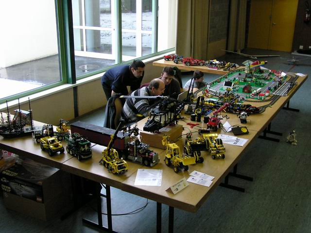
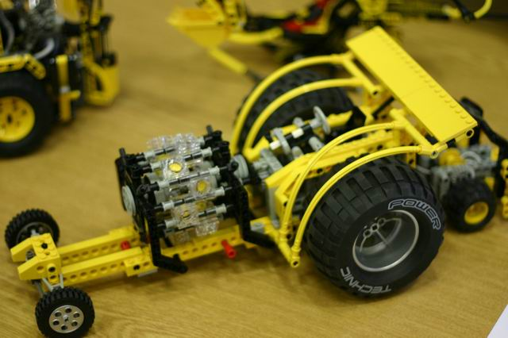
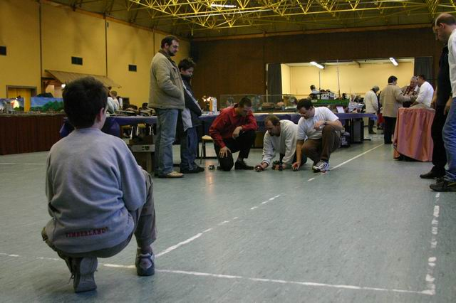
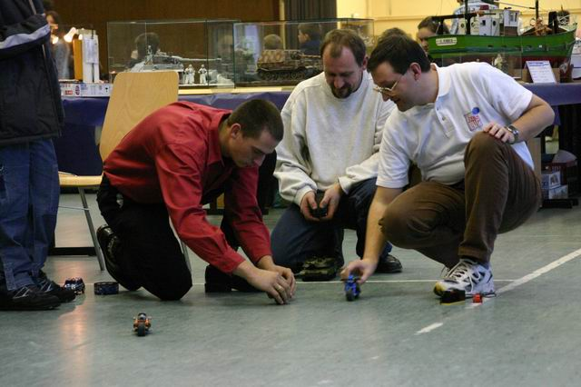

**par [Marc Schickelé](mailto:marc.schickele@free.fr)**

Le 24 et 25 janvier, j’ai participé au nom de Freelug à la première expo de modélisme organisé par le syndicat d’initiative de Seltz. Commme d’habitude, le public est ébahi devant notre stand.

J’étais épaulé par deux nouveaux adhérents : **Philippe Chatin** et **Marc Klein**.

Voici quelques extraits, mais des [videos](http://sam.rotule.free.fr/seltz2004/page_01.htm) et des photos complémentaires sont disponibles sur [Freelug](http://photos.freelug.org/category.php?cat=43&expand=all) et [Brickshelf](http://www.brickshelf.com/cgi-bin/gallery.cgi?f=70142).

**Que de monde...**

**Vue sur la ville...**

**Démonstration convainquante de MLCAD par Marc Klein, au premier plan le semi-remorque de Philippe.**

**Un powerpuller avec un moteur en étoile...Si si ! çà existe !**

**3...2...1...Vraooouuummmm ! Alexandre (mon fils) surveille la ligne d’arrivée.**

**Des modélistes convertis aux Moto-racers**
