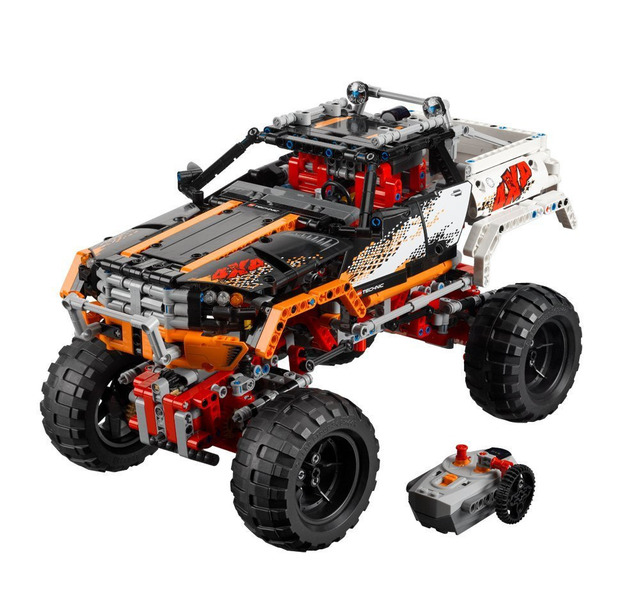
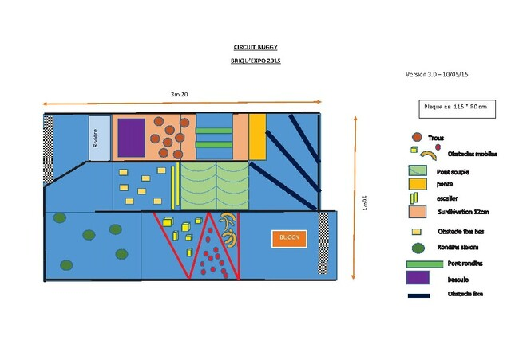
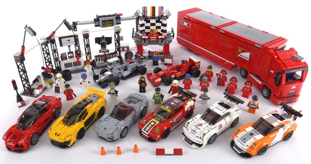

Lors de la deuxième édition de la [BRIQU’Expo Diemoz](http://briquexpodiemoz.com/), deux nouveaux concours sont proposés par FreeLUG sur le thème **des Bolides** :

_**1- Concours ouvert à tous : Buggy Technic**_

Les organisateurs vous proposent de réaliser un buggy Technic, dans la lignée du véhicule 9398 4x4 Crawler LEGO Technic pour franchir le parcours proposé en un temps record !

**9398 4x4 Crawler LEGO Technic**

Le parcours sera à disposition tout le week-end, et il vous sera possible de faire quelques essais avant la course officielle qui aura lieu Dimanche à partir de 14h00.

Sans vous dévoiler toutes les subtilités du parcours surprise, voici les principaux éléments qui vous permettront de réaliser votre Buggy :

**Le parcours**

Le parcours est visible en meilleure résolution [ici](https://flic.kr/p/vnmT9X).

Chaque participant aura droit à deux essais officiels. Le meilleur temps sera retenu.  
Les vainqueurs recevront les lots suivants :

-   1er Lot : [42039 24 Hours Race Car](http://shop.lego.com/en-FR/24-Hours-Race-Car-42039)
-   2eme Lot : [42036 Street Motorcycle](http://shop.lego.com/en-FR/Street-Motorcycle-42036)

Voici les quelques règles à respecter :  
**–** Seules les pièces LEGO sont autorisées  
**–** Le véhicule devra être télécommandé  
**–** Il devra être alimenté par Pile ou Batterie LEGO  
**–** Il ne devra pas excéder les dimension suivantes : 40 cm x 23 cm

Le jury se réserve le droit d’attribuer un autre lot d’une valeur supérieure ou égale au lot annoncé en cas d’indisponibilité du produit.

Tous les détails sur le site [www.briquexpodiemoz.com](http://briquexpodiemoz.com/).

_**2- Concours ouvert aux exposants uniquement : Speed Champions**_

Nous vous proposons de créer et amener à Diemoz un véhicule dans la lignée des véhicules proposés par LEGO dans la gamme [Speed Champions](http://shop.lego.com/fr-FR/Speed-Champions-ParTheme?bcBack=yes).

**Gamme Speed Champions**

Le véhicule devrait respecter le gabarit et l’esprit de la gamme [Speed Champions](http://shop.lego.com/fr-FR/Speed-Champions-ParTheme?bcBack=yes).

Les véhicules des participants seront intégrés au diorama de la LGV dès Samedi 10h00. Un jury délibérera le Dimanche en début d’après midi pour récompenser les 3 vainqueurs.

Les lots proposés sont les suivants :

-   1er Lot : [60069 Swamp Police Station](http://shop.lego.com/en-FR/Swamp-Police-Station-60069)
-   2ème Lot : [31024 Roaring Power](http://shop.lego.com/en-FR/Roaring-Power-31024)
-   3ème Lot : [60083 Snowplow Truck](http://shop.lego.com/en-FR/Snowplow-Truck-60083)

Le jury se réserve le droit d’attribuer un autre lot d’une valeur supérieure ou égale au lot annoncé en cas d’indisponibilité du produit.

Tous les détails sur le site [www.briquexpodiemoz.com](http://briquexpodiemoz.com/).
