Pour cette seconde édition, les organisateurs donnent leur maximum pour proposer de nombreuses activités et un spectacle inoubliable pour petits et grands.

[Vidéo de la publication d’origine](https://www.youtube.com/embed/SrTOhoPR4Vw)

**1- Le Parking :**  
Pour rappel, l’exposition a lieu dans la Salle Polyvalente Gabriel Rey.  
Les horaires d’ouverture sont les suivants :

-   Samedi 12 Septembre : 11h à 19h
-   Dimanche 13 Septembre : 10h à 17h30
-   Attention, fermeture des caisses 1h avant la fin.

Rappel des tarifs :

-   Moins de 5 ans : Gratuit
-   Moins de 14 ans : 1 Euro
-   14 ans et + : 3 Euros

Un grand parking sera mis à disposition des visiteurs à proximité de la salle. Il suffira de suivre le fléchage mis en place à Diemoz et dans les communes environnantes.

**Attention, il n’y a pas de distributeur d’argent à Diemoz**, et les cartes bleues ne seront pas acceptées par les vendeurs. Pensez à retirer de l’argent avant de venir. Sinon, les distributeurs les plus proches sont à [Heyrieux](https://www.google.fr/maps/place/Heyrieux/@45.6275119,5.0578744,13z/data=!3m1!4b1!4m2!3m1!1s0x47f4d033df0c12a3:0x408ab2ae4be77d0) et [Saint Georges d’Espéranche](https://www.google.fr/maps/place/Saint-Georges-d'Esp%C3%A9ranche/@45.562804,5.088995,13z/data=!3m1!4b1!4m2!3m1!1s0x47f4d6acadf37b5f:0x408ab2ae4be6c00).

**2- Entrées et billets :**  
Les organisateurs mettent à disposition deux entrées :

-   Une entrée pour les personnes ayant déjà leurs billets
-   Une entrée pour les personnes n’ayant pas encore leurs billets

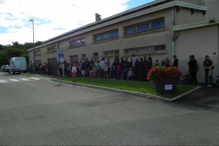

**Jusqu’à 100m de file d’attente en 2013**

Pensez bien à acheter vos billets à l’avance pour vous éviter une longue file d’attente ! Pour rappel, les billets sont en vente dans les boutiques suivantes :

-   A Diemoz à la cave [Les vents d’anges](https://www.facebook.com/pages/SARL-LES-Vents-Danges/277947102269585)
-   A St Georges d’Espéranche au salon de coiffure [1,2,3, Styl’](https://www.facebook.com/pages/123-Styl/228607713817550?fref=ts)
-   A la Verpillière au salon de coiffure JP Coiffure
-   A Bourgoin chez [Cultura](http://www.cultura.com/les-magasins/cultura-bourgoin-jallieu.html)

Et sur internet jusqu’au 25 Août seulement sur le site [Ulule](http://fr.ulule.com/moz-lego/).

Une fois entré, un livret vous sera remis, vous rappelant les activités et concours proposés, et vous présentant les stands et partenaires.

**3- Les activités :**  
Sans vous dévoiler tout ce que nous vous réservons voici un petit aperçu des animations et lots qui vous seront proposés. Pour cela, il suffira d’utiliser les coupons présents dans le livret qui vous sera remis à l’entrée.

**–** Comme en 2013, un grand stand de briques sera à votre disposition. Laissez aller votre imagination et proposez nous vos constructions les plus folles. Chaque soir, un jury récompensera les réalisations les plus remarquables.

[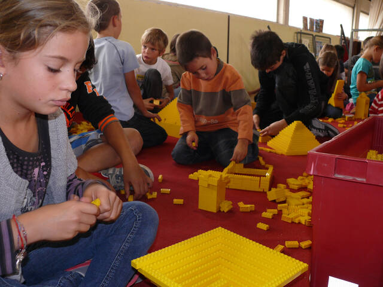](https://www.freelug.org/IMG/jpg/P1120547.jpg)

**Le stand de briques jaunes**

Les lots proposés seront les suivants :

[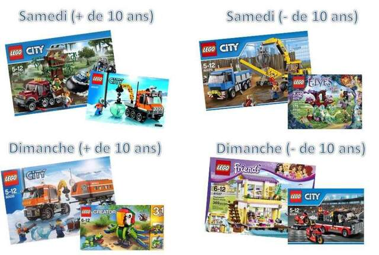](https://www.freelug.org/IMG/jpg/briques.jpg)

**Lots pour les concours de construction Briques**

**–** Pour les plus petits un espace Duplo sera mis à disposition.

**–** Retrouvez les 10 personnages aux couleurs de MOZ.  
10 minifigurines présentes sur les dioramas des exposants ont revêtu le T-Shirt de MOZ :

[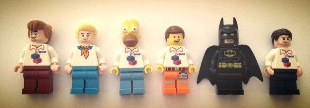](https://www.freelug.org/IMG/jpg/Les_supporters_de_MOZ.jpg)

**Les supporters de MOZ**

Retrouvez les tous, notez leur emplacement sur le bulletin de participation présent dans le livret pour gagner un des lots suivants :

[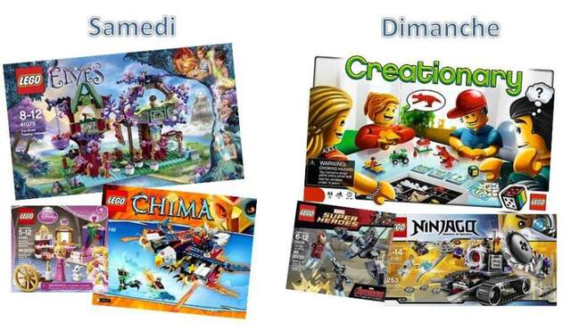](https://www.freelug.org/IMG/jpg/bonhomme.jpg)

**Lots pour les concours MOZ**

**–** Enfin, des tombolas seront organisées Samedi et Dimanche basées sur le principe des calendriers. Il suffira d’acheter une des dates du calendrier, et les dates tirées au sort pourront repartir avec les lots suivants :

[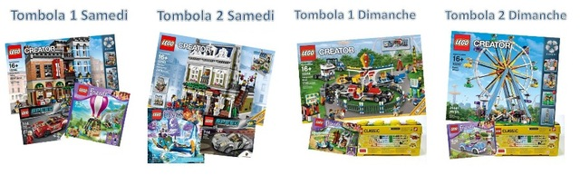](https://www.freelug.org/IMG/jpg/Tombolas.jpg)

**Lots pour les tombolas**

**4- Les concours :**

**–** Concours de photos

Un grand concours a été organisé avec [Samsofy](http://www.samsofy.fr/). Pour participer, il suffisait de réaliser une photo sur le thème « Les bolides » et dans l’esprit de l’artiste.

**Les bolides selon Samsofy**

Les photos des participants seront exposées tout le week-end. Un jury, composé de l’artiste, un membre FreeLUG, un membre du Sou des Ecoles et trois personnes de l’équipe organisatrice sélectionneront les trois plus belles photos de chaque catégorie qui se verront récompensées par un des lots suivants :

[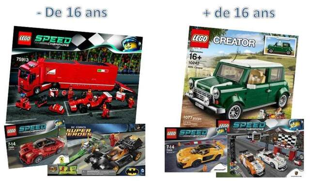](https://www.freelug.org/IMG/jpg/samsofy.jpg)

**Lots pour le concours de Photo avec Samsofy**

Les lots seront à retirer le Dimanche 13 Septembre 2015 à partir de 16h00 à Diemoz.  
Tous les détails du concours sont disponibles [ici](http://freelug.org/spip.php?article2063).

**–** Concours de construction

Un concours de construction est également organisé avec notre partenaire [Hoth Bricks](http://www.hothbricks.com/) : **Imaginer le véhicule de l’an 3000**. Pas de contrainte ni de limite. Attention, il est évident que le modèle doit être constitué exclusivement de briques LEGO et que votre véhicule doit être une vraie création. Pas de "modification" d’un set existant ou de pompage manifeste de la création d’autrui.  
**Pour participer** : Il vous faudra apporter votre création le dimanche 13 septembre avant 11h00 sur le lieu de l’exposition. Tous les modèles participants seront exposés et un jury désignera les gagnants de ce concours dont la dotation, motivante, se trouve ci-dessous :

[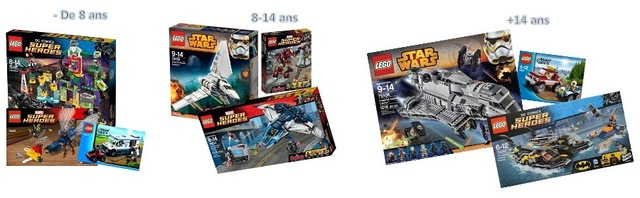](https://www.freelug.org/IMG/jpg/hothbricks.jpg)

**Lots pour le concours de construction avec Hoth Bricks**

Tous les détails sont disponibles sur le site de [Hoth Bricks](http://www.hothbricks.com/2015/08/briquexpo-diemoz-2015-concours-minifig-exclusive-et-pre-vente-de-billets/).

**–** Concours de buggy

Enfin, pour les fans de Technic, les organisateurs vous proposent de réaliser un buggy Technic, dans la lignée du véhicule 9398 4x4 Crawler LEGO Technic pour franchir le parcours proposé en un temps record !  
Le parcours sera à disposition tout le week-end, et il vous sera possible de faire quelques essais avant la course officielle qui aura lieu Dimanche à partir de 14h00.

Sans vous dévoiler toutes les subtilités du parcours surprise, voici les principaux éléments qui vous permettront de réaliser votre Buggy :

[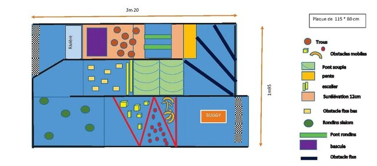](https://www.freelug.org/IMG/jpg/trace.jpg)

**Tracé du parcours**

Les lots suivants sont à gagner :

[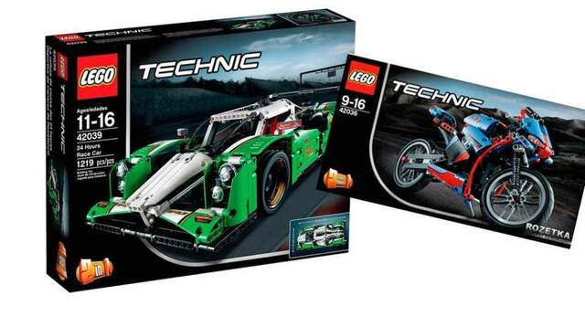](https://www.freelug.org/IMG/jpg/buggy.jpg)

**Lots pour le concours de Buggy**

Plus de détails disponibles [ici](http://www.freelug.org/spip.php?article2081).

**–** Concours réservé aux exposants : Speed Champions

Nous vous proposons de créer et amener à Diemoz un véhicule dans la lignée des véhicules proposés par LEGO dans la gamme [Speed Champions](http://shop.lego.com/fr-FR/Speed-Champions-ParTheme?bcBack=yes). Le véhicule devra respecter le gabarit et l’esprit de la gamme. Les véhicules des participants seront intégrés au diorama de la LGV dès Samedi 10h00. Un jury délibèrera le Dimanche en début d’après midi pour récompenser les 3 vainqueurs par un des lots suivants.

[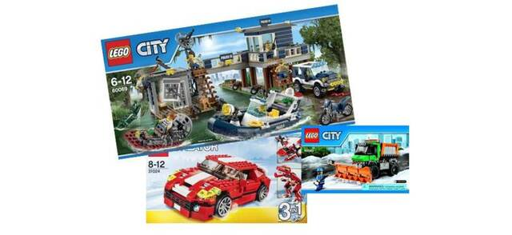](https://www.freelug.org/IMG/jpg/afol.jpg)

**Lots pour le concours de construction Speed Champions**

Plus de détails disponibles [ici](http://www.freelug.org/spip.php?article2081).

**5- La restauration :**  
Plusieurs types de restauration vous seront proposés :  
**–** Sur place :  
Une restauration rapide sera proposée sur place : Frites, hotdogs, churros, glaces, boissons.

**–** Vous pouvez aussi vous rendre chez nos partenaires qui se trouvent à proximité (possibilité de s’y rendre à pied) :

-   Pizzeria [Giorgio](http://www.pizza-giorgio.com/) qui a ouvert depuis peu son restaurant (Samedi seulement)
-   Restaurant [Le Café de la Place](https://www.google.fr/maps/place/Caf%C3%A9+de+la+Place/@45.5889923,5.0939537,15z/data=!4m2!3m1!1s0x0:0x52fc3a22e8d620ee?sa=X&ved=0CF0Q_BIwCmoVChMI0_eVnfWnxwIVRlwaCh01RQBY) qui vous proposera pour l’occasion les menus suivants :
    -   Menu à 17.50€ :
        -   Entrée
        -   Chili con carne
        -   Fromage
        -   Dessert
    -   Menu à 12€ :
        -   Entrée
        -   Saucisse/frites ou Poulet/frites
        -   Fromage
        -   Dessert

N’hésitez pas à réserver !

**6- Les goodies :**  
Pour cette seconde édition, un stand goodies vous permettra de repartir avec des souvenirs de cette journée passée aux milieux des briques avec entre autres :

-   Des briques gravées et personnalisées
-   Des porte-clés gravés et personnalisés
-   La Figurine MOZ. Attention, les quantités seront limitées. Si vous souhaitez en avoir une, vous pouvez la commander sur le site [Ulule](http://fr.ulule.com/moz-lego/).
-   Des T-shirts
-   Ainsi qu’un pack "Souvenir" qui vous permettra de repartir avec T-Shirt, MOZ, une brique gravée "BRIQU’Expo Diemoz 2015", une brique gravée personnalisée, ainsi que des surprises pour un prix défiant toute concurrence !

**7- Ce que vous pourrez voir :**  
De nombreux représentants des divers LUG français et autres seront présents et vous présenteront leurs créations et collections : Train, City, Castle, Star Wars, Super Héros, Technic, Bionicle, Fabuland et plein d’autres choses !

Pour la seconde fois, la LGV (Ligne à Grande Vitesse) sera présente et les Afols présents tenteront de battre à nouveau le record de vitesse, après qu’il soit tombé en Juin dernier lors de l’édition 2015 de Fana’Briques. Une chose est sûre, avec la LGV, même si les records ne tombent pas, le spectacle sera assuré :

[Vidéo de la publication d’origine](https://www.youtube.com/embed/0YCqPSKfLgU)

De plus, vous pourrez rencontrer et discuter avec de nombreux représentants du monde Afol :

-   [Briquefan](https://www.youtube.com/channel/UCeohvTWYjZDOubRaSIlpBCQ) qui tiendra un stand pour l’occasion
-   Will le blogueur de [Hoth bricks](http://www.hothbricks.com/) (et des autres pages dédiées aux diverses franchises)
-   Nicolas le responsable de [Muttpop](http://www.muttpop.fr/), la maison d’édition qui propose de nombreux livres sur le monde des LEGO
-   [Samsofy](http://www.samsofy.fr/) qui présentera une partie de sa collection
-   et plein d’autres Afols français ou étrangers

Enfin, de nombreux vendeurs seront également présents :

-   [Cultura](http://www.cultura.com/les-magasins/cultura-bourgoin-jallieu.html)
-   [Littlebricks](http://www.littlebricks.eu/)
-   La boutique [Power of The Brick](https://www.bricklink.com/store.asp?p=cyril99)
-   La boutique [EssenBrick.de](http://www.bricklink.com/store.asp?p=essenbrick)
-   [La grande Récré](http://www.lagranderecre.fr/magasin-jouets-la-grande-recre-saint-bonnet-de-mure-69720.html)
-   [Muttpop](http://www.muttpop.fr/)
-   [Emmaüs](http://www.emmaus-bourgoin.org/)
