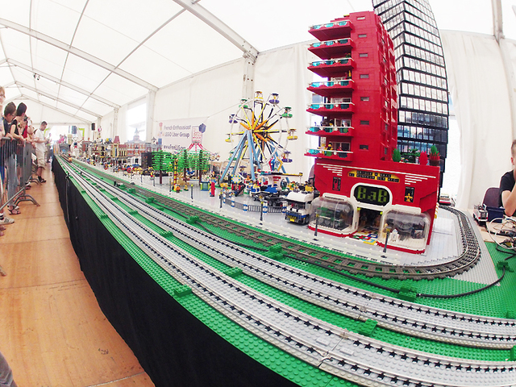
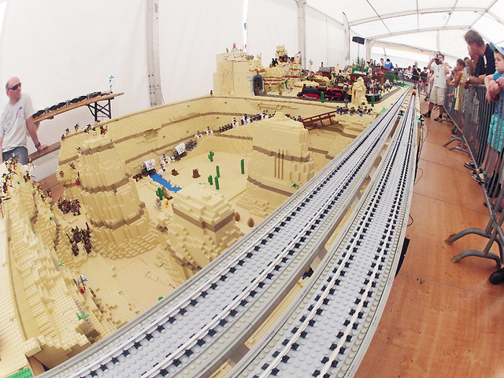
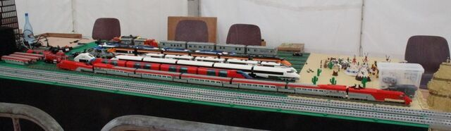
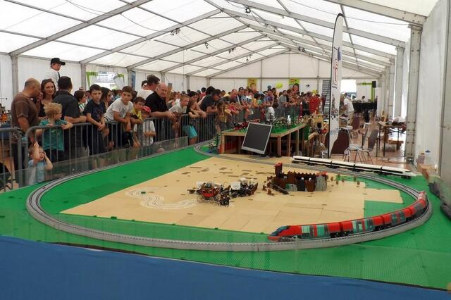
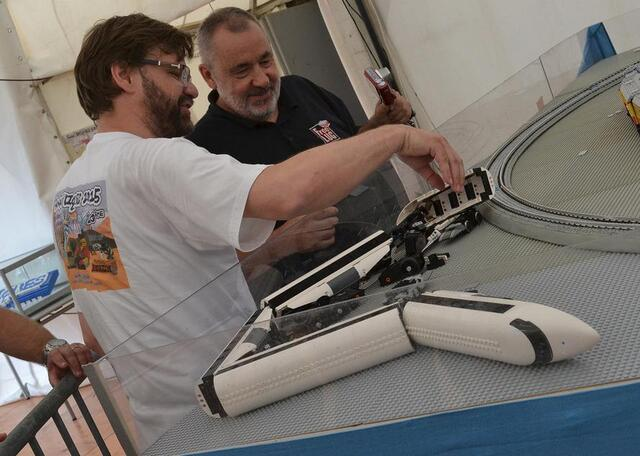
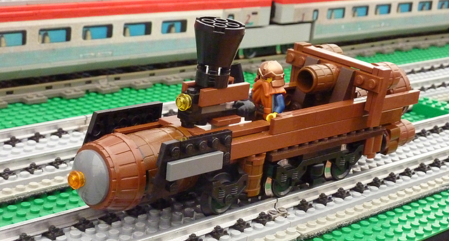

Pour l’édition 2015 de Fana’briques, la LGV est de retour donnant l’occasion de se retrouver sur un grand layout train - ville et western proposé par les membres de FreeLUG.

**Fana’briques 2015 : un bon cru.** (par cdhd)

10 ans c’est une date et une étape importante pour un évènement.  
Le magnifique feu d’artifice du vendredi l’a bien montré.

La taille de l’expo aussi : celle de la maturité avec une grande diversité de présentation et bien sûr la LGV avec le layout collectif de FREELUG.

Sur la partie gauche la partie city

Et sur le côté droit un grand ensemble western qui est aussi le thème 2015 de Fana’briques.

Mais je vais laisser chacun parler de ’’son expo’’.  
Merci à tous

**Un des records de Saint Rambert 2009 est enfin tombé.** (par DanSto)

Pour ce quatrième passage de la LGV à Fana’briques, je me suis contenté de participer à la course au record dans la catégorie train officiel (j’avais un petit stand Star Wars dans la salle) et, enfin dirais-je, l’ancien record à 25,59 km/h de 2009 a été battu par mon AGV Italo datant pourtant de 2011.

Ainsi, samedi après-midi, après avoir remplacé un moteur défectueux, mon AGV a parcouru la ligne droite à la vitesse de 26,36 km/h. Dimanche matin, c’est à la vitesse de 26,74 km/h que mon AGV a filé vers un nouveau record. Enfin, à la demande d’amis, j’ai fait une nouvelle tentative dimanche à 16 heures en atteignant d’abord 27,07 km/h pour finir ce weekend avec un nouveau record officiel de 27,47 km/h. Ce nouveau record est une conséquence de mon acharnement à faire rouler des trains MOCs mais aussi du travail de Denis et Xavier pour nous proposer une LGV plus performante à chaque fois.

Comme il se doit, après un Shinkansen en 2008, un Thalys en 2010 et un AGV Italo en 2012, j’ai amené un nouveau train qui se veut une évolution de l’AGV en 8 tenons de large avec quelques innovations techniques : pivots amortis, bogies à deux moteurs, grandes roues et double prise de contact électrique.  
J’avais préparé ce train pour la catégorie officielle mais la commission ne l’a pas reconnu comme tel et il a participé au challenge proto : en ligne droite, il a tout de même atteint 29,00 km/h mais, comme il freine mal, il n’a pas bouclé le tour.

_Mes trois trains du weekend : au premier rang, le Thalys de 2010 à 10 voitures (seules 7 sont alignées), juste derrière, l’AGV rouge à vitres bleues qui a établi le nouveau record dans sa catégorie et au troisième rang, l’AGV-NG (Next Generation) blanc (le gros avec 5 voitures articulées). (Photo A. Overberg)_

_Les deux AGV (galerie de France et Alex)._

_L’AGV-NG crashé au bout de la ligne droite (photo de Silvood du forum BrickTechnic)._

J’en profite pour féliciter et remercier Xavier et Denis pour, en plus du boulot fourni pour réaliser cette LGV, les conseils et les encouragements tout le long du weekend.

Voilà, voilà : un superbe weekend en ce qui me concerne avec une bonne ambiance sur le stand FreeLUG et un record du monde à la clé.

**Trop court...** (par Sylca)

Fana’briques 2015, c’est déjà fini, snif. De très belles réalisations pour cette 10ème édition.

Un grand merci à l’organisation (et aux bénévoles), toujours aussi impeccable, ainsi qu’à Denis & Xavier, qui outre le fait d’avoir conçu cette LGV, l’amènent, la montent et nous permettent d’exposer dessus. Et en plus, ils nous laissent même jouer avec ! C’est-y pas gentil ça ?

Une 1ère pour moi. On m’avait averti : "ne commence pas, tu vas attraper le virus !"

En effet, on se laisse vite griser par la vitesse, en oubliant ce qu’on inflige aux moteurs, ce qui a des conséquences parfois (souvent... ?) fatales pour ces chers moteurs (dans tous les sens du terme). 1 run, 3 tours, 3 moteurs HS. L’inexpérience se paye. M’enfin, on fera mieux (en tout cas, plus sûr) la prochaine fois !

Content d’avoir revu les habitués, et merci à tous pour ces bons moments !

**De bons moments** (par PZ)

Déjà il faut participer à l’installation et au montage de la centaine de tables pour comprendre ce qu’est la LGV. Après viens le moment d’installer le diorama et les nécessaires modifications (et cette année on a été servis).

Ensuite vient le moment des runs et la perte corps et âme de la locotonneau.

Mais grâce à ça, le prototono est né et a chatouillé le record du monde. L’envie de continuer est née, peut-être un record à la prochaine expo...  
Fana’briques reste un rassemblement incontournable pour les AFOLs.

**La fête du LEGO !** (par Pierrolego)

Et ce fut encore un grand bonheur que d’arriver à Rosheim pour passer ce week end en bonne compagnie !  
2015, 10 ans de Fana’briques, et surtout une bien belle édition !  
Beaucoup de choses à découvrir, voir, du monde à qui parler...  
Et surtout jouer aux trains sur la LGV !!

Pleins de frissons et déjà arrive le dimanche soir et le temps de tout ranger...  
Mais toutes ces images et moments restent en tête... Et je sais déjà que je reviendrai !!!  
Merci à toute l’équipe de Fana’briques pour cette organisation impeccable et à Xavier et Denis pour cette LGV de la mort qui tue !

**La dixième !** (par Laurent)

Ayant déjà participé à plusieurs éditions de Fana’briques, je devais venir pour célébrer la dixième. C’est chose faite, toujours avec le même plaisir. un grand merci aux organisateurs toujours aux petits soins pour nous, aux exposants pour toutes leurs créations et aux ’runners’ de la LGV pour le spectacle... et la reconstruction de quelques trains partis dans le décor :D

**Le suivant ne sais pas encore quoi penser** (par le suivant)  
Merci aux autres contributeurs de ce layout : Arnaud ; Jean-Yves BROT ; Erik ; Eric ; Pierre C ; Xavier.  
...
