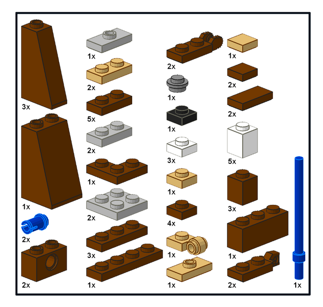
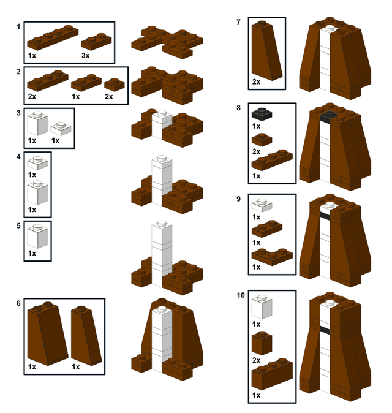
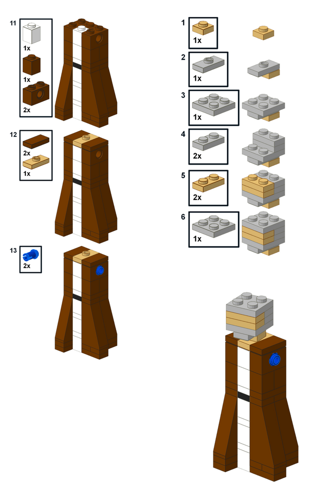
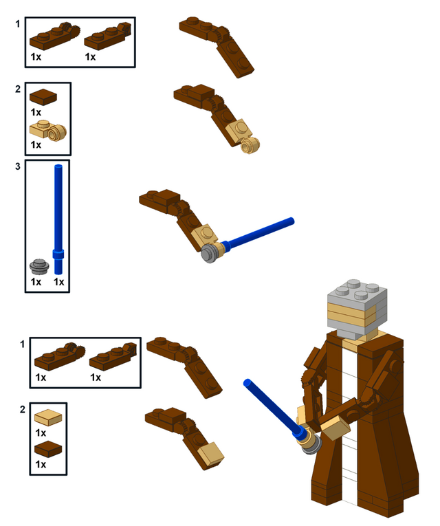

Les constructions qui vous sont proposées ici sont recréées à partir de modèles présentés dans les parcs LEGOLAND ou les LEGO Stores. Elles sont notamment adaptées pour être plus solides et en utilisant des pièces abordables et non modifiées.

Le personnage que nous vous proposons de construire aujourd’hui est le Obi-Wan de l’épisode IV de la saga Star Wars. C’est un Obi-Wan agé, surnommé "le vieux Ben" par Luke Skywalker, incarné à l’écran par Alec Guiness.

Le personnage mesure un peu moins de 9 plaques (8,3cm) pour 56 pièces qui vous coûteront environ 6 euros. C’est un personnage un peu petit - nous mettrons cela sur le compte de l’âge.

Ce qui est intéressant avec ce personnage, c’est qu’en lieu et place de jambes, il est construit sur des briques pentues de grandes tailles pour simuler les manteaux amples et les capes Jedi.

La tête est un design on ne peut plus classique. Barbe et cheveux court.

Les bras utilisent des plaques charnières à clic et c’est peut être là que vous aurez le plus de difficultés à reproduire le personnage. En effet la [plaque hinge avec un doigt](http://alpha.bricklink.com/pages/clone/catalogitem.page?P=44301#T=C), en marron, n’apparaît que dans trois sets plutôt confidentiels.

Pour finir, le vieux Ben utilise un sabre laser bleu. Mais la barre 6.6L bleue est d’une rareté telle qu’il est peut probable que vous la possédiez ou que vous souhaitiez l’acheter (plus de 10 euros !). Toutefois d’autres couleurs sont disponibles (comme le Pearl Gold très courant en version 6L qui peux faire un bel effet). La Bar 3L, quant à elle, est vraiment trop courte à cette échelle même si elle est disponible dans un très joli bleu transparent.

Et voilà un Obi-Wan Kenobi prêt à en découdre. Il ne restera donc plus qu’à lui trouver un adversaire pour un duel au sabre laser !
