## Les trains de la LGV

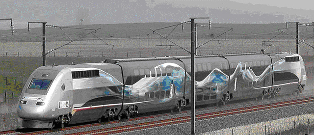

Cet article se propose de présenter tous les trains officiels ou proto qui ont roulé et sont classés sur la LGV.

Chaque train est présenté une seule fois avec son meilleur temps supérieur à 10 Km/h.

## Les officiels

* * *

**27,47 Km/h - AGV Italo** - _DanSto_

Fanabrique 2015

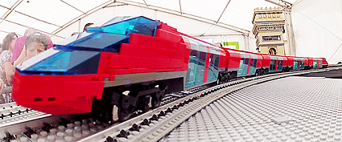

* * *

**25,59 Km/h - LEGO 7897** -

Saint Rambert 2009

* * *

**25,07 Km/h - LEGO 4511** - _cdhd_

BrickExpo Diemoz 2013

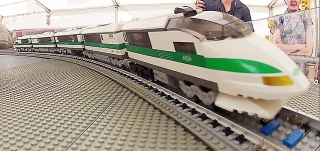

* * *

**21,77 Km/h -LEGO 10233** - _Arnaud_

Fanabrique 2015

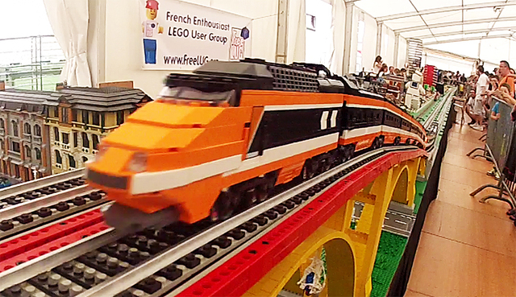

* * *

**21,25 Km/h - TGV Atlantique** - _Brikolego_

Fanabrique 2015

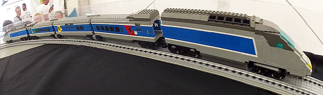

* * *

**21,13 Km/h - Shinkansen** - _DanSto_

Saint Rambert 2009

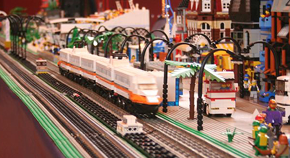

* * *

**20,42 Km/h - Thalys** - _DanSto_

Fanabriques 2010

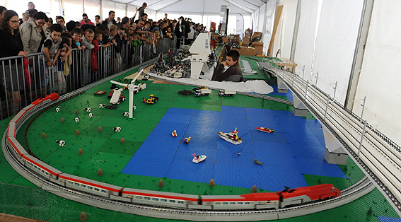

* * *

**19,87 Km/h - Thalys** - _Gerard S_

Fanabriques 2012

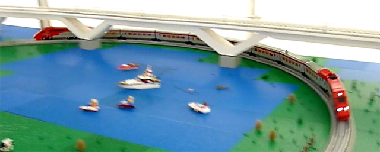

* * *

**19,31 Km/h - TGV 001** - _NICO_

Fanabriques 2008

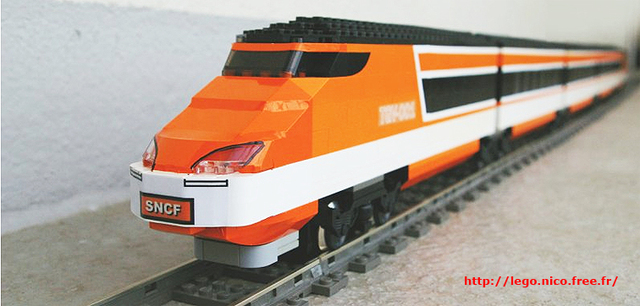

* * *

**19,19 Km/h - TGV La poste** - _Thierry_

Fanabriques 2008

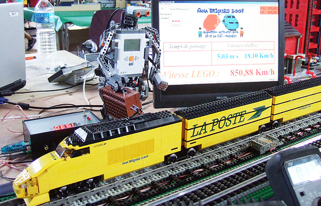

* * *

**18,81 Km/h - TGV Atlantique** - _Nicolas S_

Fanabriques 2008

* * *

**17,93 Km/h - TGV V150** - _NICO_

Fanabriques 2008

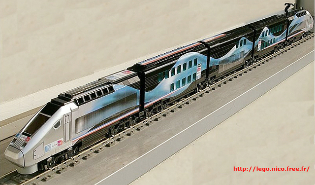

* * *

**17,45 Km/h - TGV HSBC** - _NICO_

Fanabriques 2008

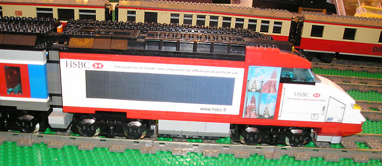

* * *

**15,76 Km/h - LEGO 60051**\-

Fanabriques 2015

* * *

## Les prototypes

* * *

**29,81 Km/h - Space train V1** - _Jac_

Saint Rambert 2009

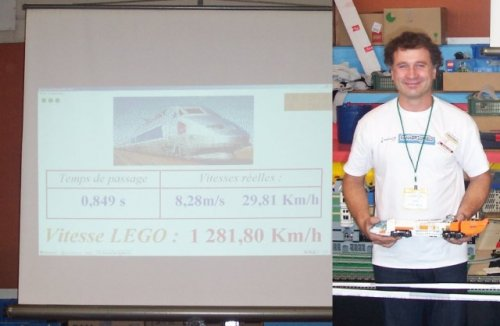

* * *

**29,68 Km/h - Proto Tono** -

Fanabriques 2015

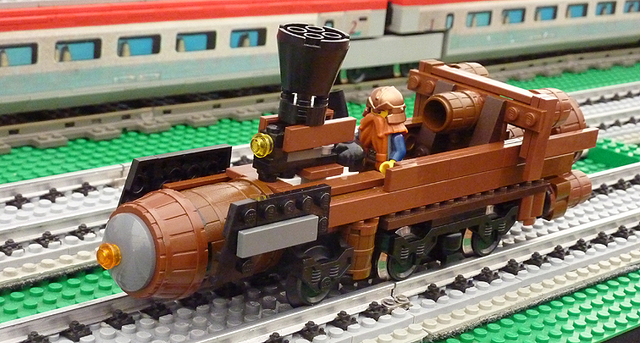

* * *

**29,35 Km/h - Proto noir ailée** - _DanSto_

Fanabrique 2012

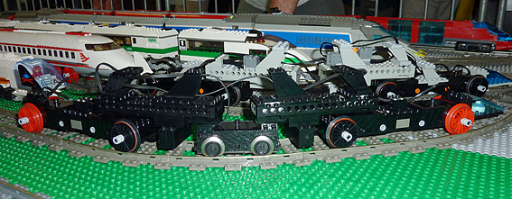

* * *

**29,19 Km/h - Plasmazator II** - _CDHD_

Rail-Expo 2014

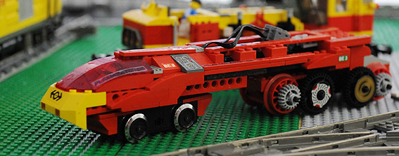

* * *

**28,85 Km/h - La flèche double** - _Jac_

Brick Expo Diemoz 2013

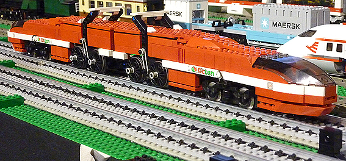

* * *

**27,91 Km/h - La flèche** -

Fanabriques 2011

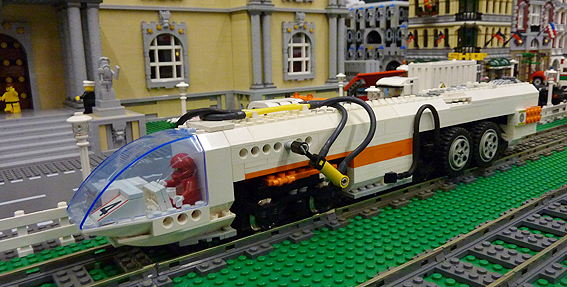

* * *

**27,17 Km/h - Bat Train** - _MilkBrick_

Rail-Expo 2014

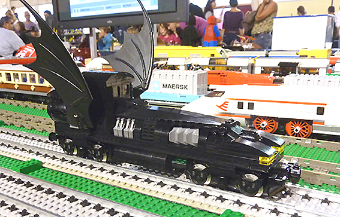

* * *

**26,99 Km/h - Supo3000** - _Pierrolego_

Fanabriques 2015

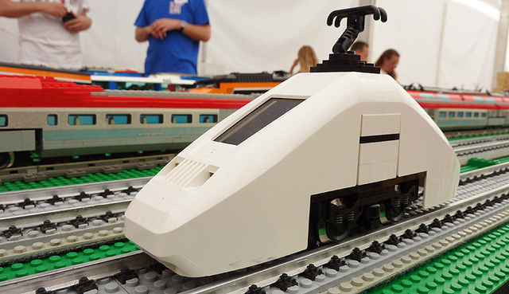

* * *

**26,94 Km/h - AGV-Proto1** - _DanSto_

Fanabriques 2015

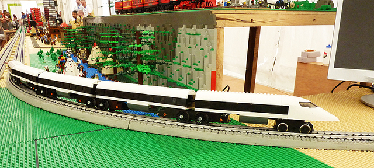

* * *

**26,42 Km/h - Fusée** - _PierroLego_

Rail-Expo 2014

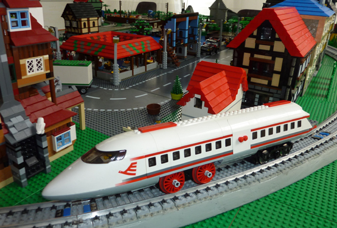

* * *

**25,76 Km/h - BuzzTrain** - _Yannick_

Rail-Expo 2014

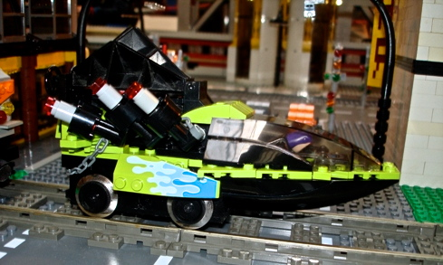

* * *

**22,05 Km/h - Gaston** - _MilkBrick_

Rail-Expo 2014

* * *

**19,74 Km/h - 1903 - Schnelltriebwagen** -

Fanabriques 2010

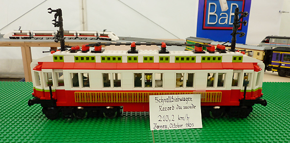

* * *

_18,19 Km/h - Pendolino_

Fanabriques 2015

* * *

**17.74 Km/h - BBR5** - _DanSto_

Fanabriques 2010

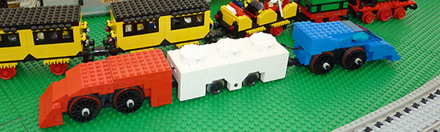

* * *

**16,70 Km/h - TurboJac** - _Jac_

Fanabriques 2011

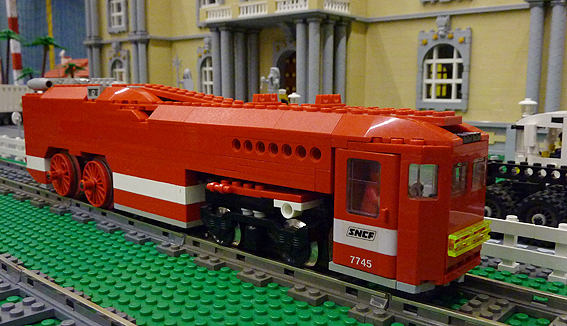

* * *

**16,21 Km/h - Zeppelin Berlin-Hambourg** -

Fanabriques 2010

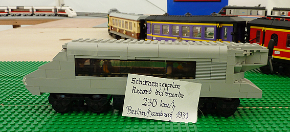

* * *

**14,00 Km/h - TramTaco** -

Brick-Expo Diemoz 2013

* * *

**13,77 Km/h - Plasmazator 1** - _cdhd_

Brick-Expo Diemoz 2013

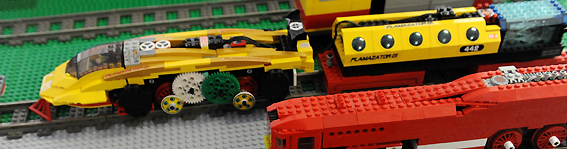

* * *

**— Km/h - truc ?** - _DanSto_

Fanabriques 2010

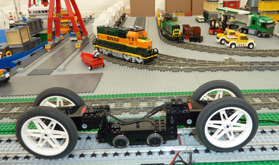

* * *

... et le vôtre prochainement ?

* * *

Articles connexes :

[Le record du monde de vitesse d’un train LEGO : 27,47 Km/h à Fanabriques 2015](http://www.freelug.org/spip.php?article2089)

[Règlement V4 : record du monde de vitesse d’un train LEGO](http://www.freelug.org/spip.php?article2091)
