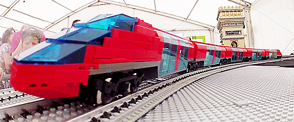
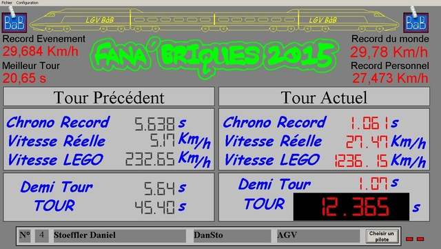
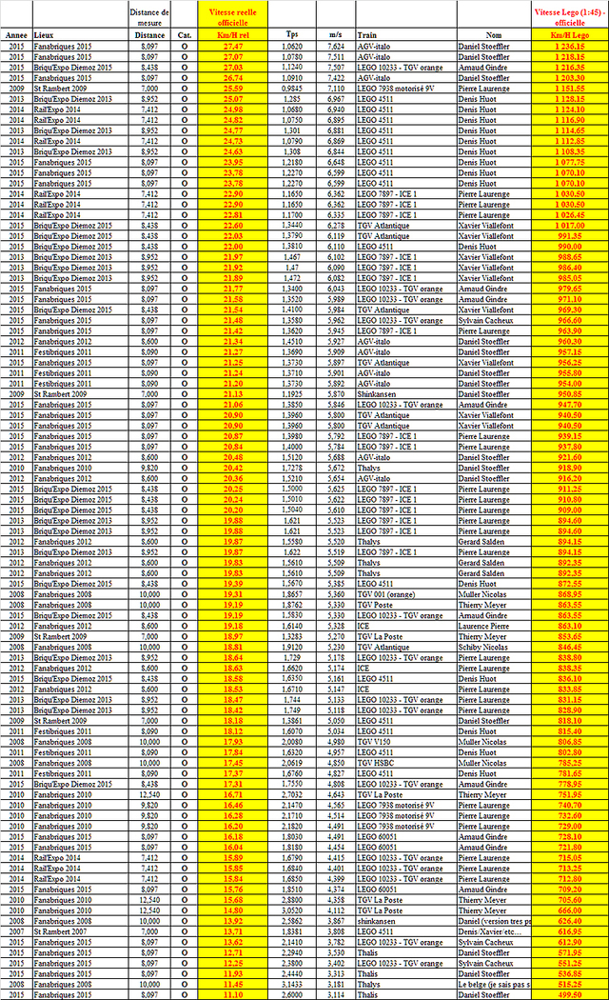
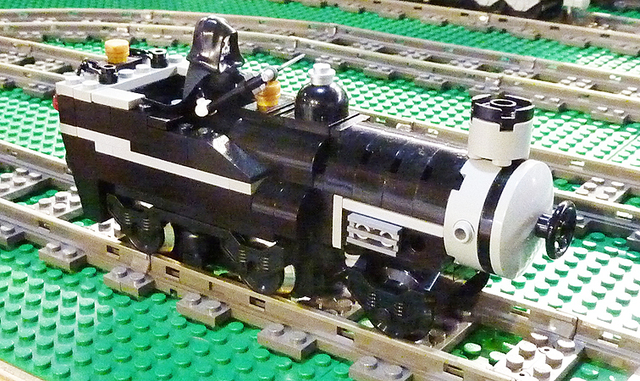
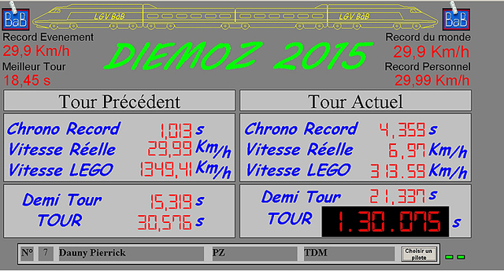
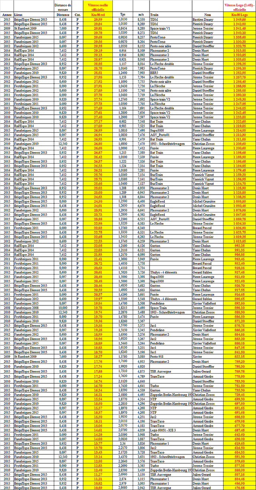

Après Briqu’Expo Diemoz 2015, voici une remise à jour des résultats officielles des tentatives de record de vitesse d’un train LEGO sur la LGV.

**Résultats**

Ces tableaux sont un récapitulatif des vitesses atteintes.  
Pour établir les tableaux de résultats officiels, il a été gardé un maximum de 3 chronos par manifestation/catégorie/train et supérieur à 10 km/h.

**Récapitulatif catégorie officielle**

Record actuel : 27,47 Km/h - nouveau record établi lors de Fanabriques 2015

**L’AGV Italo - nouveau record à 27,47 Km/h**

**Récapitulatif catégorie "proto"**

Record actuel : 29,99 Km/h - nouveau record établi lors de Briqu’Expo Diemoz 2015

\*-\*-\*-  
cdhd.

## Documents joints

-   **[ResultatProtoDiemoz2015.pdf](https://www.freelug.org/IMG/pdf/ResultatProtoDiemoz2015.pdf "Télécharger PDF - 3.8 Mio")**
    
    17 septembre 2015 \- PDF - 3.8 Mio
    
-   **[ResultatOfficielleDiemoz2015.pdf](https://www.freelug.org/IMG/pdf/ResultatOfficielleDiemoz2015.pdf "Télécharger PDF - 3.2 Mio")**
    
    17 septembre 2015 \- PDF - 3.2 Mio
