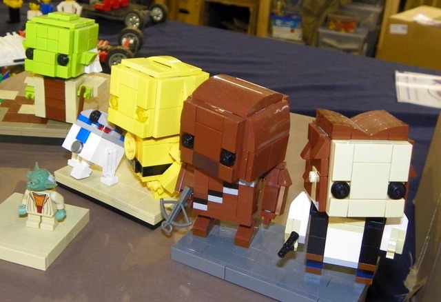
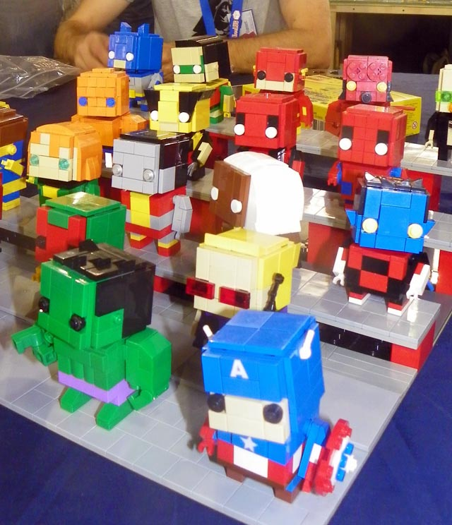
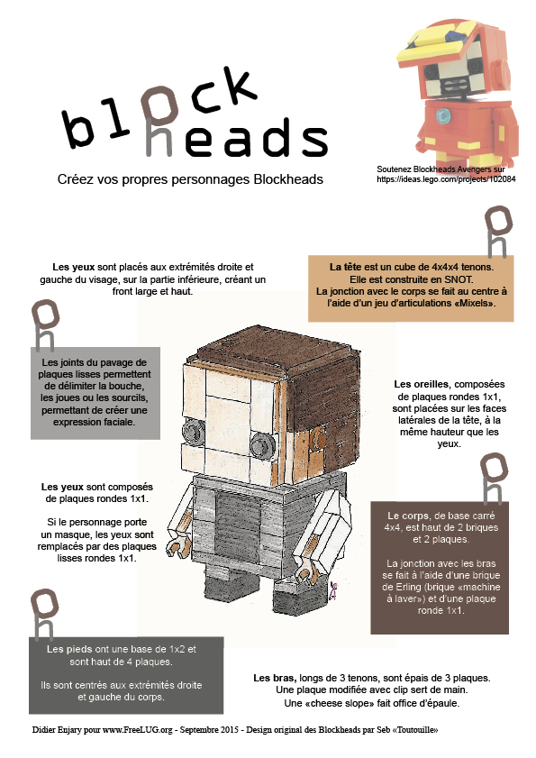
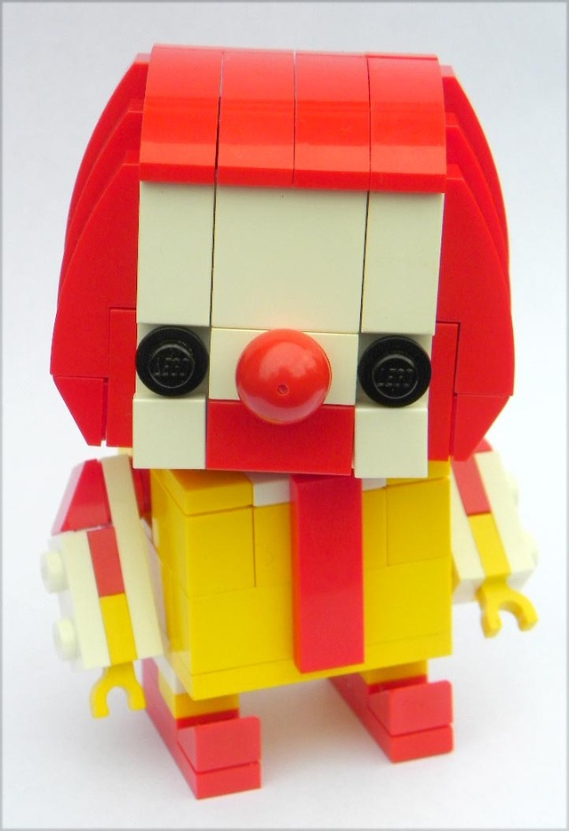

Retour sur les Blockheads présentés lors de la Briqu’Expo Diemoz.

Les Blockheads, présentés par Seb "Toutouille", est un concept de personnages à grosses têtes. Cette esthétique est familière des fans des figurines vinyles Funko POP ! et des mangas japonais présentant des personnages "Chibi" (version enfant de personnages adultes).

Les Blockheads StarWars - Yoda , R2-D2, C-3PO, Chewbacca et Han Solo.

Le concept est proche de celui de CubeDude d’Angus MacLane mais les personnages Blockheads sont articulés entre le corps et la tête ce qui permet de leur faire prendre des poses naturelles et non figées.

L’articulation employée est celle des Mixels, de type "towball and socket" (rotules) : un pièce avec une boule et une autre avec un réceptacle. Ce type de connexion est ancienne mais la version Mixel présente un frottement important permettant de figer une position.

Les articulations "Mixel" ([1](http://alpha.bricklink.com/pages/clone/catalogitem.page?P=14704&idColor=86#T=C&C=86),[2](http://alpha.bricklink.com/pages/clone/catalogitem.page?P=15456&idColor=86#T=C&C=86),[3](http://alpha.bricklink.com/pages/clone/catalogitem.page?P=14417&idColor=85#T=C&C=85)) sont montées au centre du personnage en montage SNOT, laissant entre le corps et la tête un espace d’environ une plaque d’épaisseur. Les techniques et pièces SNOT étant nombreuses il n’y a pas de solution unique pour ce montage. Vous pouvez vous reporter à [ce document](http://freelug.org/IMG/pdf/LivreTechniquesAvancees.pdf) (un peu ancien) pour vous familiariser avec les techniques SNOT.

La famille des Blockheads

Pour le reste, nous vous proposons donc aujourd’hui des lignes directrices pour construire votre propre personnage Blockheads. Ce sont des instructions générales vous permettant de vous rapprocher du "standard" tout en étant libre de l’adapter.

Si vous appréciez ces personnages et ce concept, vous pouvez voter sur [LEGO Ideas](https://ideas.lego.com/) pour découvrir et soutenir ["Blockheads Avengers"](https://ideas.lego.com/projects/102084)

Un nouveau venu dans la famille des Blockheads : Ronald McDonald

En savoir plus sur les Blockheads et leur créateur :

En anglais :  
[Glob of grease](http://eurobricksstarwarsforum.com/2015/09/23/you-disproportionate-glob-of-grease/),  
[Blocky stormtrooper](http://eurobricksstarwarsforum.com/2015/05/06/arent-you-a-little-blocky-for-a-stormtrooper/)

En français :  
[AFOL et Moceur 1](http://www.techartgeek.com/geek/afol-et-moceurs-1-seb-toutouille/),  
[AFOL et Moceur 2](http://www.techartgeek.com/geek/afol-et-moceurs-2-special-may-4th/)

## Documents joints

-   **[GuideLine.pdf](https://www.freelug.org/IMG/pdf/GuideLine.pdf "Télécharger PDF - 426 kio")**
    
    20 septembre 2015 \- PDF - 426 kio
