FreeLUG vous propose aujourd’hui la review du set 75902 - Mystery Machine de la nouvelle gamme LEGO ScoobyDoo.

Bonjour à tous, je vous propose aujourd’hui ma deuxième review, la Mystery Machine.

[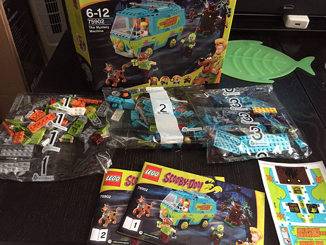](https://www.freelug.org/IMG/png/MM_Mini_01-2.png)

Voici le contenu de ce set, des sachets numérotés de 1 à 3, deux manuels d’instructions de montage et une planche d’autocollants assez conséquente.

[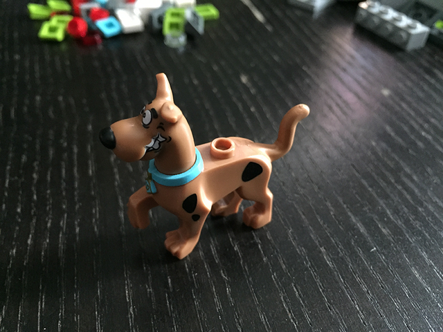](https://www.freelug.org/IMG/png/MM_Mini_02.png)

Dans le premier sachet on trouve ScoobyDoo (version debout et avec tête qui à peur).

[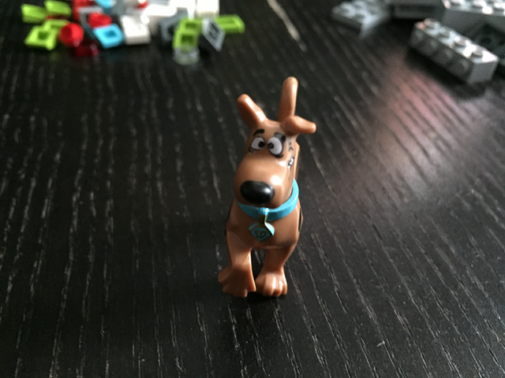](https://www.freelug.org/IMG/png/MM_Mini_03.png)

Le même de face.

[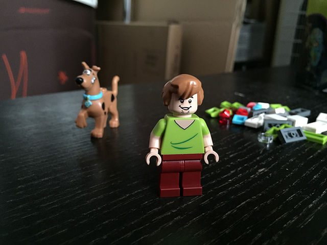](https://www.freelug.org/IMG/png/MM_Mini_04.png)

Et son comparse de toujours, Sammy (ici côté tête souriante). Niveau tampographie c’est le strict minimum, par contre on a droit à des bras bicolores.

[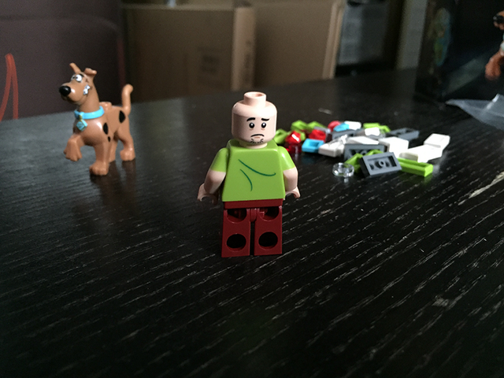](https://www.freelug.org/IMG/png/MM_Mini_05.png)

Sammy de dos avec sa tête alternative.

[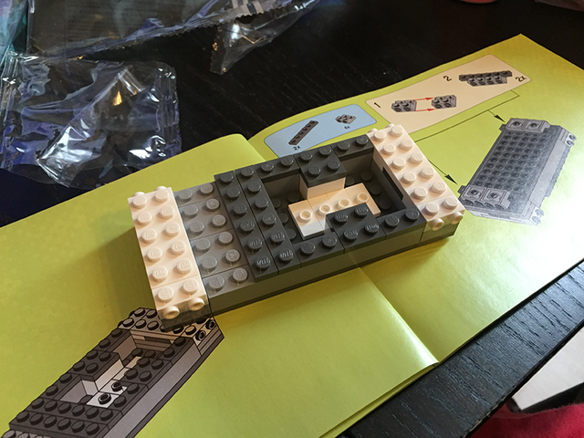](https://www.freelug.org/IMG/png/MM_Mini_07-2.png)

On commence la base de la Mystery Machine.

[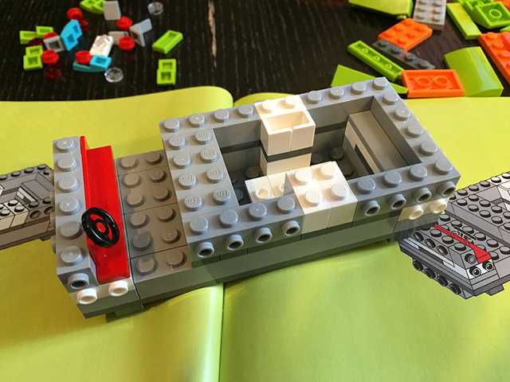](https://www.freelug.org/IMG/png/MM_Mini_08.png)

Déjà le volant est placé.

[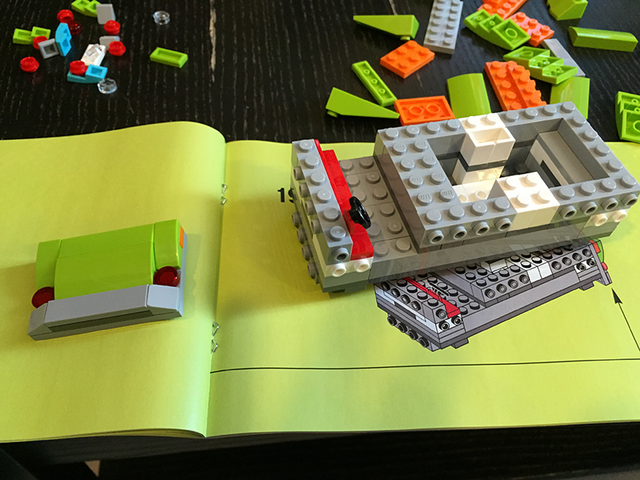](https://www.freelug.org/IMG/png/MM_Mini_09.png)

Le pare-choc arrière assemblé.

[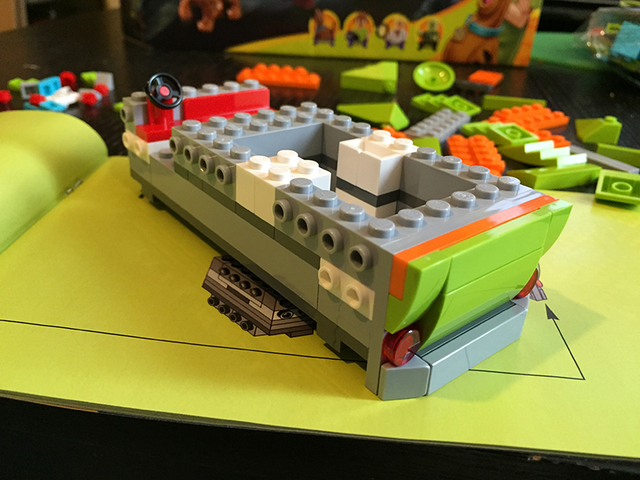](https://www.freelug.org/IMG/png/MM_Mini_10.png)

Et monté sur la Mystery Machine

[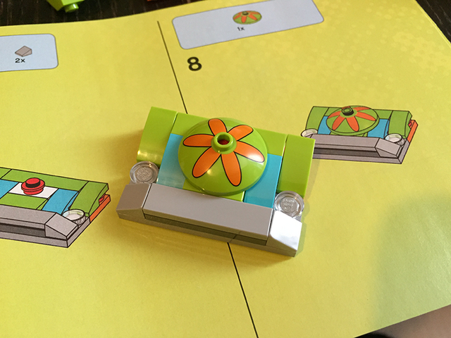](https://www.freelug.org/IMG/png/MM_Mini_11.png)

Au tour du pare-choc avant.

[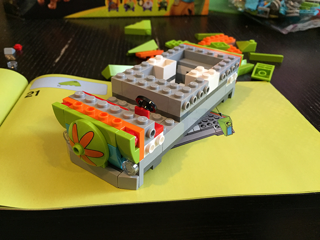](https://www.freelug.org/IMG/png/MM_Mini_12.png)

Monté lui aussi.

[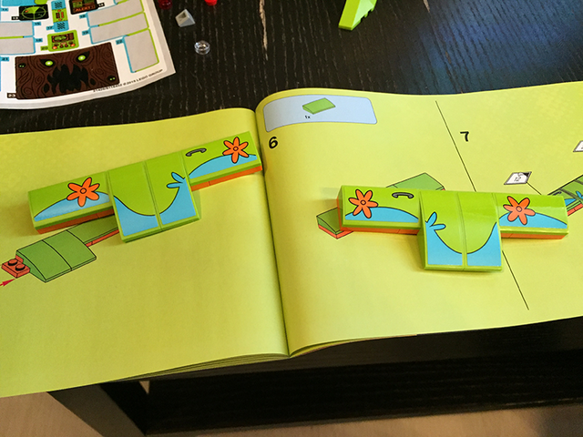](https://www.freelug.org/IMG/png/MM_Mini_13.png)

Les deux cotés avec de nombreux autocollants.

[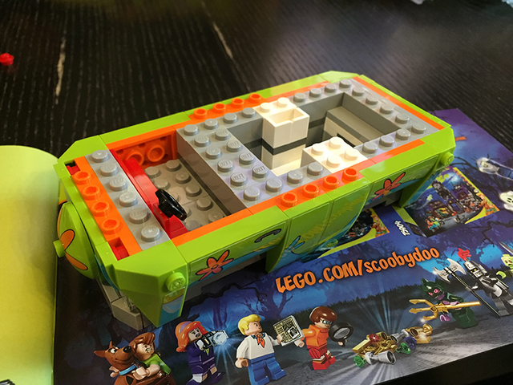](https://www.freelug.org/IMG/png/MM_Mini_14.png)

La mystery Machine prend forme peu à peu.

[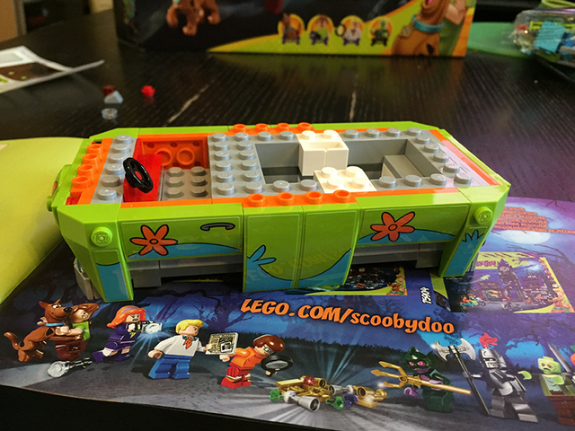](https://www.freelug.org/IMG/png/MM_Mini_15.png)

Sous un autre angle. Et nous sommes déjà à la fin du premier livret d’instructions.

[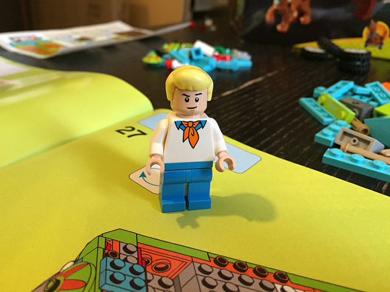](https://www.freelug.org/IMG/png/MM_Mini_16.png)

La minifigure de Fred, on reconnait bien son visage.

[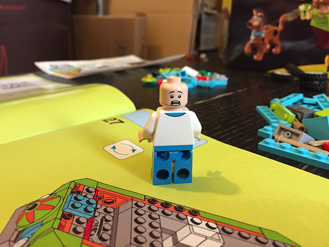](https://www.freelug.org/IMG/png/MM_Mini_17.png)

De dos avec le visage alternatif en mode effrayé.

[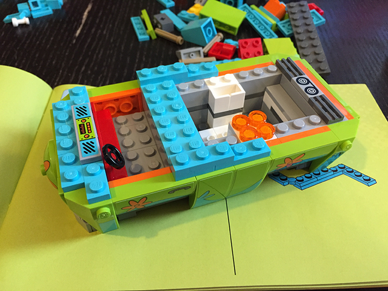](https://www.freelug.org/IMG/png/MM_Mini_18.png)

On continue la construction avec le haut et l’intérieur du véhicule. Vous remarquerez au passage la seule pièce (hors enjoliveurs) sérigraphiée, la bande du magnéto. Le tableau de bord étant pour sa part un autocollant

[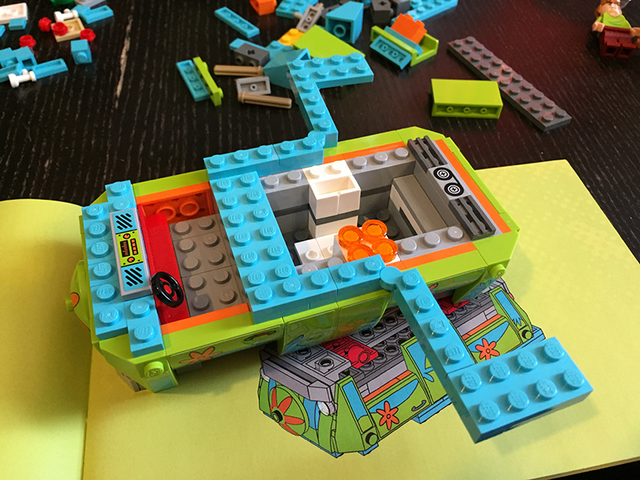](https://www.freelug.org/IMG/png/MM_Mini_19.png)

Installation du système de charnière permettant d’ouvrir l’arrière du van.

[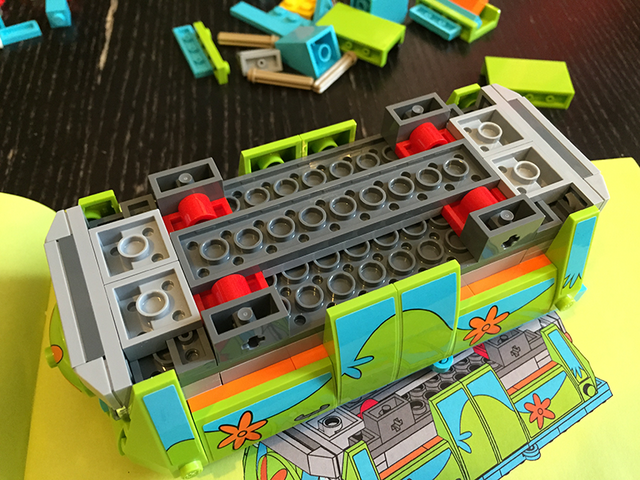](https://www.freelug.org/IMG/png/MM_Mini_20.png)

Montage des essieux.

[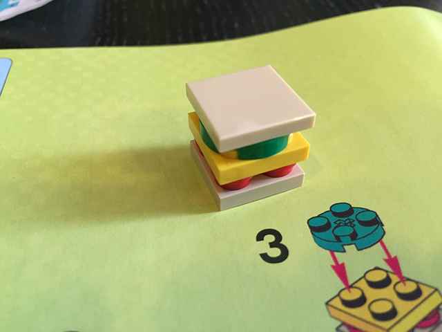](https://www.freelug.org/IMG/png/MM_Mini_21.png)

Oh ! Un sandwich ^^

[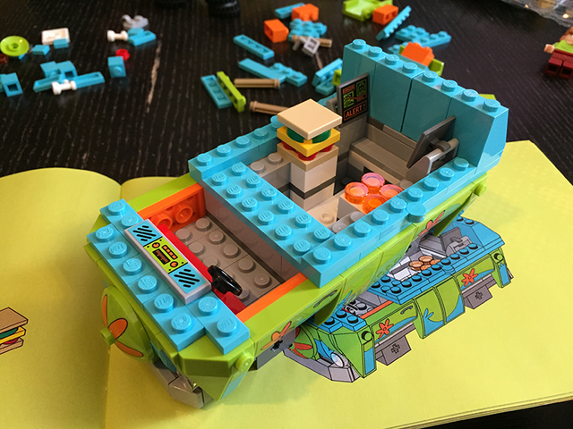](https://www.freelug.org/IMG/png/MM_Mini_22.png)

Les écrans de contrôle sont maintenant placés.

[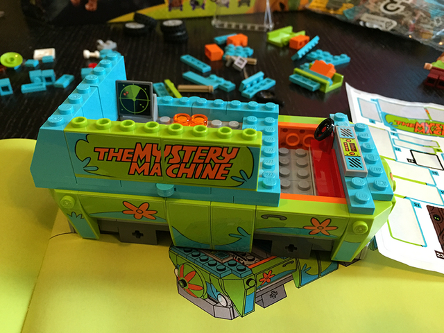](https://www.freelug.org/IMG/png/MM_Mini_23.png)

On monte les flans, et encore des p#@ !\*/° d’autocollants.

[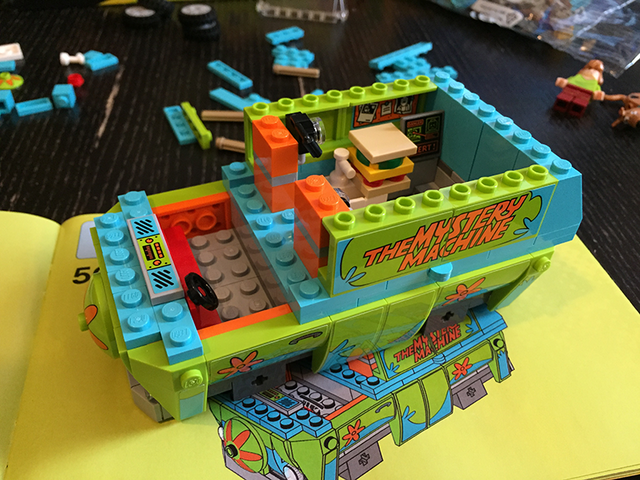](https://www.freelug.org/IMG/png/MM_Mini_24.png)

On reproduit à l’identique de l’autre côté.

[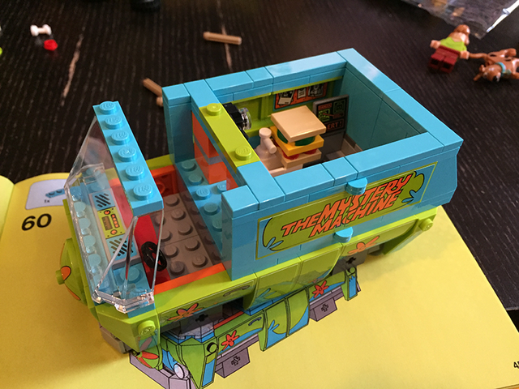](https://www.freelug.org/IMG/png/MM_Mini_26.png)

Ça prend forme.

[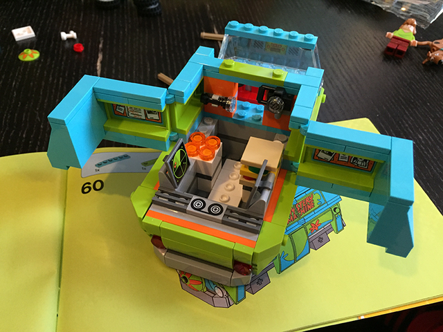](https://www.freelug.org/IMG/png/MM_Mini_27.png)

L’arrière ouvert.

[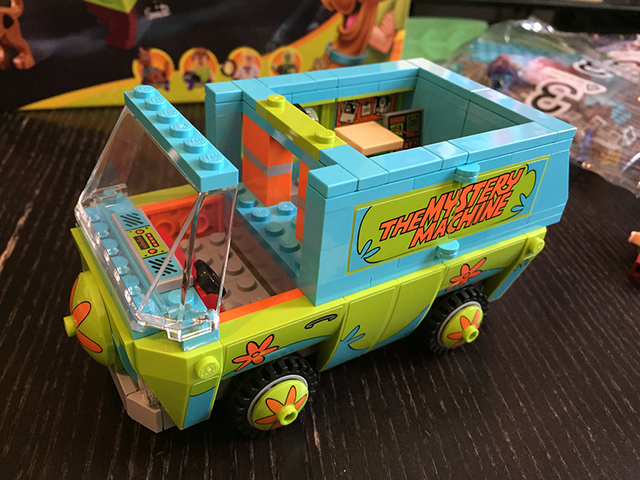](https://www.freelug.org/IMG/png/MM_Mini_28.png)

Les roues sont installées, avec les magnifiques enjoliveurs.

[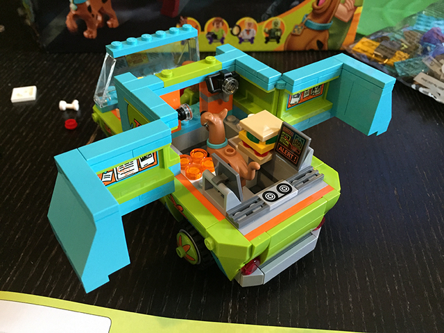](https://www.freelug.org/IMG/png/MM_Mini_29.png)

Ça y est Scooby a pris place.

[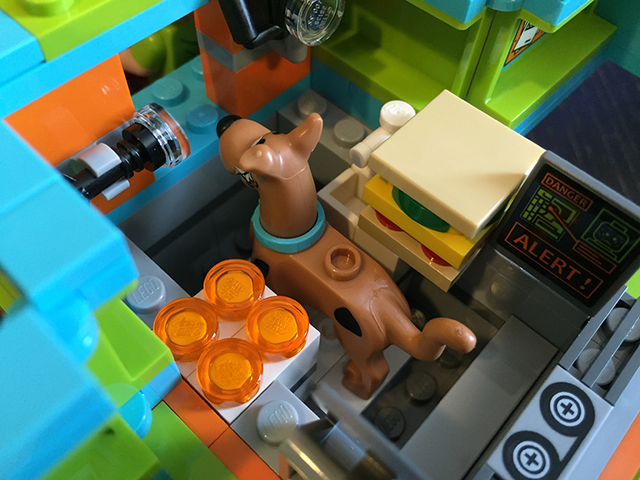](https://www.freelug.org/IMG/png/MM_Mini_30.png)

Gros plan sur l’intérieur.

[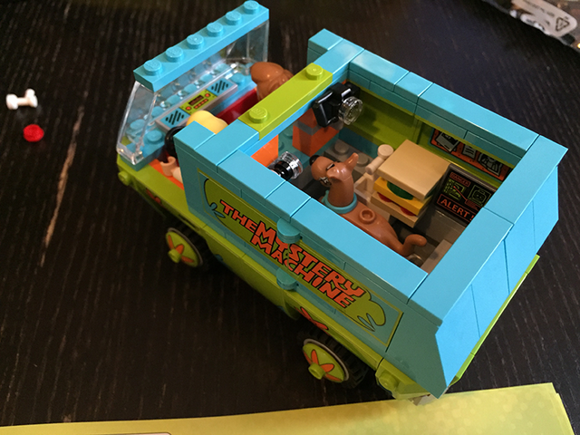](https://www.freelug.org/IMG/png/MM_Mini_31.png)

Allez, tout le monde embarque.

[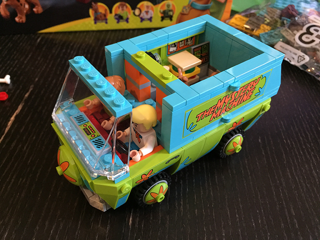](https://www.freelug.org/IMG/png/MM_Mini_32.png)

Vue d’un autre angle.

[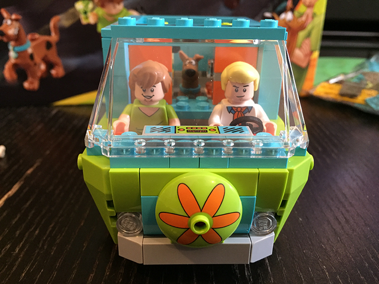](https://www.freelug.org/IMG/png/MM_Mini_33.png)

De face, il faut avouer que ça a de la gueule (même si le toit n’est pas encore construit).

[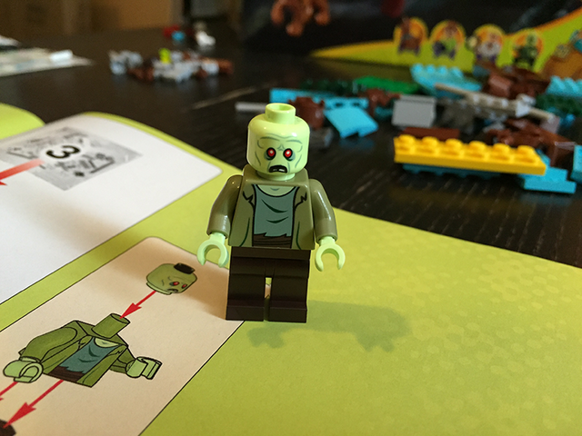](https://www.freelug.org/IMG/png/MM_Mini_34.png)

On arrive au troisième sachet et à la troisième minifigure de ce set, le zombie. J’adore sa tête.

[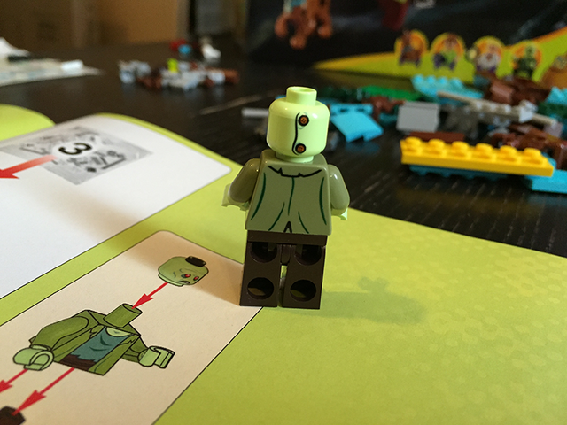](https://www.freelug.org/IMG/png/MM_Mini_35.png)

Le zombie de dos, avec le boutons pour maintenir le masque.

[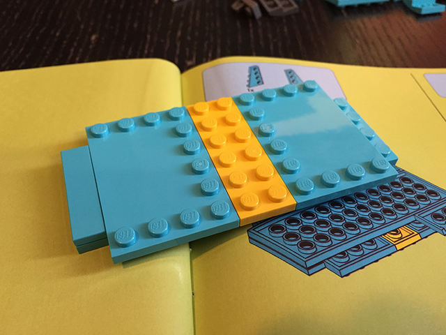](https://www.freelug.org/IMG/png/MM_Mini_36.png)

On commence à monter le toit de la Mystery Machine.

[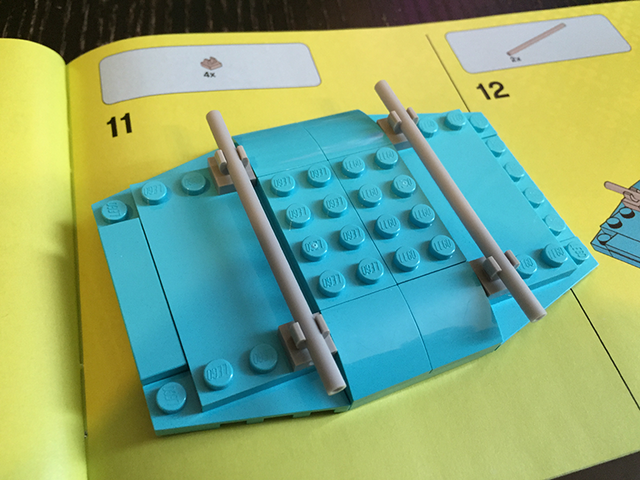](https://www.freelug.org/IMG/png/MM_Mini_38.png)

Et hop les barre de toit sont installées.

[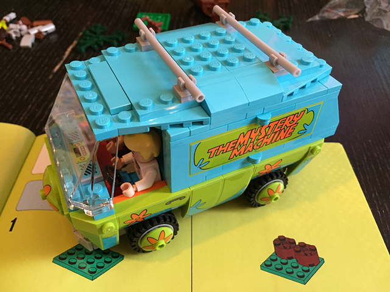](https://www.freelug.org/IMG/png/MM_Mini_39.png)

Enfin la Mystery Machine est complète.

[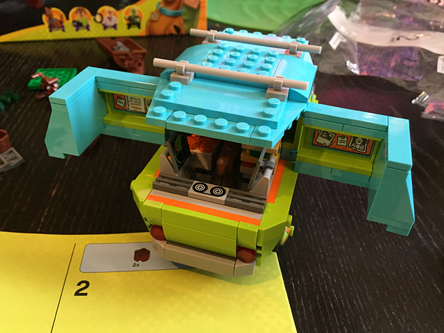](https://www.freelug.org/IMG/png/MM_Mini_40.png)

Vue de l’arrière avec les pans ouverts.

[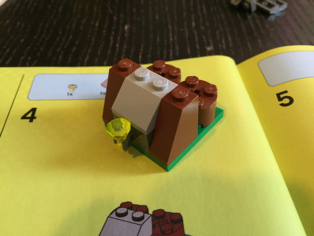](https://www.freelug.org/IMG/png/MM_Mini_41.png)

Début du montage de l’Épouvant’arbre

[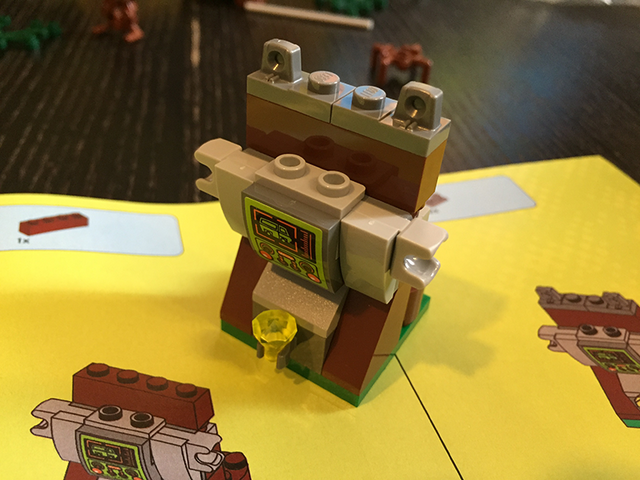](https://www.freelug.org/IMG/png/MM_Mini_42.png)

Mais c’est un automate, la preuve un écran de contrôle est monté dessus.

[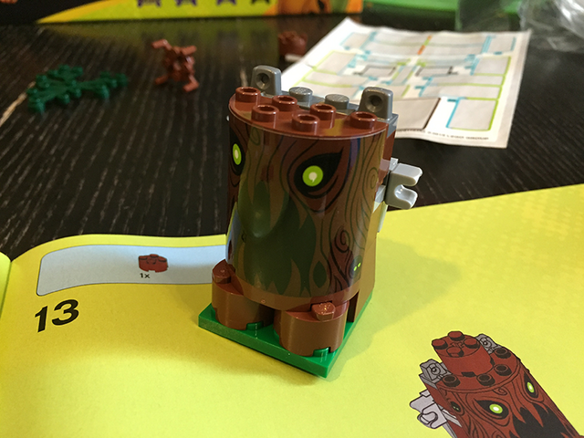](https://www.freelug.org/IMG/png/MM_Mini_43.png)

Encore un autocollant pour la tête de l’arbre...

[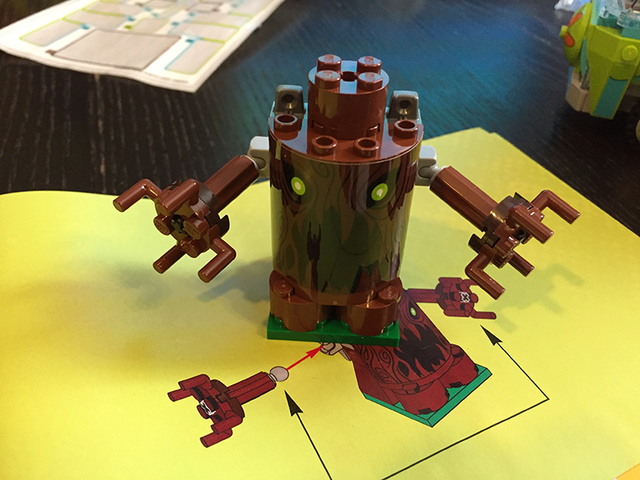](https://www.freelug.org/IMG/png/MM_Mini_44.png)

Les bras sont en place.

[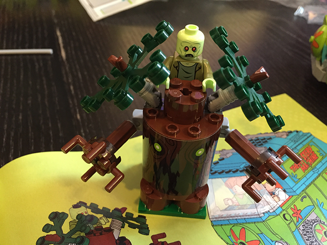](https://www.freelug.org/IMG/png/MM_Mini_45.png)

L’Épouvant’arbre est maintenant fini, le zombi prend place sur le marche-pied situé derrière.

[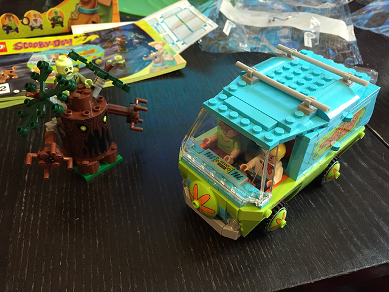](https://www.freelug.org/IMG/png/MM_Mini_46.png)

Et voilà le set au complet.

* * *

**Mon avis sur le 75902**

Très bon sentiment pour ce set emblématique, très sympa à construire. Le rendu final est vraiment top.

Mes deux seuls regrets sont les autocollants trop nombreux et l’étroitesse de la Mystery Machine (je doute de pouvoir y installer Vera et Daphné).  
A part ça, c’est un set first choice à posséder absolument.
