Je vous propose aujourd’hui ma review du set Architecture 21006, the White House (la baraque à Barack).

[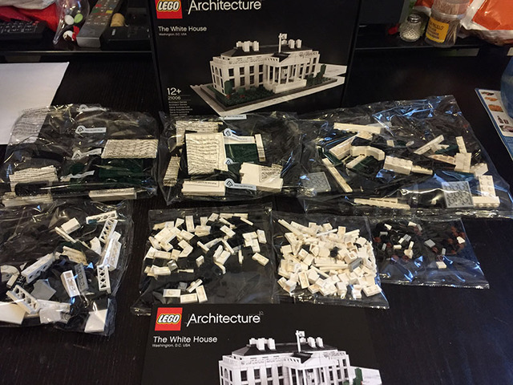](https://www.freelug.org/IMG/jpg/White_House_01_Mini.jpg)

La boite se compose de 7 sachets et du manuel de construction. Ce dernier est broché, comme pour tous les sets Architecture ou Ideas, et est agrémenté de photos et de commentaires.

[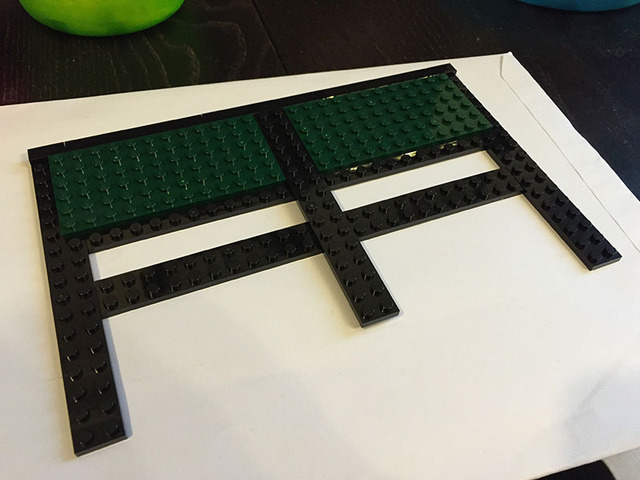](https://www.freelug.org/IMG/jpg/White_House_02_Mini.jpg)

On commence par le socle et on s’aperçoit tout de suite que cette White House sera d’une belle taille par rapport à une Big Ben ou un Empire State Building de la même gamme.

[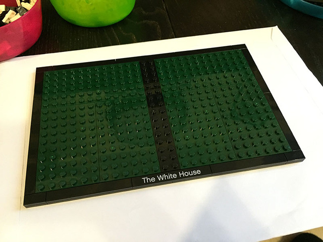](https://www.freelug.org/IMG/jpg/White_House_03_Mini.jpg)

Le socle terminé, avec sa tile sérigraphiée "The White House".

[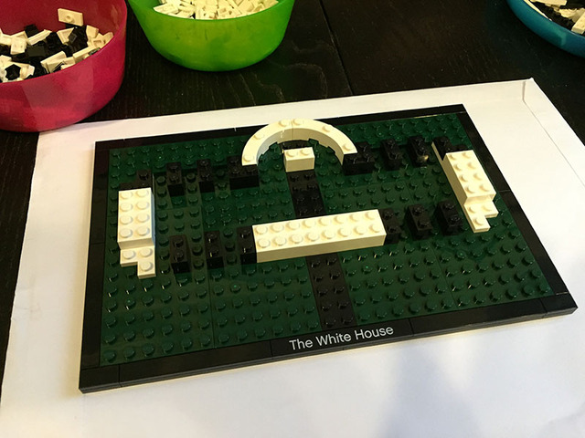](https://www.freelug.org/IMG/jpg/White_House_04_Mini.jpg)

On commence les fondations du bâtiment.

[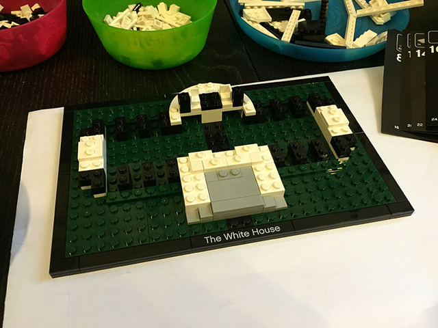](https://www.freelug.org/IMG/jpg/White_House_05_Mini.jpg)

On devine maintenant le perron et le bureau Ovale à l’arrière du bâtiment.

[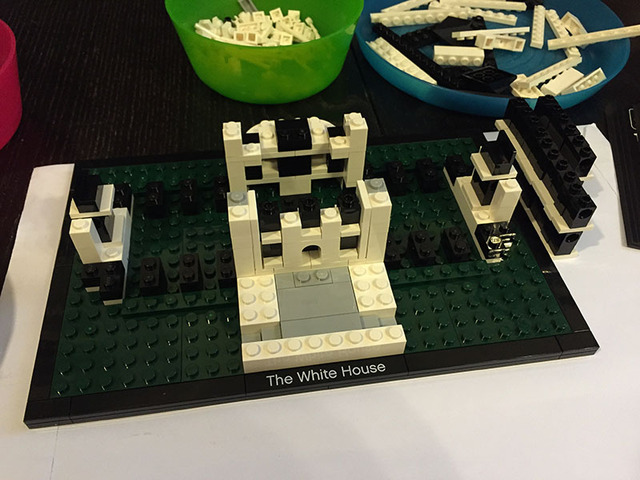](https://www.freelug.org/IMG/jpg/White_House_06_Mini.jpg)

Les murs continuent de monter.

[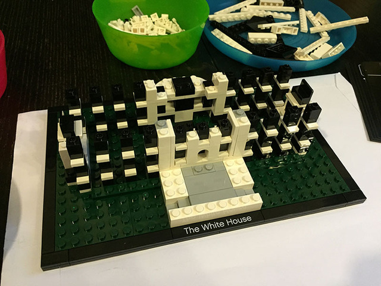](https://www.freelug.org/IMG/jpg/White_House_07_Mini.jpg)

Les futures fenêtres sont posées.

[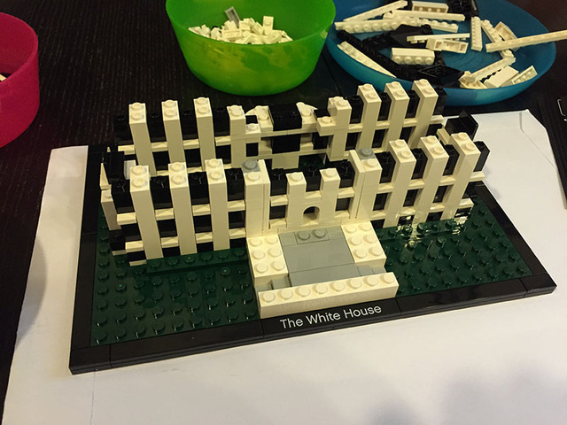](https://www.freelug.org/IMG/jpg/White_House_08_Mini.jpg)

Les façades avants et arrières prennent formes.

[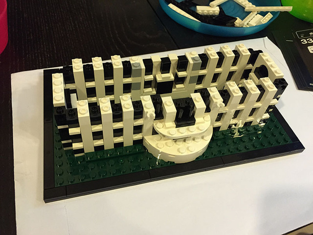](https://www.freelug.org/IMG/jpg/White_House_09_Mini.jpg)

On s’occupe maintenant de l’arrière et de son célèbre Bureau Ovale.

[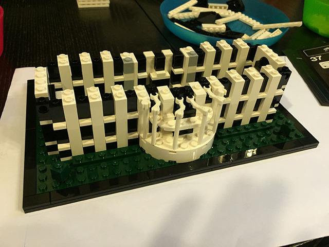](https://www.freelug.org/IMG/jpg/White_House_10_Mini.jpg)

Intéressante technique pour le montage des colonnes.

[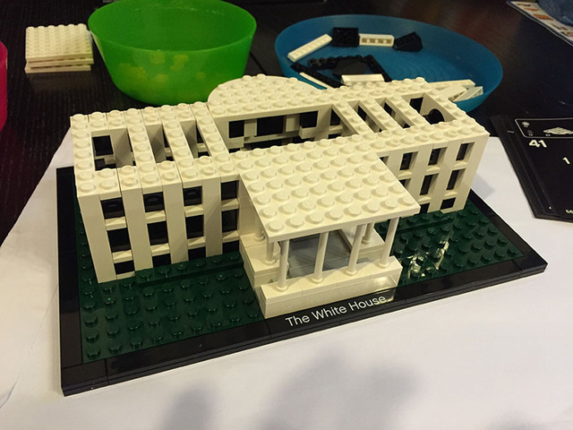](https://www.freelug.org/IMG/jpg/White_House_11_Mini.jpg)

Ça y est les façades sont terminées.

[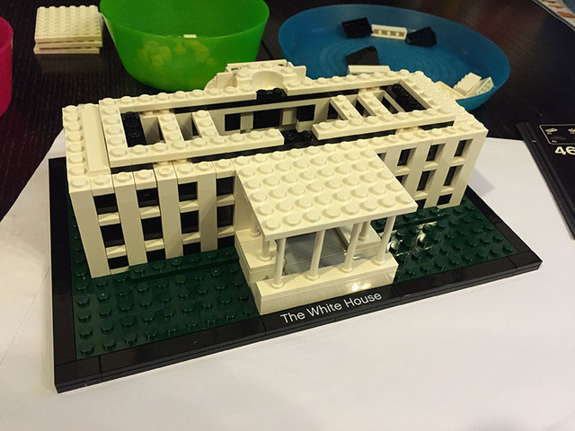](https://www.freelug.org/IMG/jpg/White_House_12_Mini.jpg)

Place à la charpente du toit.

[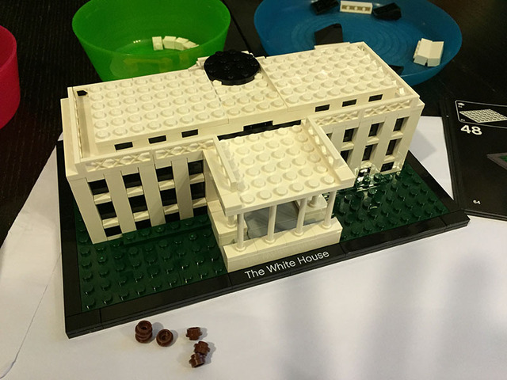](https://www.freelug.org/IMG/jpg/White_House_13_Mini.jpg)

Les plafonds sont maintenant en place.

[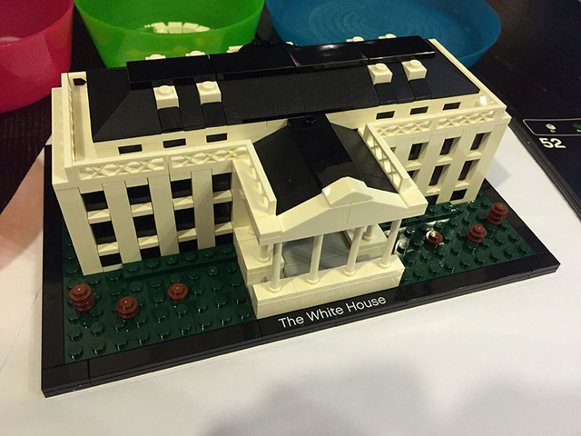](https://www.freelug.org/IMG/jpg/White_House_14_Mini.jpg)

Le toit et les troncs d’arbres sont montés.

[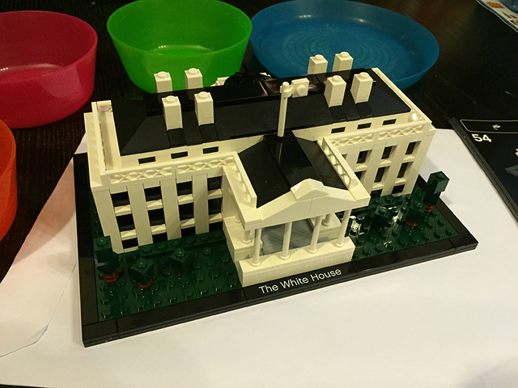](https://www.freelug.org/IMG/jpg/White_House_15_Mini.jpg)

Après les dernières briques posées, la White House est enfin finie.

[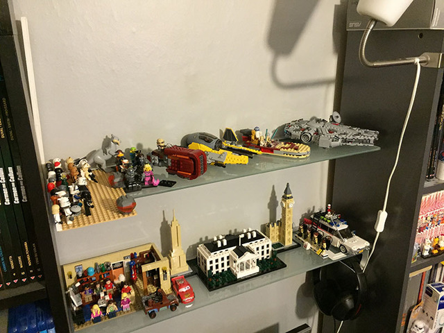](https://www.freelug.org/IMG/jpg/White_House_16_Mini.jpg)

La célèbre White House a trouvé sa place à côté de ses petits copains.
