Bonjour à tous, aujourd’hui je vous propose ma review du set Architecture 21023 - Flatiron Building.  
Ce set sorti en 2015 est composé de 471 pièces et coûte 39,99€, soit un ration prix/pièce de 8,5 centimes d’€.

[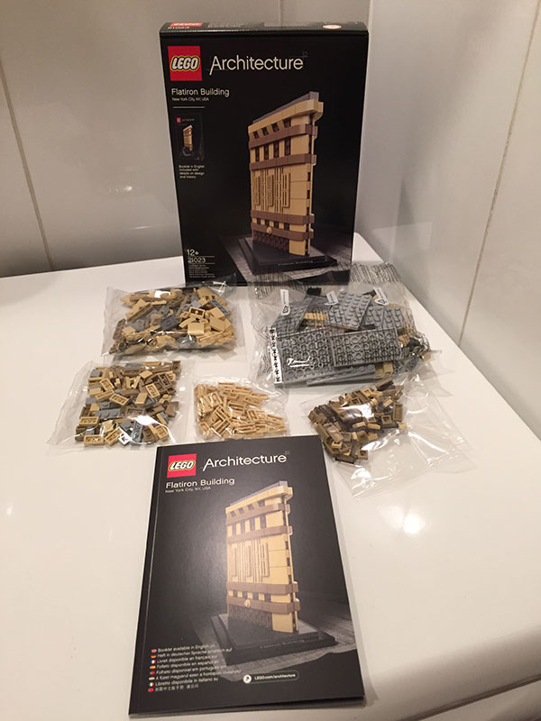](https://www.freelug.org/IMG/jpg/Flatiron_01_mini.jpg)

Le set se compose de cinq sachets, la présentation de la boite et du fascicule de montage est toujours aussi soignée avec ce code couleur noir.

[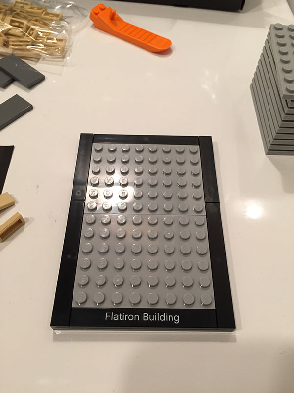](https://www.freelug.org/IMG/jpg/Flatiron_02_mini.jpg)

On commence, comme pour tous les sets Architecture, par monter la base entourée de tiles. Signature de cette gamme la tile sérigraphiée au nom du bâtiment, ici "**Flatiron Building**".

[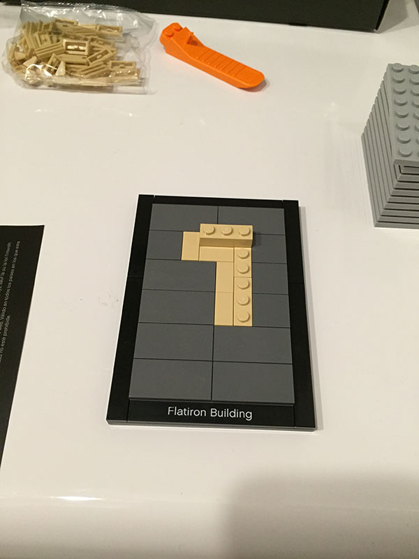](https://www.freelug.org/IMG/jpg/Flatiron_03_mini.jpg)

On place les tiles du sol et les premières briques qui compose l’ossature du Flatiron.

[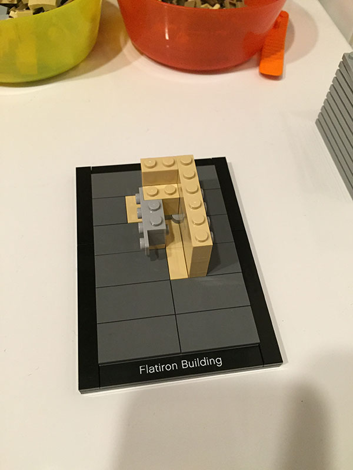](https://www.freelug.org/IMG/jpg/Flatiron_04_mini.jpg)

On voit ici les premières briques qui permettront de fixer les façades.

[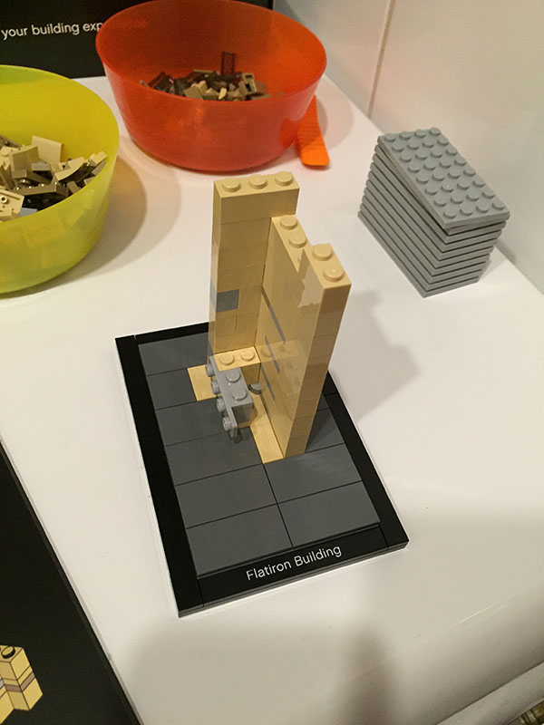](https://www.freelug.org/IMG/jpg/Flatiron_06_mini.jpg)

On monte d’abord les deux murs qui resteront à angle droit (sud et ouest).

[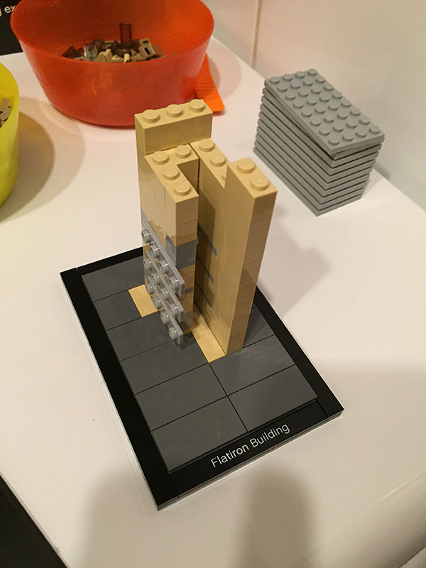](https://www.freelug.org/IMG/jpg/Flatiron_07_mini.jpg)

Ensuite le mur qui se rabattra (est).

[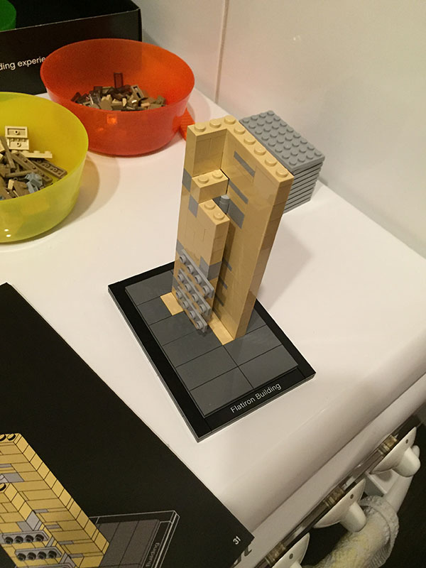](https://www.freelug.org/IMG/jpg/Flatiron_08_mini.jpg)

On peut voir ici le système qui permettra de rabattre le mur.

[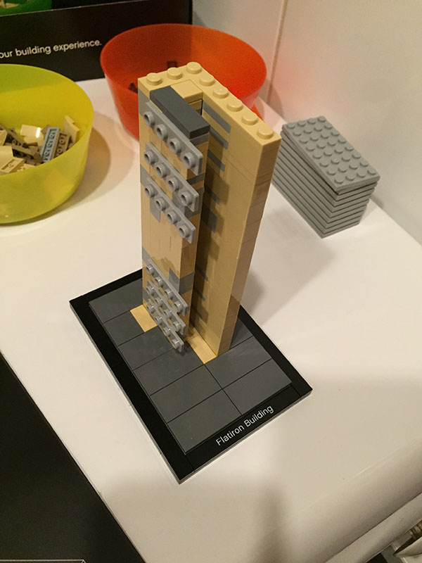](https://www.freelug.org/IMG/jpg/Flatiron_09_mini.jpg)

L’ossature est maintenant finie.

[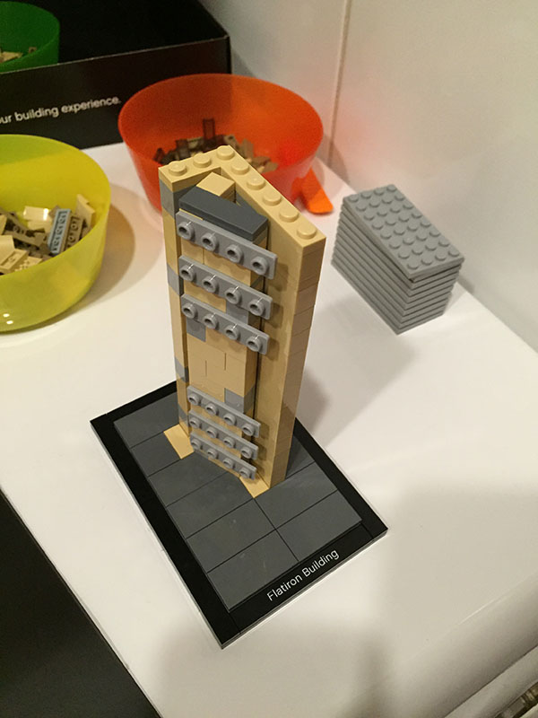](https://www.freelug.org/IMG/jpg/Flatiron_10_mini.jpg)

On rabat maintenant le mur est pour former le triangle. On voit bien le système qui permettra de maintenir les façades.

[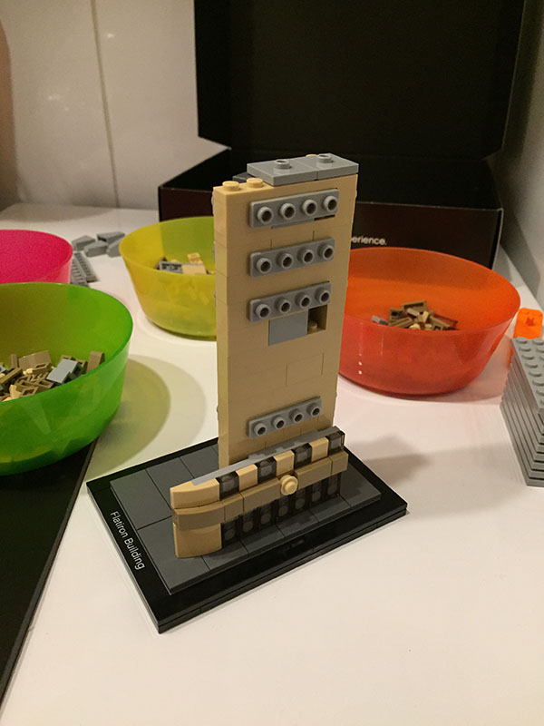](https://www.freelug.org/IMG/jpg/Flatiron_11_mini.jpg)

Voila la première pièce de la façade ouest posée sur l’ossature.

[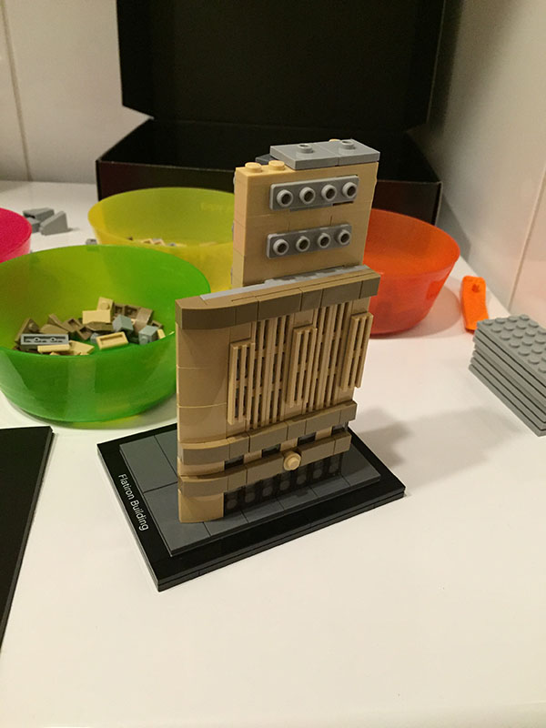](https://www.freelug.org/IMG/jpg/Flatiron_12_mini.jpg)

On continue de monter et on s’aperçoit que chaque façade est composée de trois panneaux.

[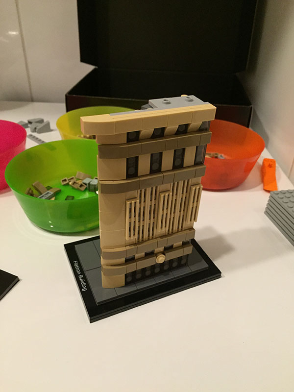](https://www.freelug.org/IMG/jpg/Flatiron_13_mini.jpg)

La façade ouest est maintenant finie.

[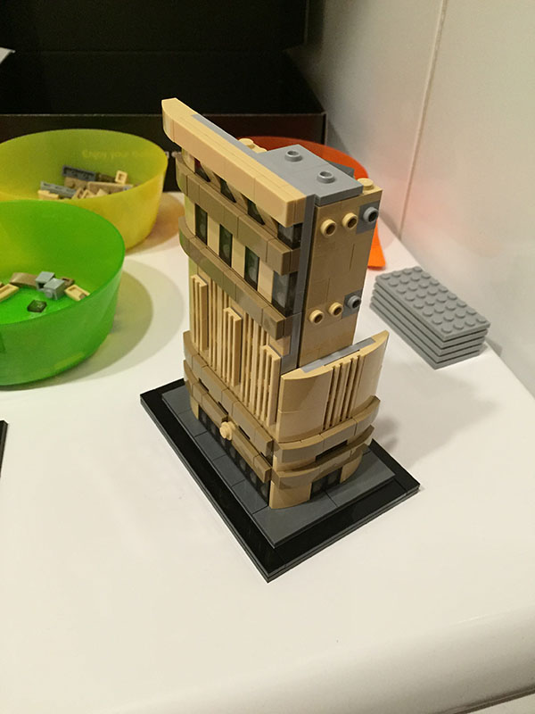](https://www.freelug.org/IMG/jpg/Flatiron_14_mini.jpg)

On attaque maintenant le montage de la façade sud à l’arrière du bâtiment. Elle est composée de deux panneaux.

[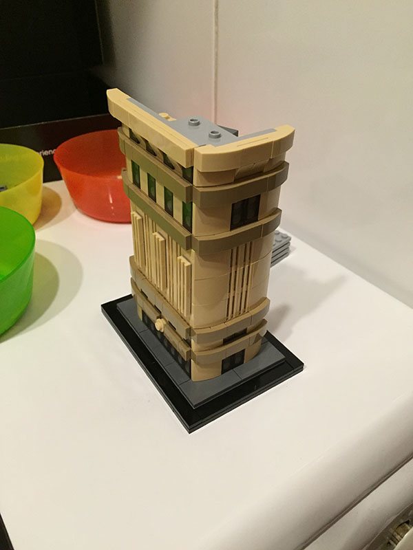](https://www.freelug.org/IMG/jpg/Flatiron_15_mini.jpg)

Deuxième panneau, la façade sud est maintenant terminée.

[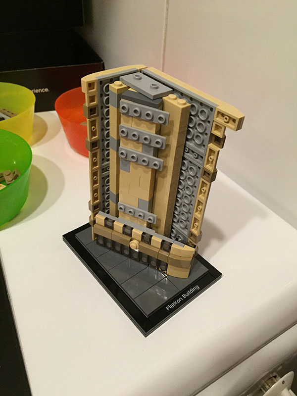](https://www.freelug.org/IMG/jpg/Flatiron_16_mini.jpg)

Au tour de la façade est.

[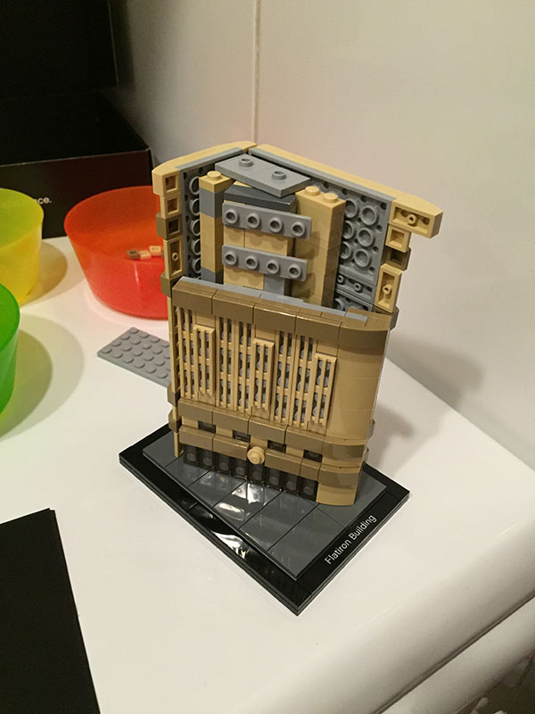](https://www.freelug.org/IMG/jpg/Flatiron_17_mini.jpg)

Deuxième panneau.

[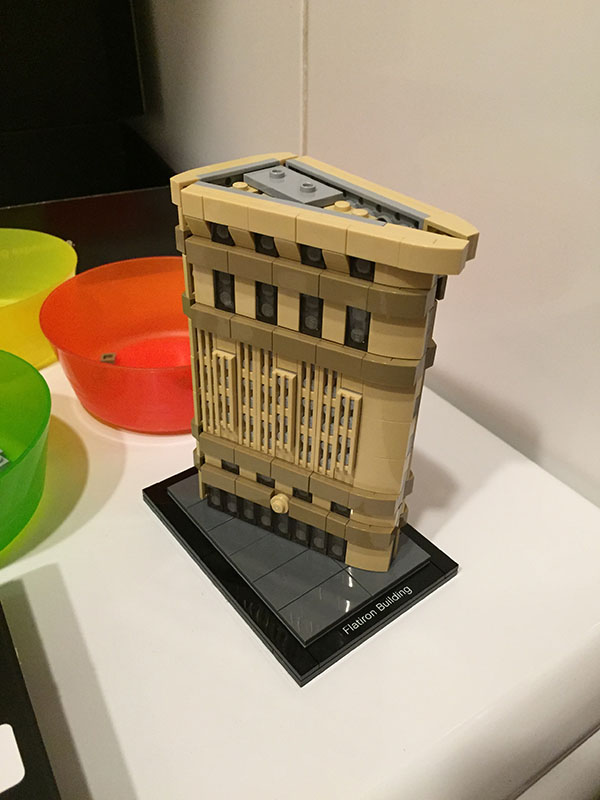](https://www.freelug.org/IMG/jpg/Flatiron_18_mini.jpg)

L’intégralité des façades sont posées, il ne reste plus que le toit à construire.

[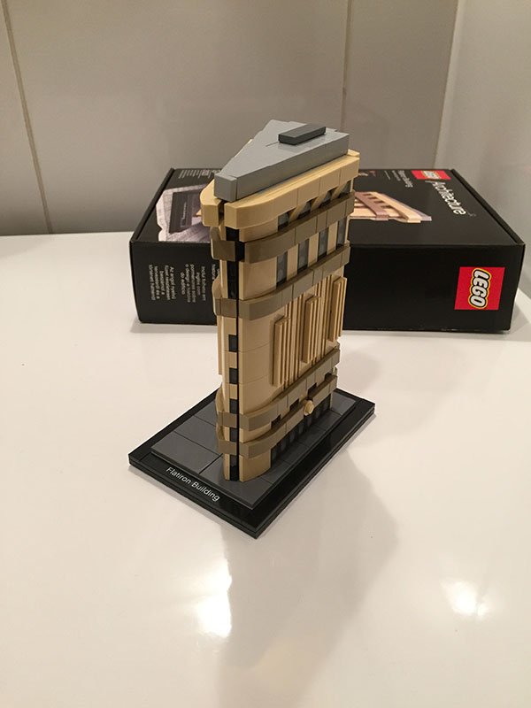](https://www.freelug.org/IMG/jpg/Flatiron_21_mini.jpg)

Vue de la façade ouest du Flatiron Building.

[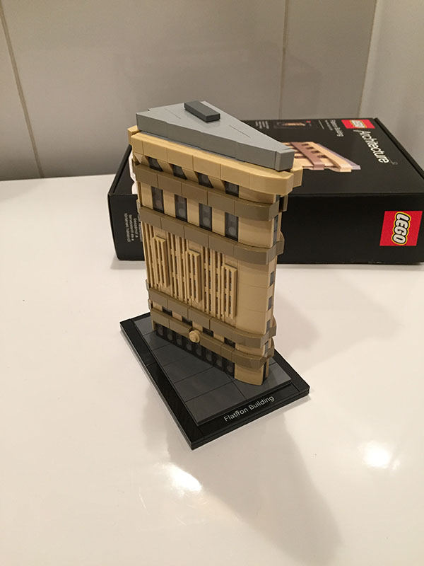](https://www.freelug.org/IMG/jpg/Flatiron_22_mini.jpg)

Vue de la façade est du Flatiron Building.

_BONUS : [voici un GIF animé réalisé avec les photos prises pour cette review](http://szl.kr/N2Y1O)_

* * *

**Avis :** Très bon set, le rendu final est vraiment beau. Seul bémol les techniques de construction ne sont transcendantes. Bien que, personnellement cela m’a permis d’apprendre comment faire des façades pour les bâtiments :)
