Aujourd’hui je vous propose la review du set 9491 dans la gamme Star Wars : Geonosian Cannon.  
Ce set sorti en septembre 2012 au prix de 26,99 € est composé de 132 pièces, soit un ratio prix/pièce de 20,4 centimes d’€.

[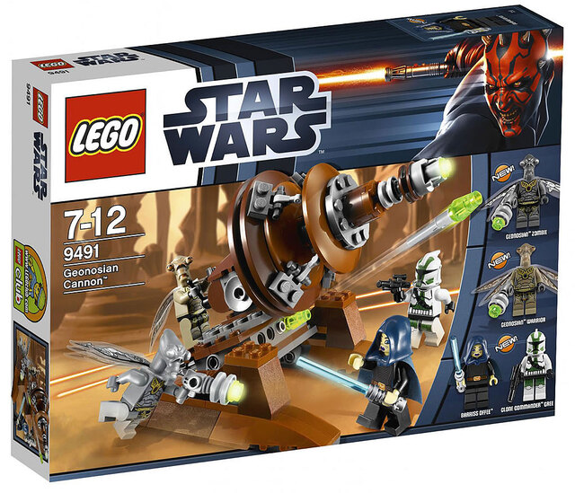](https://www.freelug.org/IMG/jpg/GEONOSIANCANNON-jpg_Box.jpg)

Le set Geonosian Cannon est composé de deux sachets, d’un livret d’instructions et d’une planche plastique prédécoupée contenant les ailes des deux minifigs Geonosiens.

[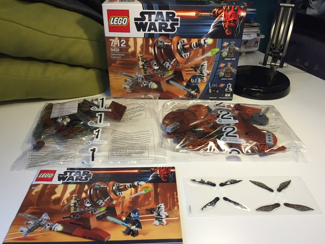](https://www.freelug.org/IMG/jpg/GeonosianCannon_01.jpg)

La minifig de la Chevalier Jedi Barriss Offee est vraiment réussie, même si elle n’est tampographiée que sur le torse. Elle aurait mérité de l’être aussi dans le dos ou au moins sur les jambes.  
Au niveau du visage la tampographie est là aussi parfaite.

[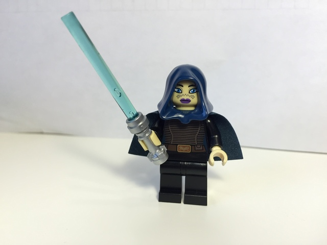](https://www.freelug.org/IMG/jpg/GeonosianCannon_02.jpg)

[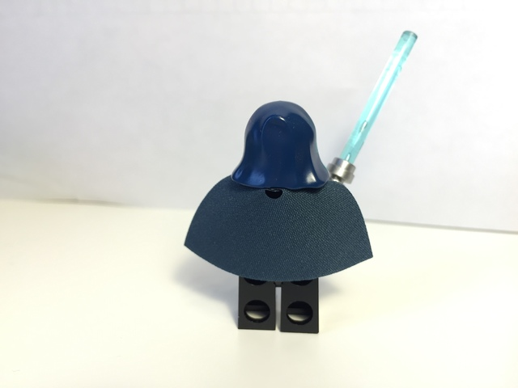](https://www.freelug.org/IMG/jpg/GeonosianCannon_03.jpg)

La minifig du Clone Commander Gree est une figurine exclusive à ce set (on la retrouve aussi dans un livre et dans un polybag) et elle est vraiment réussie. Tampographie recto-verso noire et verte pour le torse, sur les jambes et sur le casque, bref cette minifigure est une réussite.

[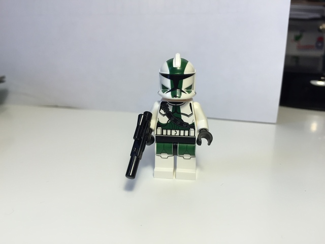](https://www.freelug.org/IMG/jpg/GeonosianCannon_04.jpg)

[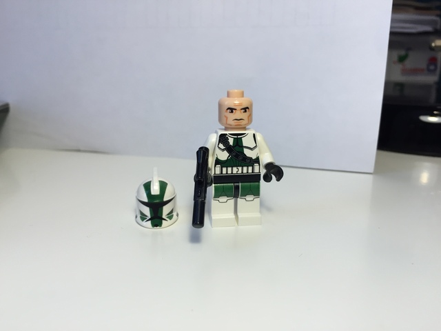](https://www.freelug.org/IMG/jpg/GeonosianCannon_06.jpg)

[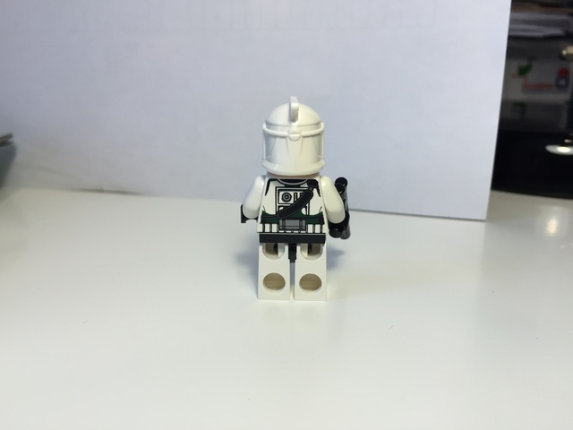](https://www.freelug.org/IMG/jpg/GeonosianCannon_05.jpg)

Le Geonosian Zombie est aussi une petite merveille de réalisation, notamment avec sa tampographie dorée

[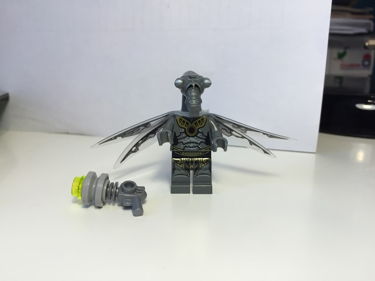](https://www.freelug.org/IMG/jpg/GeonosianCannon_07.jpg)

[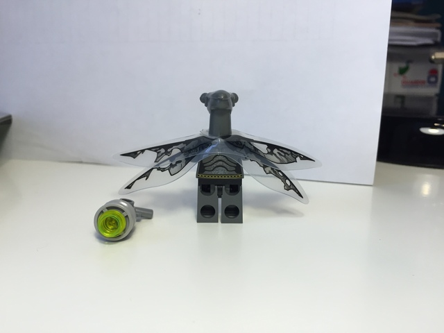](https://www.freelug.org/IMG/jpg/GeonosianCannon_08.jpg)

Le Geonosian Warrior se voit doté lui aussi une tampographie recto/verso du plus bel effet. Même si j’avoue avoir une préférence pour la version Zombie.

[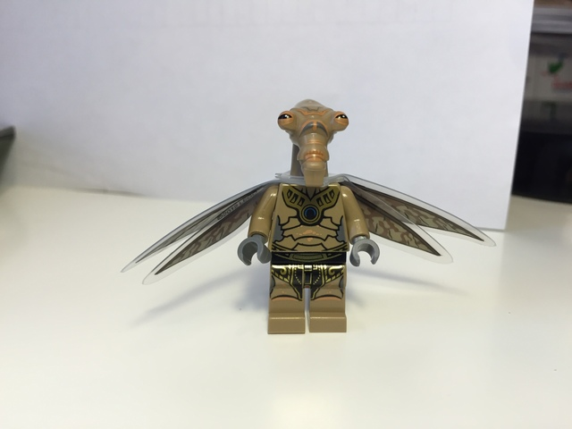](https://www.freelug.org/IMG/jpg/GeonosianCannon_09.jpg)

[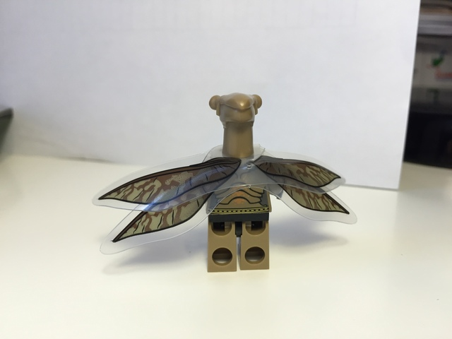](https://www.freelug.org/IMG/jpg/GeonosianCannon_10.jpg)

une fois les quatre figurines montées, on s’attelle au montage du canon avec le sachet 1.

[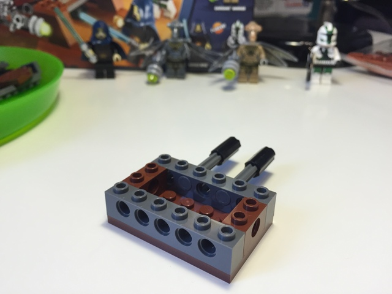](https://www.freelug.org/IMG/jpg/GeonosianCannon_11.jpg)

Une fois les deux "missiles clic" posés, on place la plateforme.

[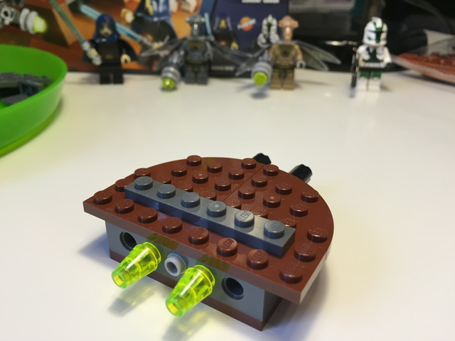](https://www.freelug.org/IMG/jpg/GeonosianCannon_12.jpg)

Puis le support de la base du canon.

[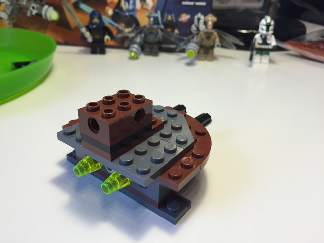](https://www.freelug.org/IMG/jpg/GeonosianCannon_14.jpg)

Quelques ornements.

[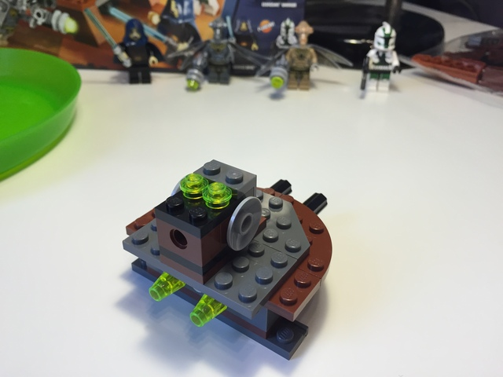](https://www.freelug.org/IMG/jpg/GeonosianCannon_15.jpg)

On finit le premier sachet en achevant le corps du canon et la pose des leviers de commande.

[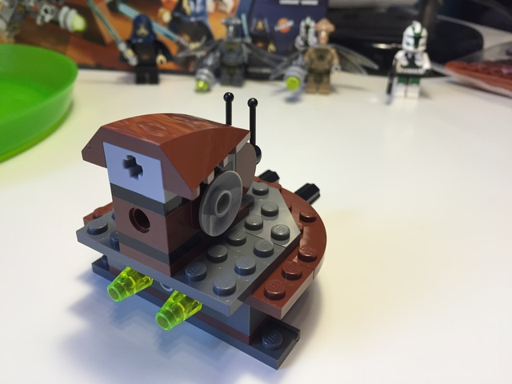](https://www.freelug.org/IMG/jpg/GeonosianCannon_16.jpg)

On commence le deuxième sachet en montant les pieds du canon.

[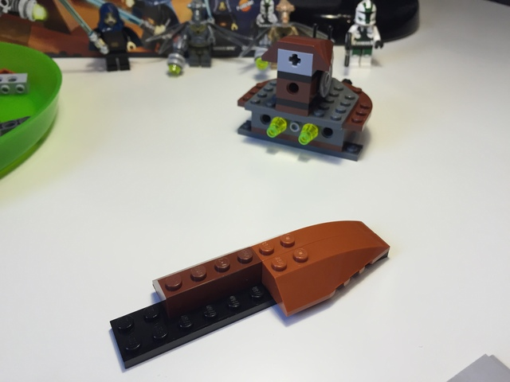](https://www.freelug.org/IMG/jpg/GeonosianCannon_17.jpg)

On poursuit le montage. Assez simple au passage.

[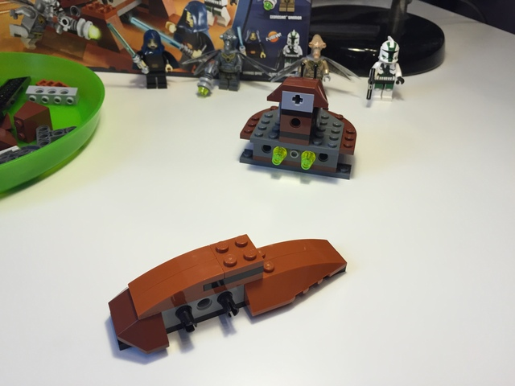](https://www.freelug.org/IMG/jpg/GeonosianCannon_19.jpg)

Voilà un des deux pieds finalisé.

[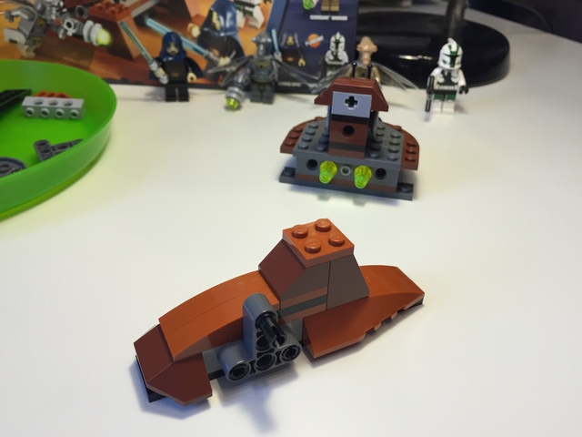](https://www.freelug.org/IMG/jpg/GeonosianCannon_20.jpg)

Et monté sur la plateforme du canon.

[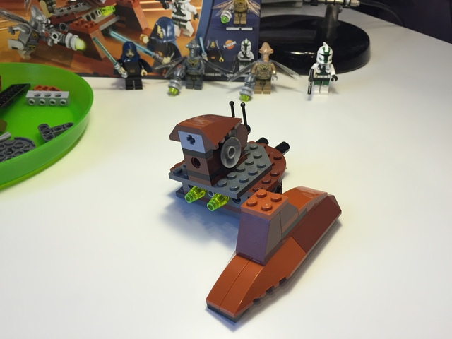](https://www.freelug.org/IMG/jpg/GeonosianCannon_21.jpg)

Le deuxième pied est en place.

[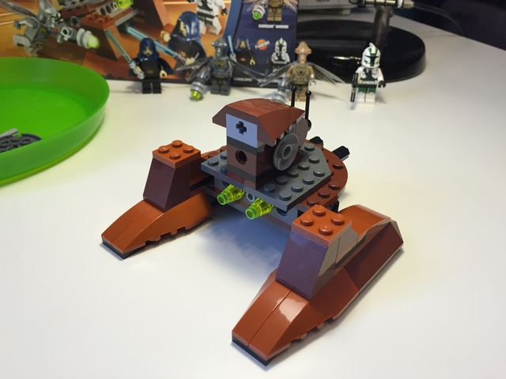](https://www.freelug.org/IMG/jpg/GeonosianCannon_22.jpg)

On s’attaque maintenant au canon en lui même.

[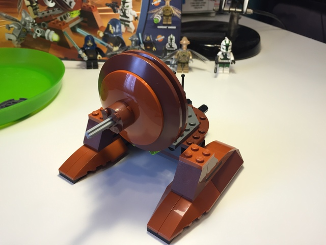](https://www.freelug.org/IMG/jpg/GeonosianCannon_23.jpg)

Ça prend forme.

[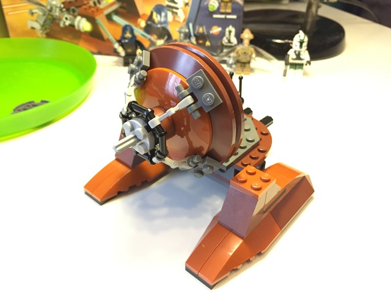](https://www.freelug.org/IMG/jpg/GeonosianCannon_24.jpg)

Voilà le canon finalisé

[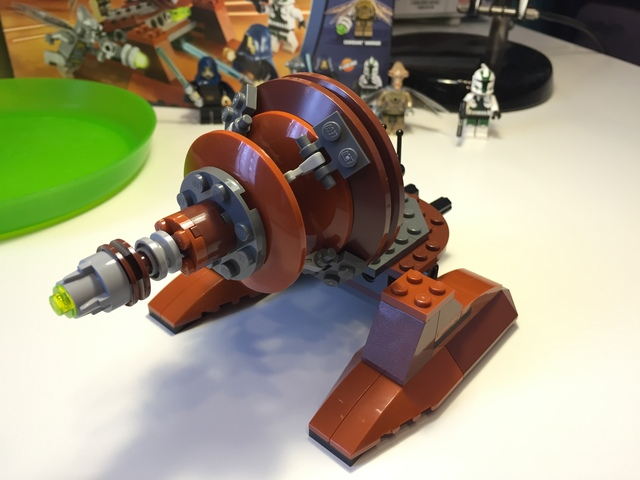](https://www.freelug.org/IMG/jpg/GeonosianCannon_26.jpg)

Et une petite mise en scène du set.

[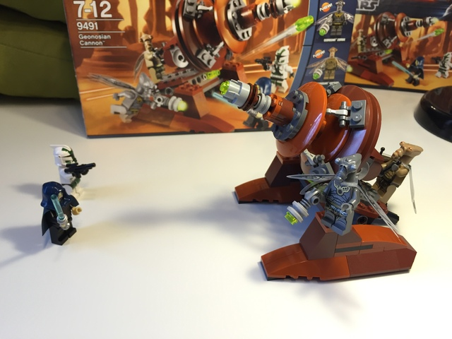](https://www.freelug.org/IMG/jpg/GeonosianCannon_27.jpg)

**Avis :**  
Bon on va pas se le cacher, ce set est juste intéressant pour les quatre minifigures qu’il contient. Si le canon est assez quelconque, les figs sont quant à elles superbes.  
Le set a été démonté juste après la réalisation de cette review et a rejoint mon vrac de briques.

_Bonus :_  
Comme d’habitude, voici un GIF animé réalisé avec les photos prises pour cette review (cliquez sur l’image pour lancer l’animation).

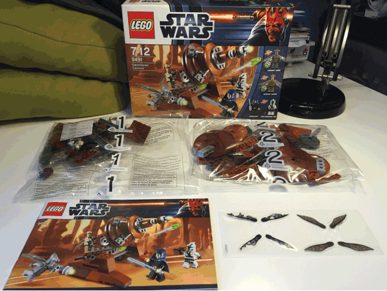
