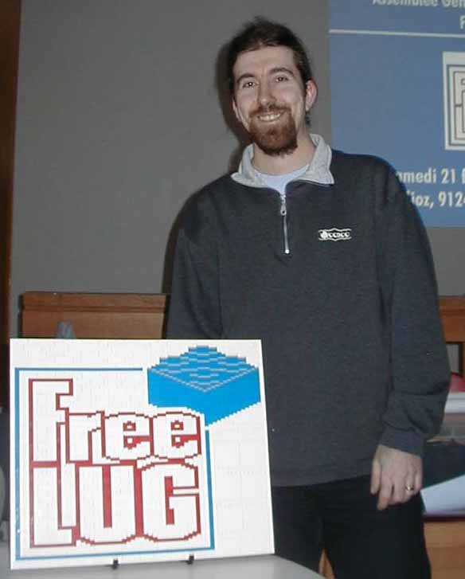
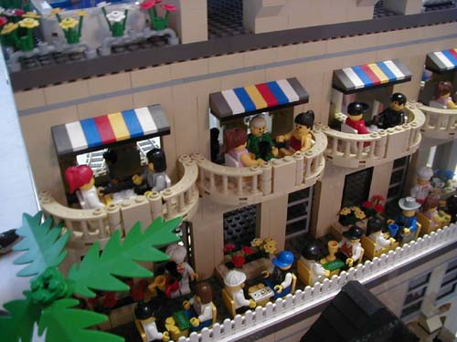
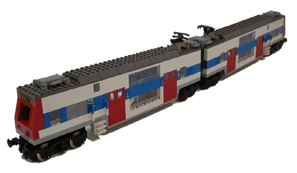
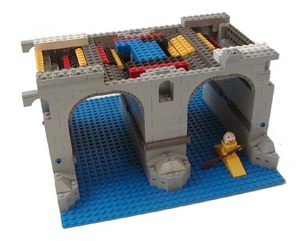
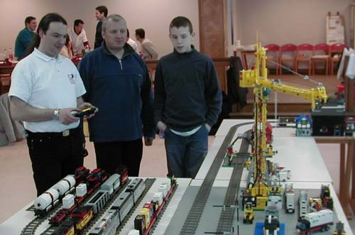
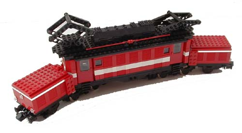
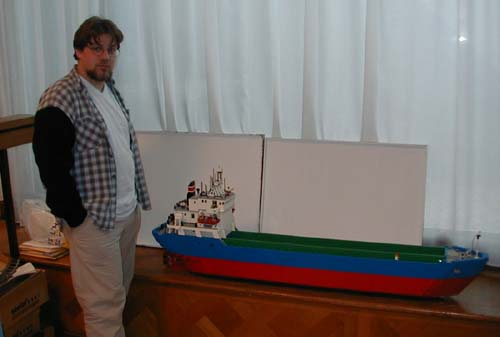
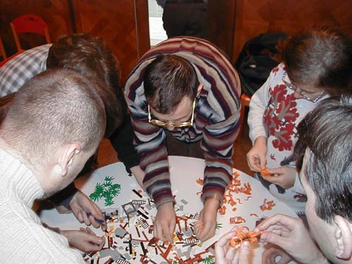
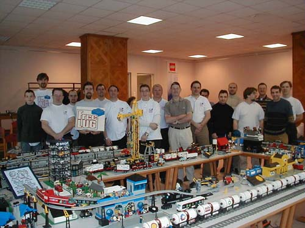

L’assemblée générale de l’association à été l’occasion pour les membres de présenter leurs créations.

Nous étions presque 20 fans de la petite brique danoise à nous être rassemblés ce week-end à St-Michel-sur-Orge. Les membres de la région parisienne ont pu organiser la réunion (salle, ravitaillement, matériel informatique - remercions en particulier Gilles pour le vidéoprojecteur et la réalisation des CDs de vidéos avec sa caméra embarquée) pendant que d’autres faisaient le voyage parfois de très loin, avec une mention spéciale pour notre membre belge, j’ai nommé Jean.

Nicolas était arrivé très tôt ce samedi matin accompagné d’une fervente supportrice pour nous présenter une avant première de l’exposition d’Orléans qui se déroulera en fin d’année : une batîment de grande hauteur : nous dévoilons juste une photo de détail afin de conserver la surprise.

Pascal, notre cher président, nous à présenté un modèle ferroviaire : une rame de RER. Certains connaissent déjà ce bel ensemble dont on ne se lasse pas.

Banban, Loys et Didier E. sont arrivés ensemble. Outre le matériel ferroviaire ([motrices](http://www.6studs.com/cc21002/cc21002.html) notamment), ils sont venus avec deux bus réalisés d’après un modèle de Marc mais aux couleurs de Grenoble et Lyon. On a pu par ailleurs observer tout à loisir l’esquisse d’un pont qui lui aussi sera présent à l’expo d’Orléans.

Philippe "Frogleap" est venu avec sa grue jaune, rendue parfaitement fonctionnelle grâce aux [Manas](http://www.peeron.com/inv/parts/23325c01). Comme lors de l’expo de [Bourguoin Jallieu](http://www.freelug.org/article.php3?id_article=207), elle a fait le bonheur des grutiers en herbe qui ont mis les piles à rude épreuve.

Marc, n’a pas pu venir avec son superbe [dauphin](http://marc.schickele.free.fr/dauphin_as365/dauphin_as365.htm) (hélicoptère) que vous pouvez retrouver sur son [site](http://marc.schickele.free.fr/) mais avec son [tramway de Strasbourg](http://marc.schickele.free.fr/quai_tram.htm), maintenant connu et reconnu, et des éléments techniques sans doute destinés à la réalisation d’un futur engin "volant", citons le moteur rotatif et le train d’atterrissage.

Quant à Erik il nous avait concocté une ébauche de monorail, la aussi dans l’objectif de l’expo d’Orléans. Ce monorail n’est pas destiné à "rouler" sur le monorail LEGO mais sur une piste construite en plaques et briques.

Pascal et Médérick sont arrivés avec retard et bonne humeur (deux potes à eux ;-)). Nous connaissions la belle motrice de Pascal en livré Fret mais Médérick nous présenta la sienne, un engin articulé original.

Toutefois, cela n’était rien en comparaison du bateau qu’il sortit de 3 énormes cartons, navire qui comportait aussi bien moults détails qu’une assistance de gouverne et une commande de propulsion par RCX !!

Après un repas qui restera mémorable (pas seulement pour nous mais aussi pour le serveur qui se demandait bien à quelle étrange secte nous appartenions) certains restèrent sur place tout simplement pour jouer avec trains et voitures télécommandées...ce qu’ils faisaient encore au réveil le lendemain matin.

La matinée du dimanche fut courte mais consacrée à des échanges d’idées et après un buffet repas certains s’adonnèrent à un curieux rituel : le dévalisage du rayon LEGO&reg du Maxitoys de Brétigny.

Enfin, peut avant les premiers départ, nous avons pu faire un "draft" ou comme le dit si francophilement notre ami québecquois Pierre, un repêchage. Il s’agit pour plusieurs personnes, après avoir acquis une boîte identique, de se réunir autour d’une table, de trier et de se redistribuer les pièces. Ainsi chacun repart avec un ensemble de pièces plus cohérent (moins de références différentes, plus de pièces dans chaque référence, références choisies à tour de rôle)

Les premières photos de l’évènement sont disponible ici :

[http://photos.freelug.org/category.php?cat=42&expand=all](http://photos.freelug.org/category.php?cat=42&expand=all)

Prochain rassemblement prévu : Juillet à Grenoble

