Bonjour à tous, aujourd’hui je vous propose une review du set 40123 dans la gamme Seasonal : Thanksgiving Feast.  
Ce set sorti en 2015 est composé de 158 pièces et coûte 9,99€, soit un ratio prix/pièce de 6,3 centimes d’€.

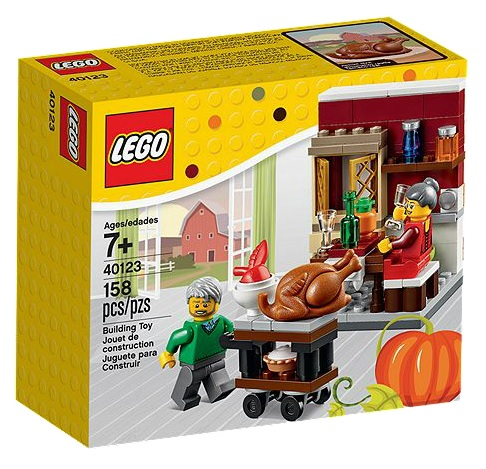

Ce petit set Seasonal est composé de trois sachets et de deux plaques 4x8 et d’une notice de construction.

[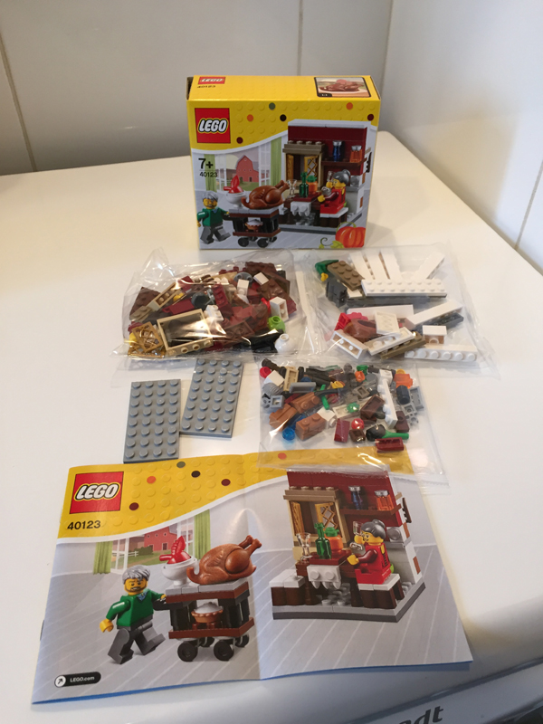](https://www.freelug.org/IMG/jpg/Thanksgiving2015_02_mini.jpg)

Voici les deux Minifigures composant ce set, un couple de personnes d’un certain âge. Même s’ils n’ont rien de transcendant, il faut avouer que plus le temps avance et plus LEGO fait des efforts sur la réalisation de ces figs

[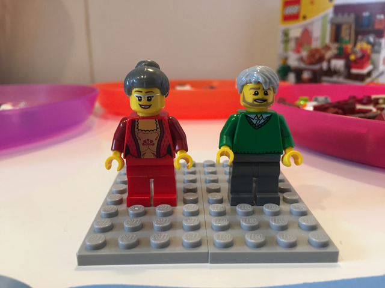](https://www.freelug.org/IMG/jpg/Thanksgiving2015_03_mini.jpg)

Voici les figs de dos, la chevelure de la femme est particulièrement jolie.

[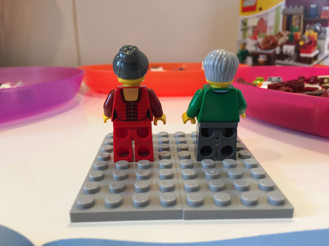](https://www.freelug.org/IMG/jpg/Thanksgiving2015_04_mini.jpg)

On commence la construction du set par la base de la scénette qui aura une taille de 8x8.

[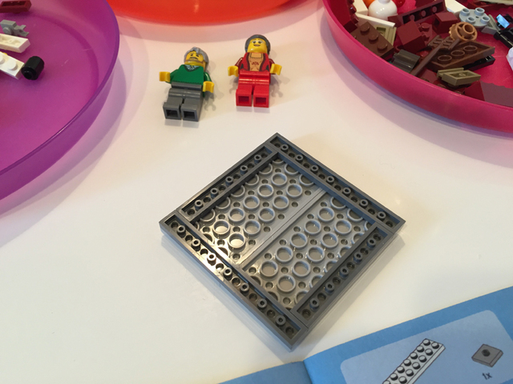](https://www.freelug.org/IMG/jpg/Thanksgiving2015_05_mini.jpg)

On débute la montage de l’unique mur.

[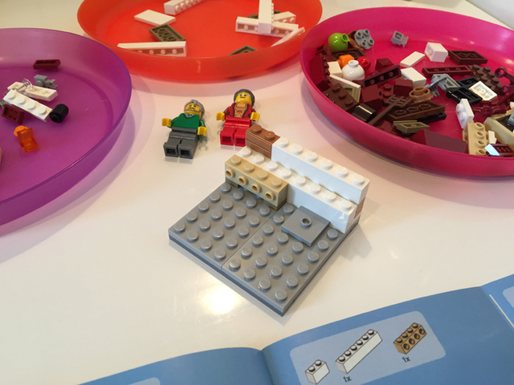](https://www.freelug.org/IMG/jpg/Thanksgiving2015_06_mini.jpg)

Le mur continue de monter, ainsi que le bas du buffet avec ses tiroirs.

[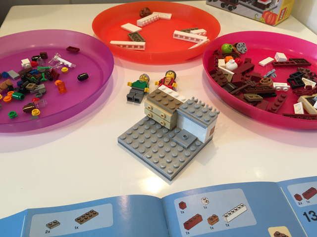](https://www.freelug.org/IMG/jpg/Thanksgiving2015_07_mini.jpg)

Tiens déjà une bouteille prend place dans le décors.

[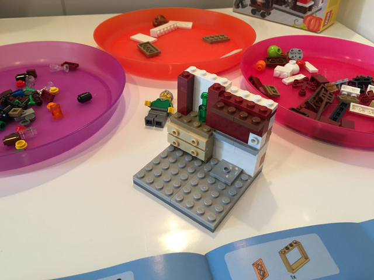](https://www.freelug.org/IMG/jpg/Thanksgiving2015_08_mini.jpg)

Les portes du buffet sont installées, ouf la bouteille est maintenant hors de vue !

[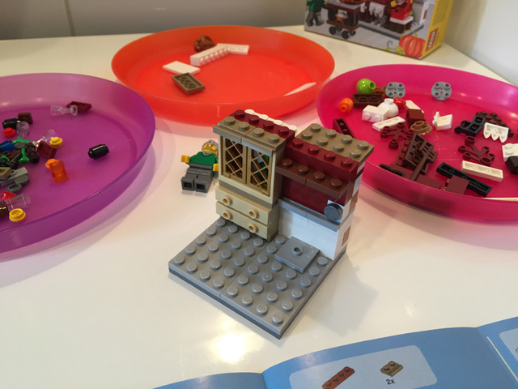](https://www.freelug.org/IMG/jpg/Thanksgiving2015_09_mini.jpg)

Ça y est le mur est totalement monté.

[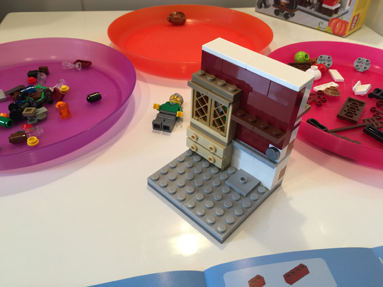](https://www.freelug.org/IMG/jpg/Thanksgiving2015_10_mini.jpg)

Une plante fait son apparition et on pose les pieds des tabourets.

[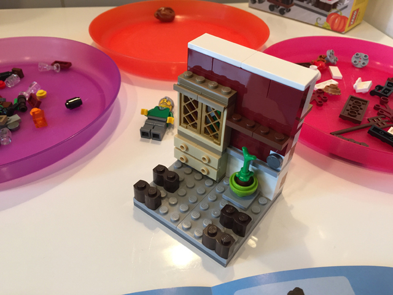](https://www.freelug.org/IMG/jpg/Thanksgiving2015_11_mini.jpg)

Les assises des tabourets sont posées, ainsi que les pieds de la table.

[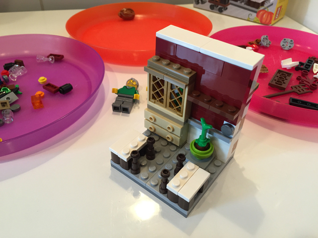](https://www.freelug.org/IMG/jpg/Thanksgiving2015_12_mini.jpg)

Et voilà la table est installée.

[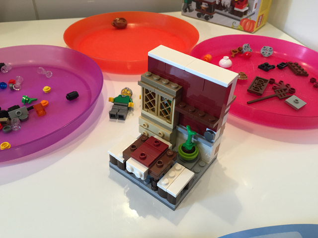](https://www.freelug.org/IMG/jpg/Thanksgiving2015_13_mini.jpg)

On agrémente la table de verres et d’une citrouille, l’étagère se voit décorée de bocaux.

[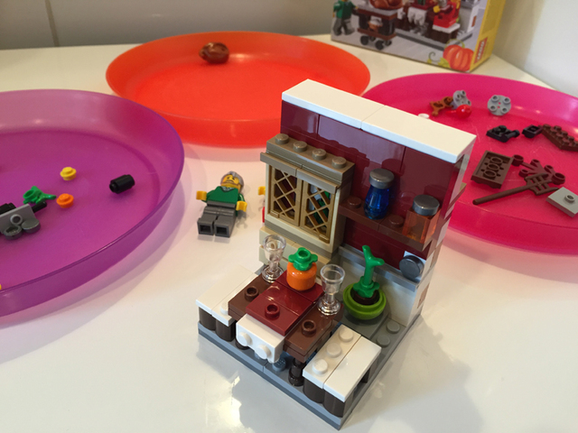](https://www.freelug.org/IMG/jpg/Thanksgiving2015_14_mini.jpg)

On habille maintenant l’extérieur du mur avec des bocaux, des outils et une plante grimpante.

[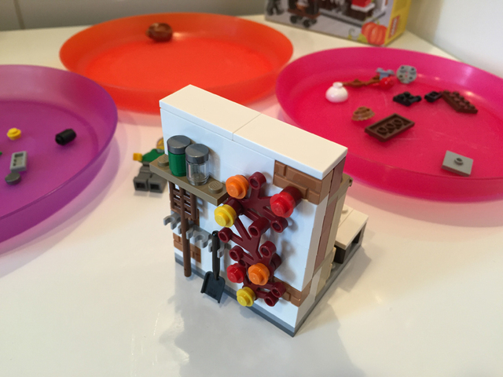](https://www.freelug.org/IMG/jpg/Thanksgiving2015_15_mini-2.jpg)

Mise en situation finale avec le chariot à plats.

[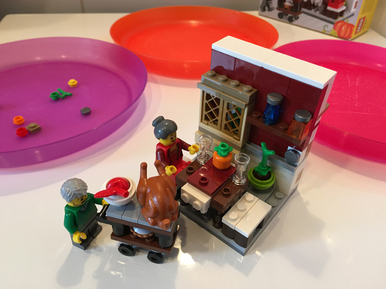](https://www.freelug.org/IMG/jpg/Thanksgiving2015_16_mini.jpg)

**Avis :**  
Ce petit set Seasonal est vraiment plaisant et rapide à monter. Cette petite scénette est vraiment un must et pour moins de 10€ il serait dommage de s’en priver.

_Bonus :_  
Voici un GIF animé réalisé avec les photos prises pour cette review (cliquez sur l’image pour lancer l’animation).

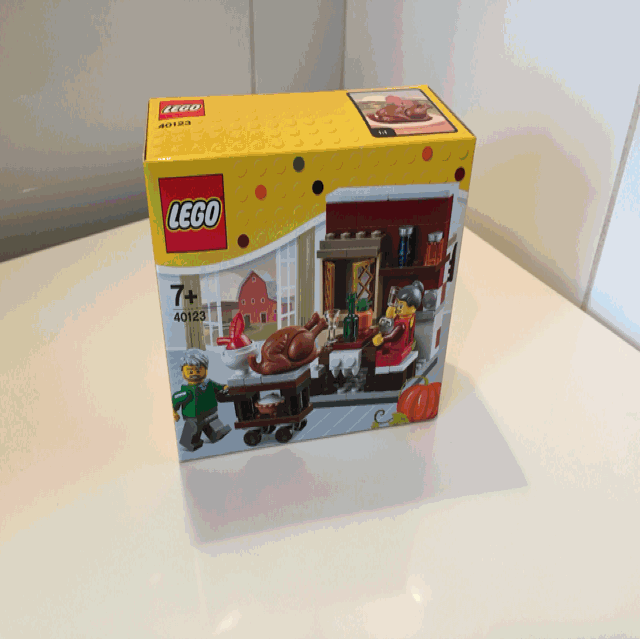
