Bonjour à tous, aujourd’hui je vous propose une review du set 10242 dans la gamme Creator Expert : Mini Cooper MK VII.  
Ce set sorti en 2014 est composé de 1077 pièces et coûte 89,99€, soit un ratio prix/pièce de 8,4 centimes d’€.

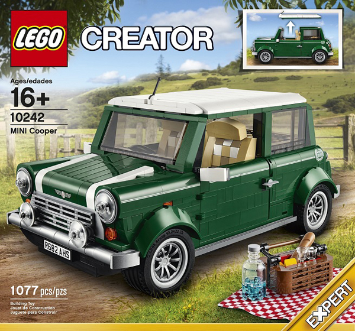

Une fois n’est pas coutume je ne vous présenterais pas le contenu de la boite, ayant acheté ce set d’occasion sans boite il m’a été impossible de prendre en photo les sachets contenus dans ce set.

On commence la construction par le bas de caisse avant et la plaque d’immatriculation. La planche de stickers comprend plusieurs modèles de plaques (anglaise, allemande, américaine), le volant étant à droite sur le modèle et la Mini étant d’origine anglaise, j’ai opté pour la plaque de ce pays.

[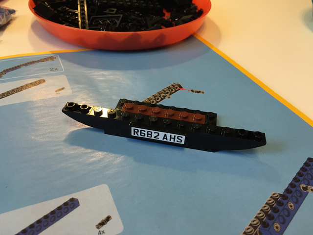](https://www.freelug.org/IMG/jpg/Mini_02_mini.jpg)

Construction du châssis avec des briques Technic, on voit déjà l’emplacement des roues.

[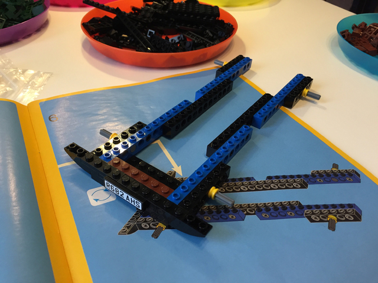](https://www.freelug.org/IMG/jpg/Mini_03_mini.jpg)

L’ossature du châssis est maintenant terminée, ainsi que l’emplacement dédié à la roue de secours.

[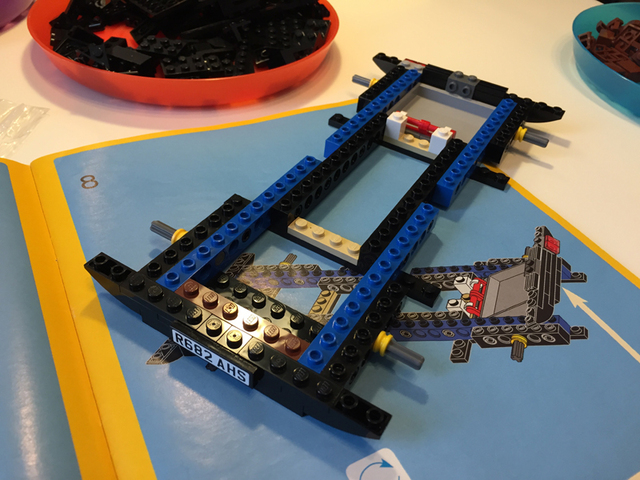](https://www.freelug.org/IMG/jpg/Mini_04_mini.jpg)

On commence à poser le sol sur le châssis.

[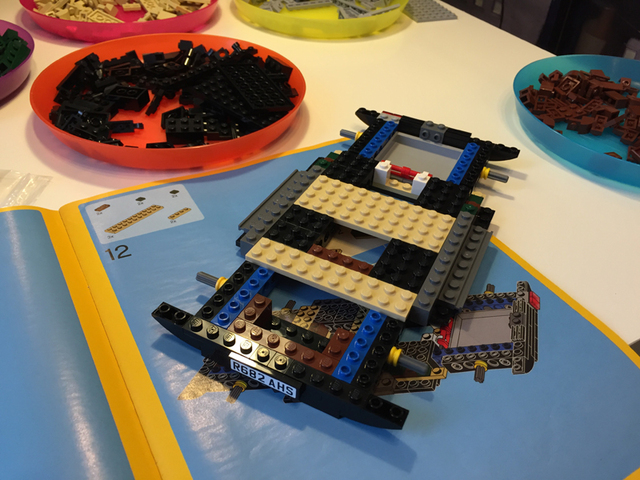](https://www.freelug.org/IMG/jpg/Mini_05_mini.jpg)

Passages de roues, support moteur et fixations des sièges sont en place.

[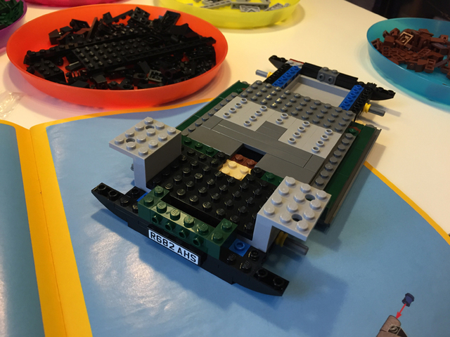](https://www.freelug.org/IMG/jpg/Mini_06_mini.jpg)

Les pare-chocs avant et arrière sont montés (avec des pièces métallisées du plus bel effet), la roue de secours est dans son logement.

[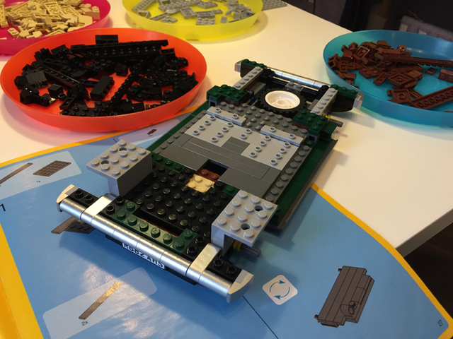](https://www.freelug.org/IMG/jpg/Mini_07_mini.jpg)

D’après le manuel d’instructions, on débute le sachet 2. Et c’est le levier de vitesses et le plancher du coffret qui ouvrent le bal.

[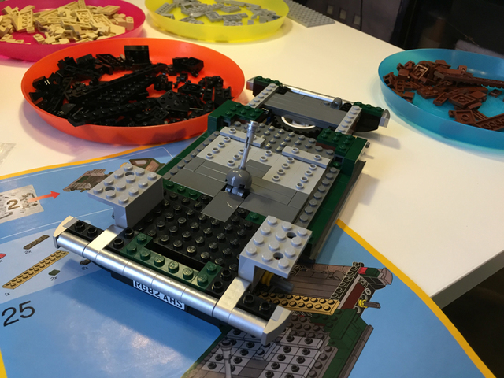](https://www.freelug.org/IMG/jpg/Mini_08_mini.jpg)

On continue avec les assises des sièges avant et de la banquette arrière.

[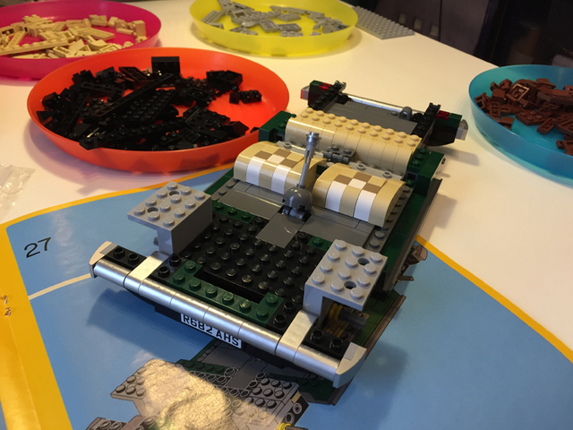](https://www.freelug.org/IMG/jpg/Mini_09_mini.jpg)

Les ailes arrières prennent forme, le dossier de la banquette aussi.

[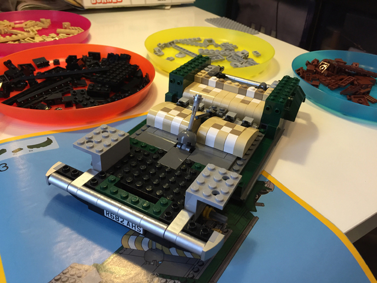](https://www.freelug.org/IMG/jpg/Mini_10_mini.jpg)

Le dossier de la banquette est finie.

[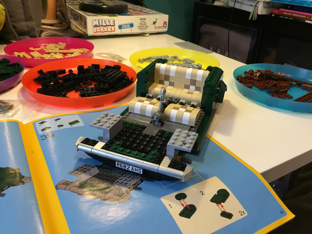](https://www.freelug.org/IMG/jpg/Mini_12_mini.jpg)

Montage des vitres et de la lunette arrière.

[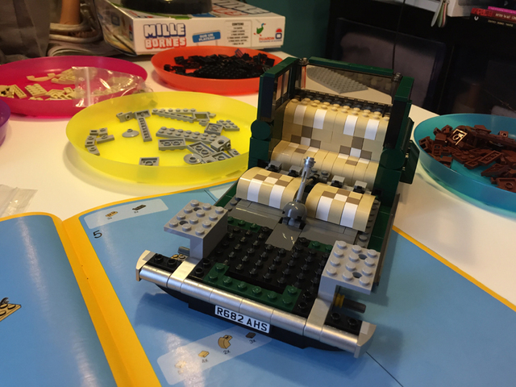](https://www.freelug.org/IMG/jpg/Mini_13_mini.jpg)

Dossiers et appuis-têtes des sièges mis en place, on peut voir que la sellerie à carreaux est du plus bel effet.

[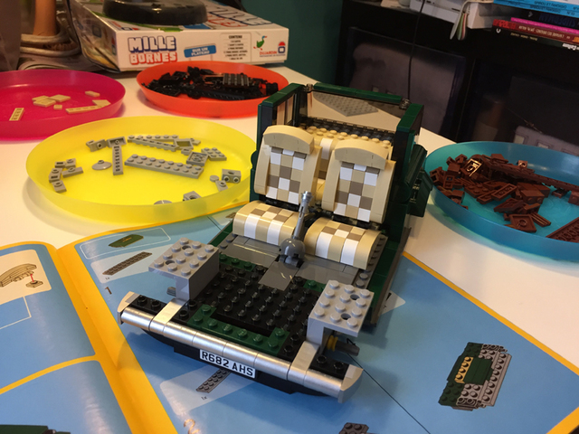](https://www.freelug.org/IMG/jpg/Mini_14_mini.jpg)

Le panier, la bouteille et la nappe sont en place dans le coffre. Déjà prêt à s’arrêter au bord d’un champs pour pique-niquer.

[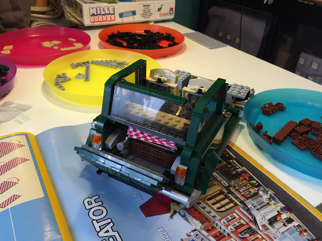](https://www.freelug.org/IMG/jpg/Mini_15_mini.jpg)

Ça y est, le volant est en place.

[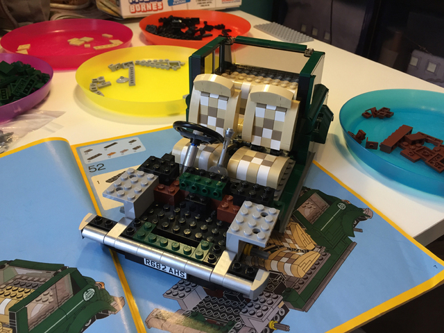](https://www.freelug.org/IMG/jpg/Mini_16_mini.jpg)

Enfin le cœur de la Mini est installé.

[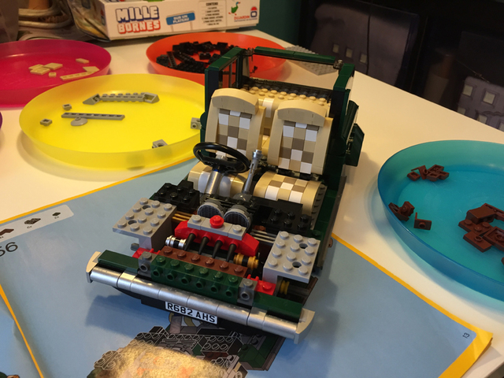](https://www.freelug.org/IMG/jpg/Mini_18_mini.jpg)

Installation du tableau de bord, de la grille de radiateur et des ailes de la voiture.

[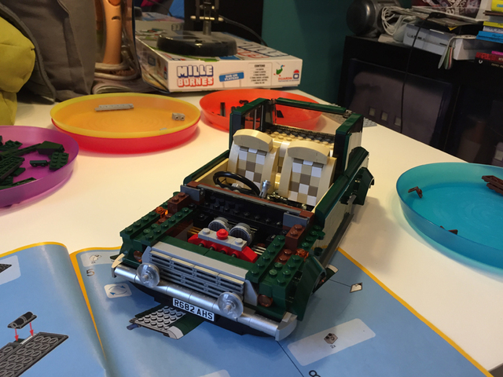](https://www.freelug.org/IMG/jpg/Mini_20_mini.jpg)

Le capot à bande blanche, le pare-brise, les phares, les rétroviseurs sont en place. On n’est pas loin de la fin.

[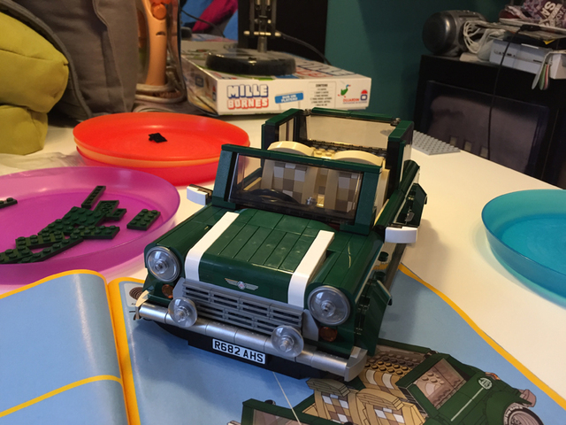](https://www.freelug.org/IMG/jpg/Mini_21_mini.jpg)

Enfin, on monte le toit et les roues. La Mini est finie.

[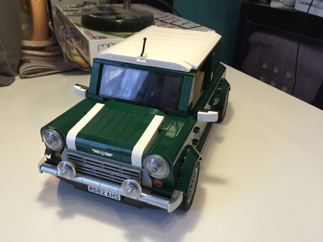](https://www.freelug.org/IMG/jpg/Mini_22_mini.jpg)

Voici quelques photos de la belle sous toutes ses coutures.

[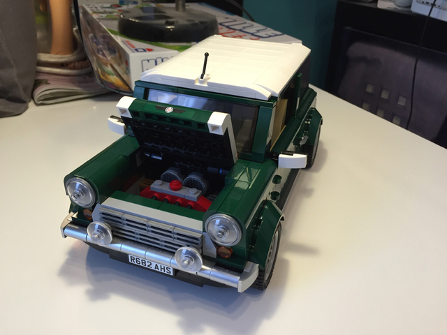](https://www.freelug.org/IMG/jpg/Mini_23_mini.jpg)

[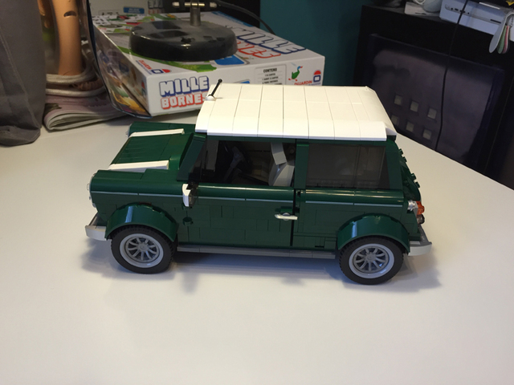](https://www.freelug.org/IMG/jpg/Mini_24_mini.jpg)

[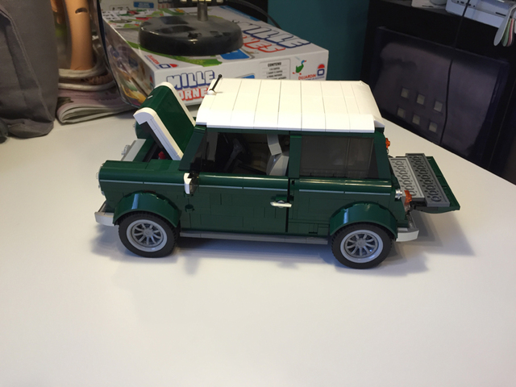](https://www.freelug.org/IMG/jpg/Mini_25_mini.jpg)

[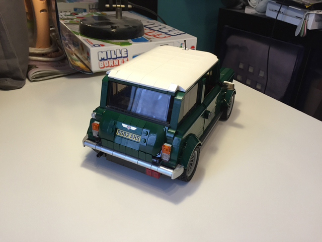](https://www.freelug.org/IMG/jpg/Mini_26_mini.jpg)

[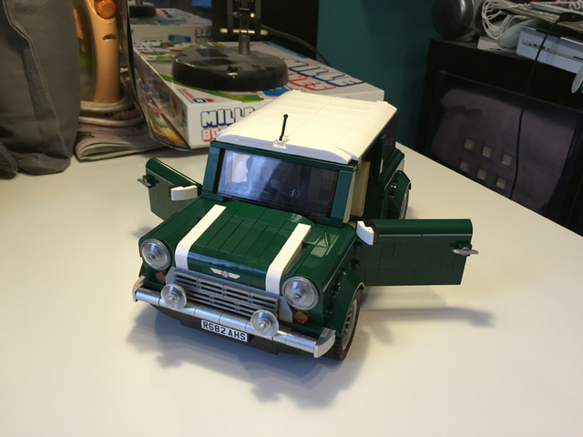](https://www.freelug.org/IMG/jpg/Mini_27_mini.jpg)

**Avis :**  
J’ai vraiment pris mon pied à monter cette Mini Cooper. Plusieurs techniques intéressantes sont utilisées, le rendu est superbe. Bref ce set est un must have.

_Bonus :_  
Comme d’habitude, voici un GIF animé réalisé avec les photos prises pour cette review (cliquez sur l’image pour lancer l’animation).

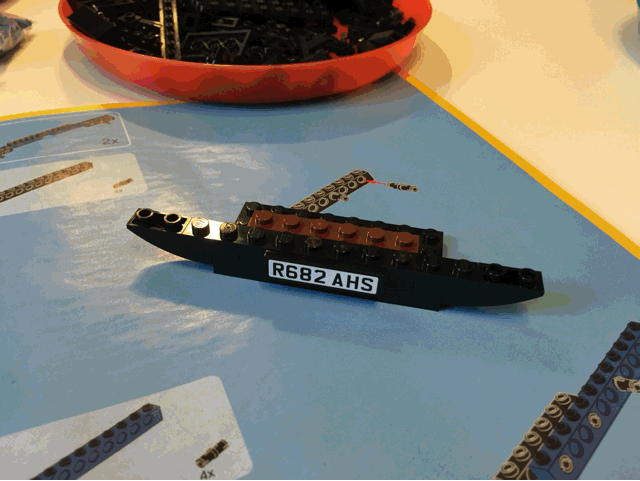
