Aujourd’hui je vous propose la review du set 21024 dans la gamme Architecture : Louvre.  
Ce set sorti en 2015 au prix de 59,99 € est composé de 695 pièces, soit un ratio prix/pièce de 86,3 centimes d’€.

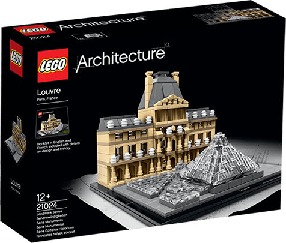

Ce set est composé de huit sachets et d’un manuel d’instructions. Ce dernier, comme la boite, à une finition impeccable et luxueuse.

[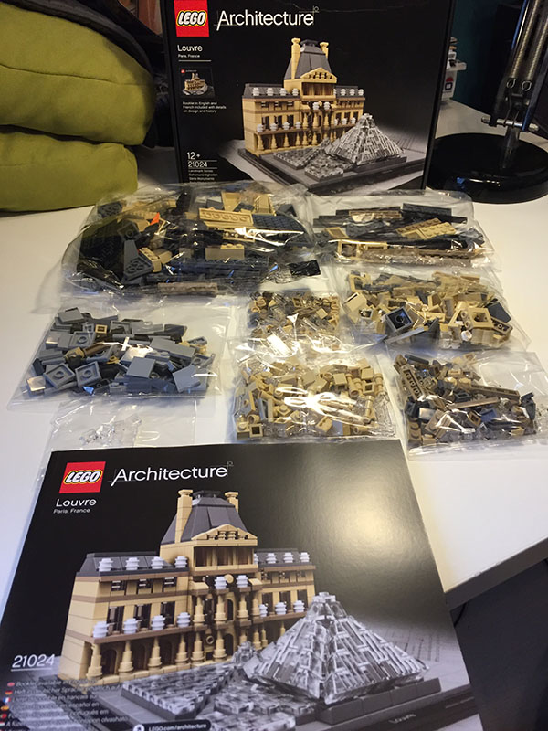](https://www.freelug.org/IMG/jpg/Louvre_01_mini.jpg)

On réalise, comme souvent sur les sets Architecture, le socle cerclé de tiles noires. Dont une sérigraphiée avec le nom du monument, ici "Louvre". Socle assez imposant tout de même puisqu’il mesure 22x24 tenons.

[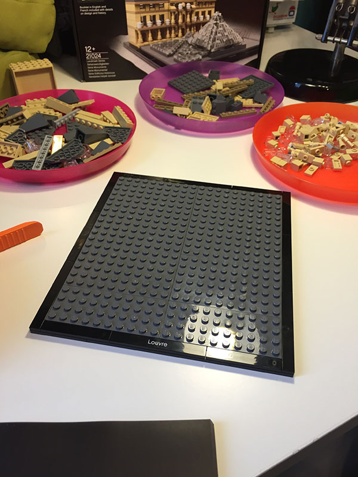](https://www.freelug.org/IMG/jpg/Louvre_02_mini.jpg)

On monte maintenant les "fondations" ainsi que le parvis.

[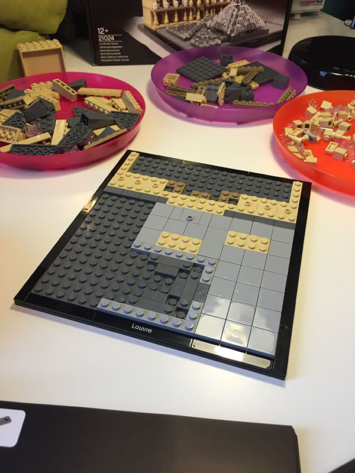](https://www.freelug.org/IMG/jpg/Louvre_03_mini.jpg)

Le parvis garni de tiles est maintenant fini, les murs du rez-de-chaussée commencent à monter.

[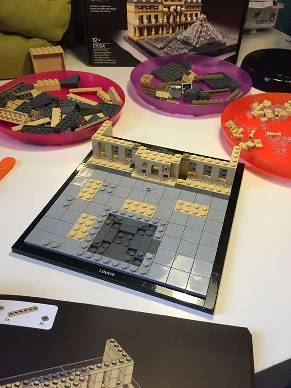](https://www.freelug.org/IMG/jpg/Louvre_04_mini.jpg)

les murs arrières et les fenêtres du premier étage sont posés.

[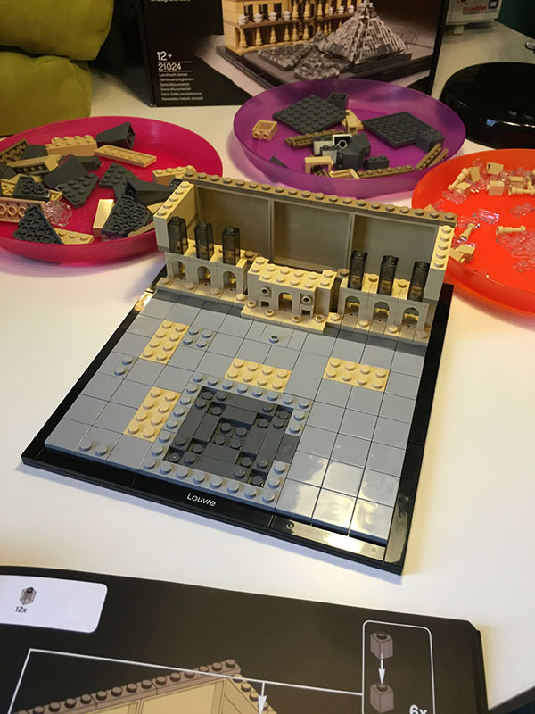](https://www.freelug.org/IMG/jpg/Louvre_05_mini.jpg)

Le premier étage est terminé.

[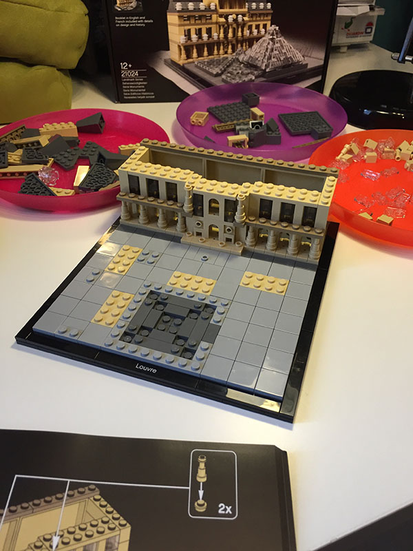](https://www.freelug.org/IMG/jpg/Louvre_06_mini.jpg)

Les colonnes de devantures du rez-de-chaussée et les vitres du deuxième étage ont fait leur apparition.

[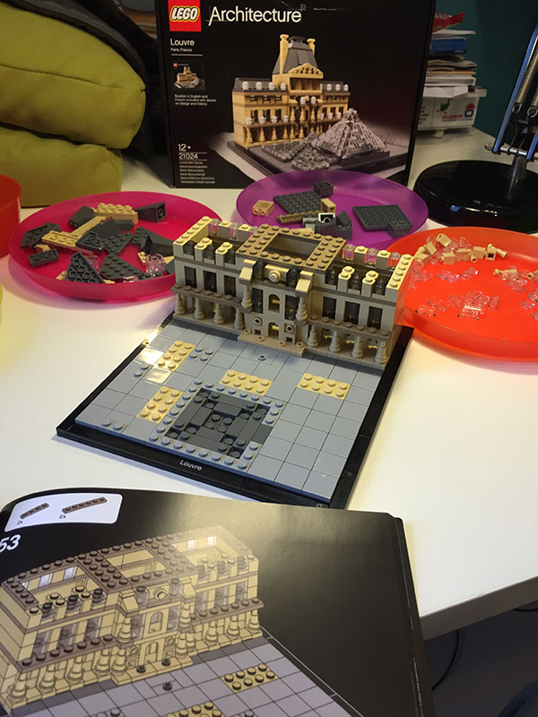](https://www.freelug.org/IMG/jpg/Louvre_08_mini.jpg)

On continu avec le montage de la "tour" centrale.

[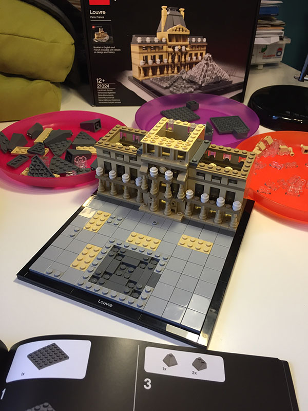](https://www.freelug.org/IMG/jpg/Louvre_10_mini.jpg)

Les toits sont posés sur les ailes du bâtiment.

[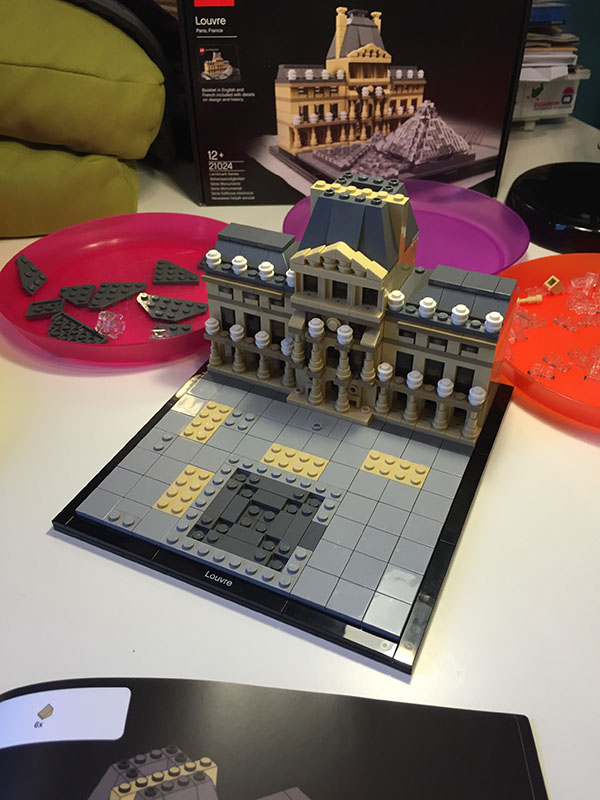](https://www.freelug.org/IMG/jpg/Louvre_11_mini.jpg)

Le bâtiment historique est fini, attaquons nous à la petite pyramide et aux zones vitrées du parvis.

[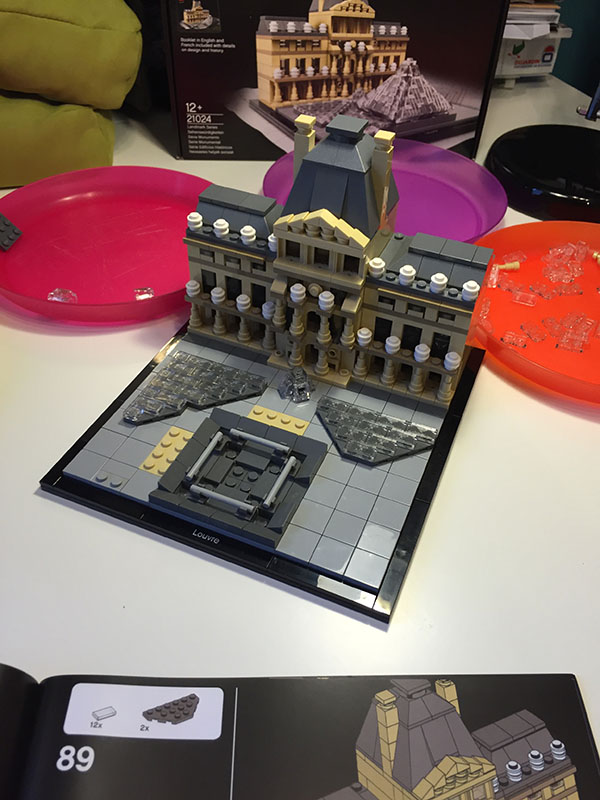](https://www.freelug.org/IMG/jpg/Louvre_12_mini.jpg)

Début du montage de la grande pyramide du Louvre.

[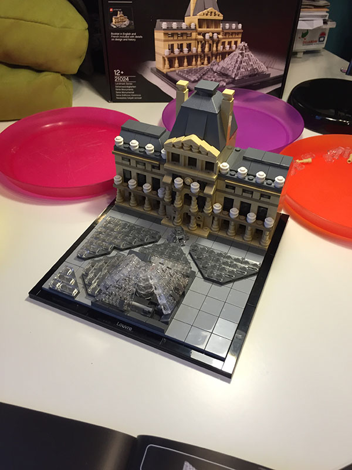](https://www.freelug.org/IMG/jpg/Louvre_13_mini.jpg)

Et voilà le set fini.

[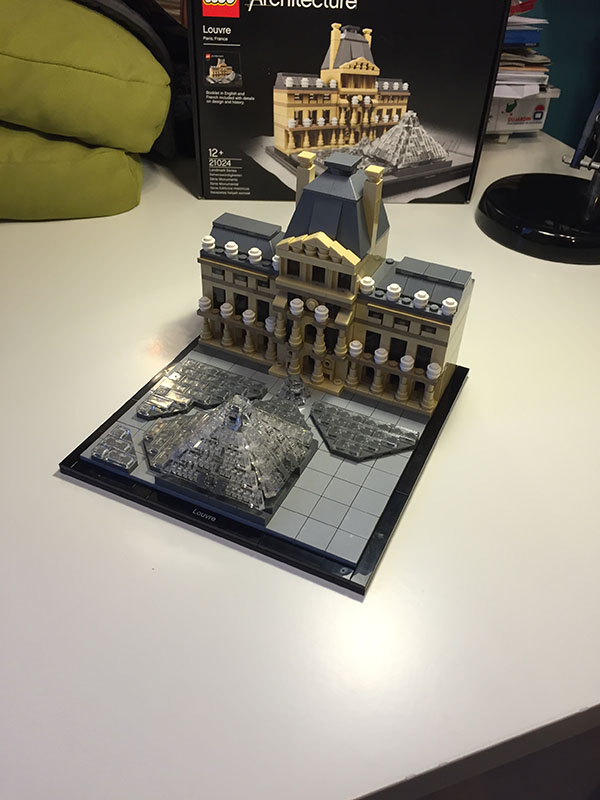](https://www.freelug.org/IMG/jpg/Louvre_14_mini.jpg)

Quelques photos du set sous différents angles.

[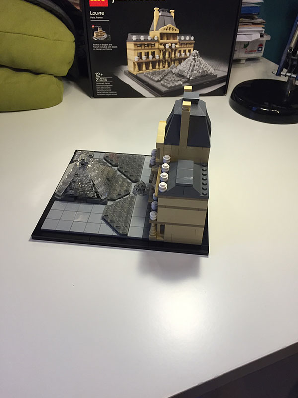](https://www.freelug.org/IMG/jpg/Louvre_15_mini.jpg)

[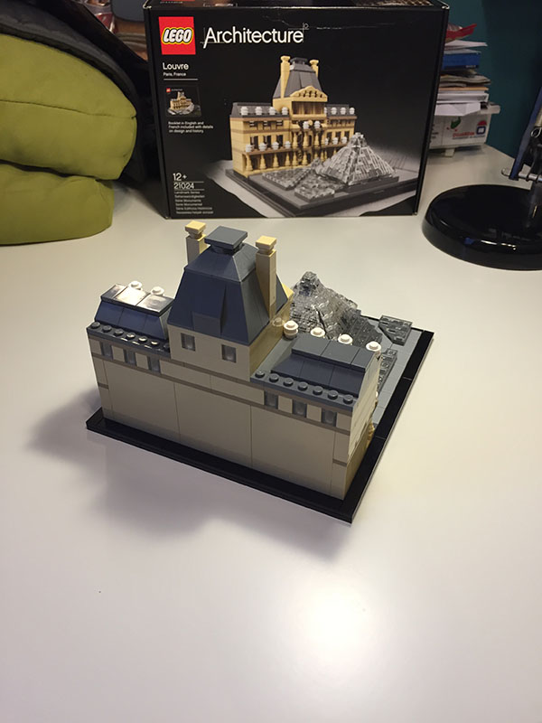](https://www.freelug.org/IMG/jpg/Louvre_16_mini.jpg)

[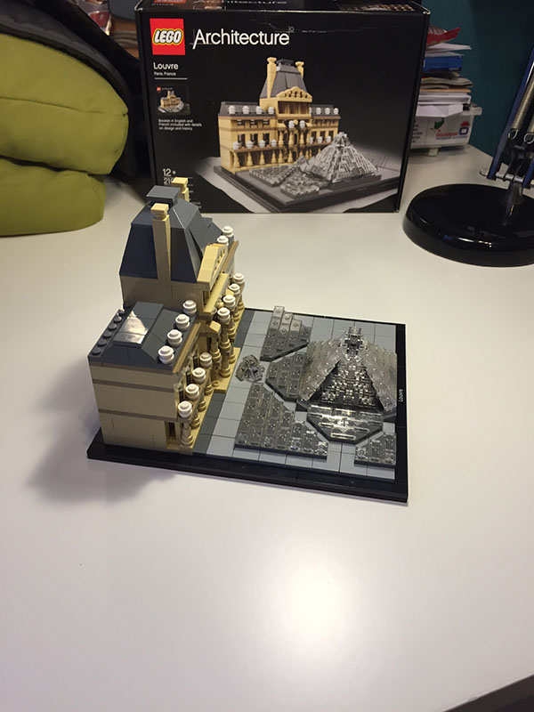](https://www.freelug.org/IMG/jpg/Louvre_17_mini.jpg)

[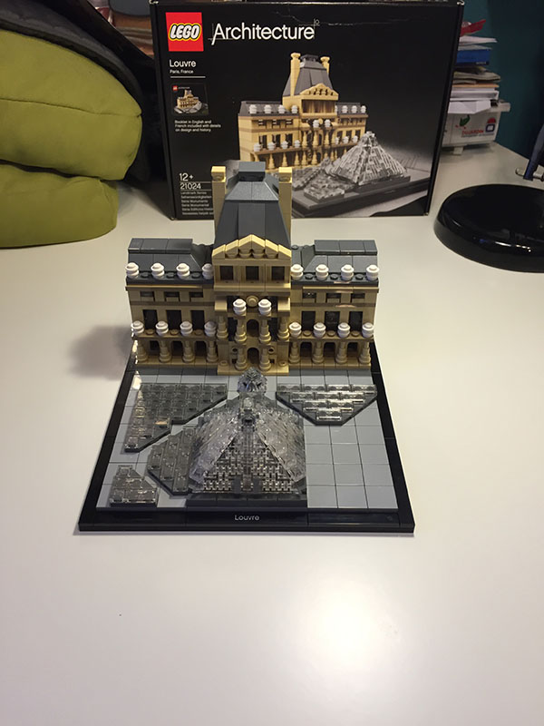](https://www.freelug.org/IMG/jpg/Louvre_18_mini.jpg)

**Avis :**  
Encore un must have, ce set Architecture une fois fini est vraiment superbe, j’étais sceptique pour la pyramide au début, mais le rendu final est vraiment top. A part pour la grande pyramide, pas de technique de construction transcendante. Un grand coup de cœur tout de même.

_Bonus :_  
Comme d’habitude, voici un GIF animé réalisé avec les nombreuses photos prises pour cette review (cliquez sur l’image pour lancer l’animation).

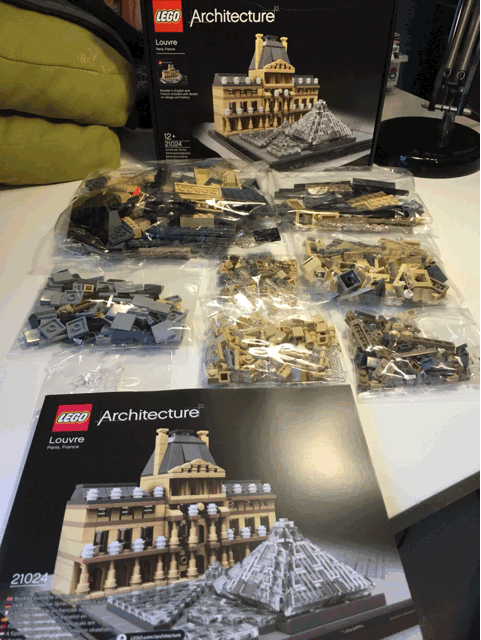
