Aujourd’hui je vous propose la review du set 850426 dans la gamme Accessoires : Pencil Holder.  
Ce set sorti en 2012 au prix de 14,99 € est composé de 157 pièces, soit un ratio prix/pièce de 9,54 centimes d’€.

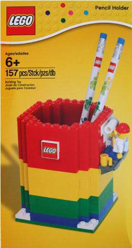

Le contenu de la boite se compose d’un sachet contenant les briques, un sachet contenant deux crayons de papier aux couleurs LEGO et d’un fascicule d’instructions.

[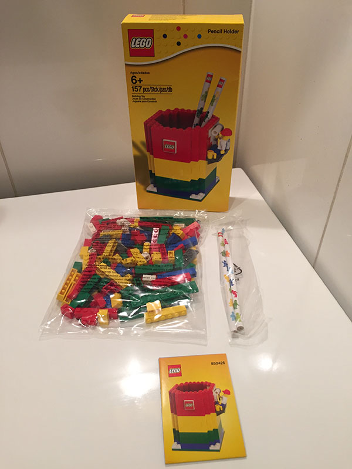](https://www.freelug.org/IMG/jpg/PencilHolder_01_mini.jpg)

La figurine du peintre est de facture classique pour un personnage City, pas de fioritures ici.

[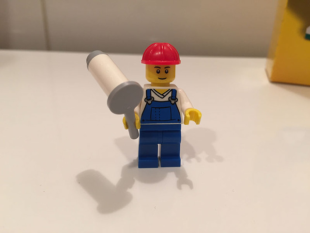](https://www.freelug.org/IMG/jpg/PencilHolder_02_mini.jpg)

La figurine de dos, le torso est tout de même tampographié recto/verso. Vous pouvez remarquer que j’ai ajouté une plate 1x1 round pour finir le rouleau de peinture afin d’éviter un trou dans le rouleau comme on peut le voir sur la boite.

[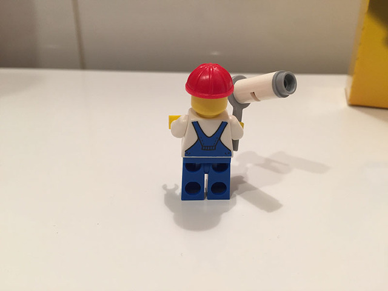](https://www.freelug.org/IMG/jpg/PencilHolder_03_mini.jpg)

On commence à monter la base du pot.

[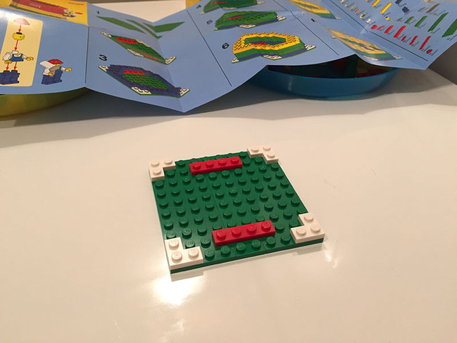](https://www.freelug.org/IMG/jpg/PencilHolder_04_mini.jpg)

Après la première rangée de briques bleues, on monte les vertes. Les briques utilisées sont vraiment les couleurs de base de LEGO.

[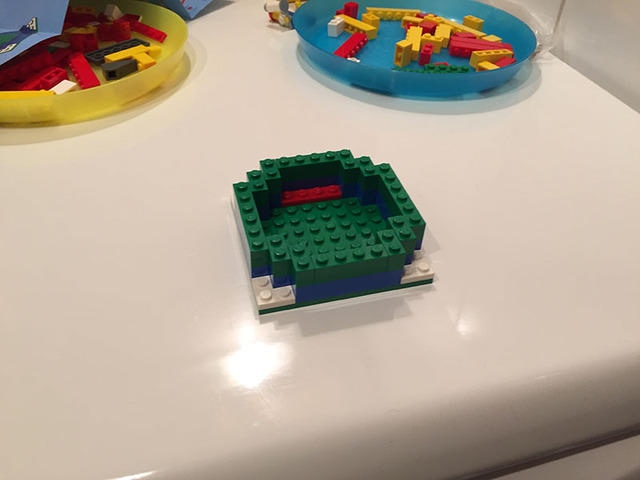](https://www.freelug.org/IMG/jpg/PencilHolder_05_mini.jpg)

Les deux photos suivantes montrent, sur la partie jaune de la construction, l’inversion du sens de construction qui permet de consolider l’ensemble.

[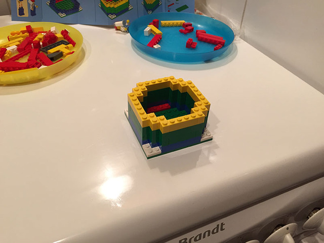](https://www.freelug.org/IMG/jpg/PencilHolder_06_mini.jpg)

[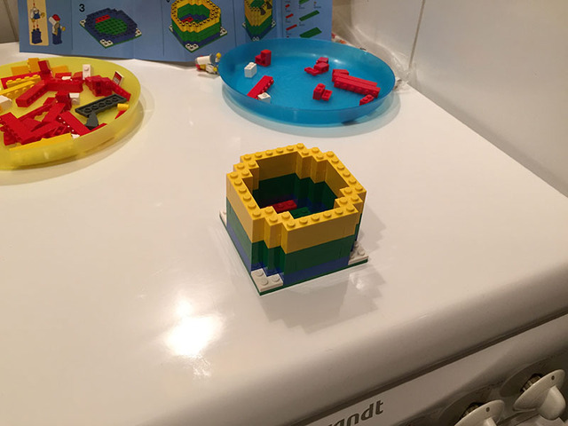](https://www.freelug.org/IMG/jpg/PencilHolder_07_mini.jpg)

On termine le jaune avec les équerres qui permettront d’installer la plateforme pour le peintre, puis on passe aux briques rouges.

[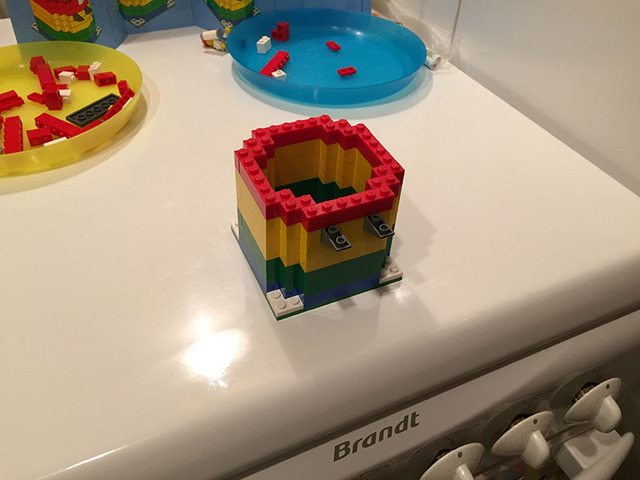](https://www.freelug.org/IMG/jpg/PencilHolder_08_mini.jpg)

Le pot continue de monter et une brique blanche fait son apparition, elle constitue le pan de mur que le peintre est en train de peindre en blanc.

[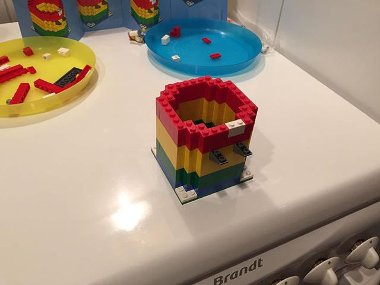](https://www.freelug.org/IMG/jpg/PencilHolder_09_mini.jpg)

On peut apercevoir sur la gauche les deux briques 1x1 blanche 1 Knob qui permettront d’apposer le logo LEGO.

[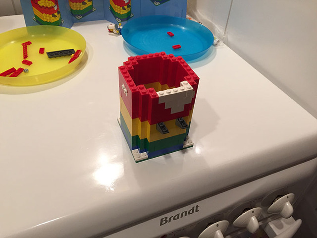](https://www.freelug.org/IMG/jpg/PencilHolder_10_mini.jpg)

Le pot est maintenant terminé, le peintre a pris place entre sa tasse et son thermos, la tile 2x2 sérigraphiée "LEGO" est en place.

[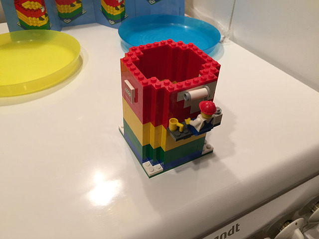](https://www.freelug.org/IMG/jpg/PencilHolder_11_mini.jpg)

Quelques photos sous différents angles.

[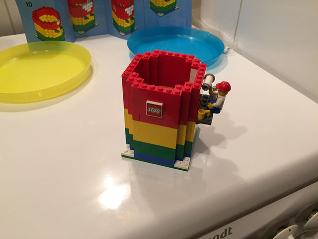](https://www.freelug.org/IMG/jpg/PencilHolder_12_mini.jpg)

[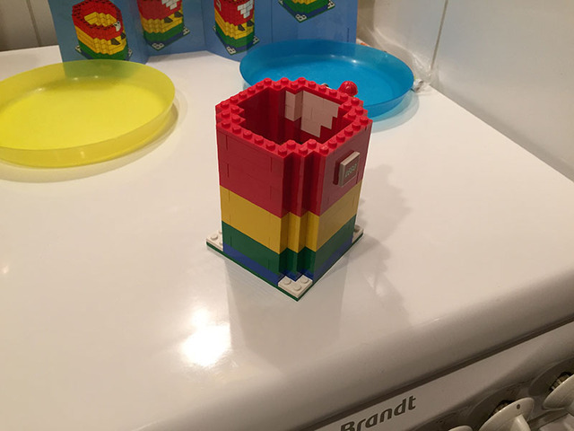](https://www.freelug.org/IMG/jpg/PencilHolder_13_mini.jpg)

[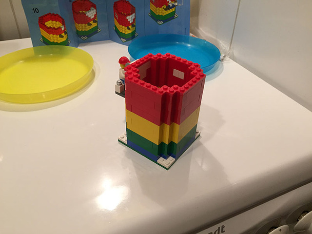](https://www.freelug.org/IMG/jpg/PencilHolder_14_mini.jpg)

[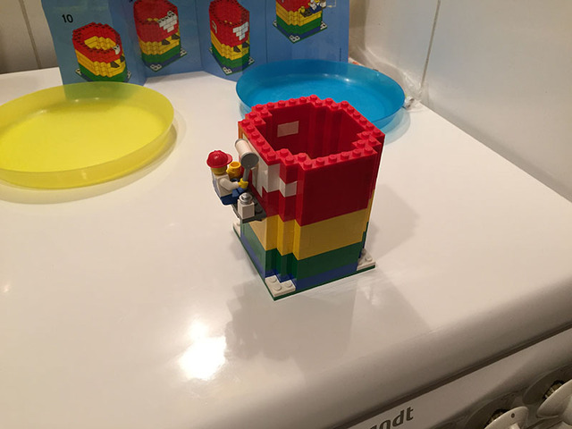](https://www.freelug.org/IMG/jpg/PencilHolder_15_mini.jpg)

Mise en situation avec les deux crayons LEGO et la boite du set.

[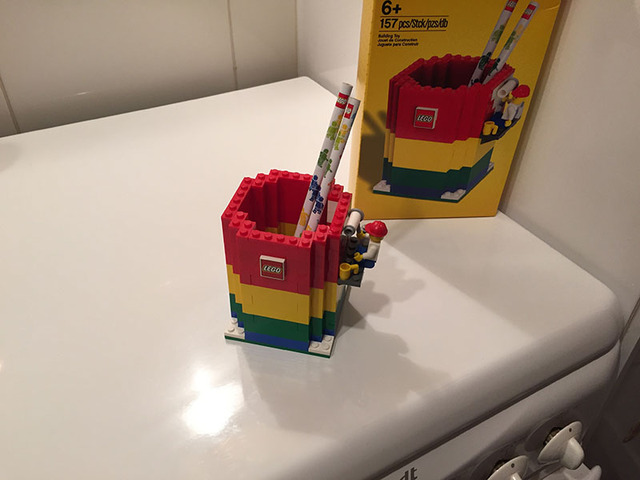](https://www.freelug.org/IMG/jpg/PencilHolder_17_mini.jpg)

**Avis :**

Un petit set qui n’a pas grand intérêt pour sa construction mais qui est fort sympathique de part son utilité.

Comme vous pouvez le voir sur la photo suivante, il trône fièrement sur mon bureau au travail à côté de mes autres goodies.

[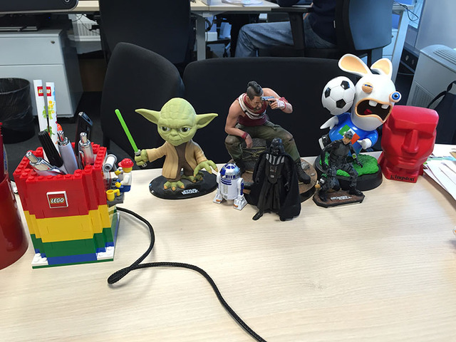](https://www.freelug.org/IMG/jpg/PencilHolder_18_mini.jpg)

_Bonus :_

Comme d’habitude, voici un GIF animé réalisé avec les nombreuses photos prises pour cette review (cliquez sur la photo pour lancer l’animation).

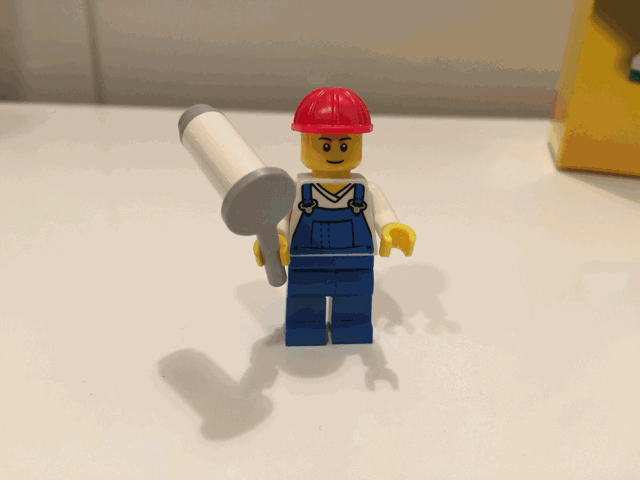
