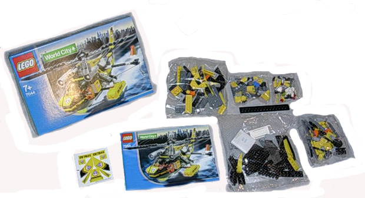
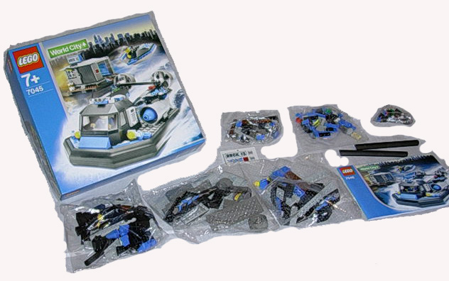
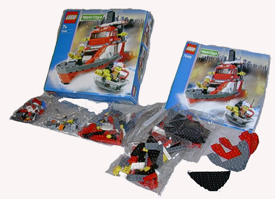

Tout nouveau, tout beau, l’étalage de mon revendeur vient de s’enrichir de ces nouveaux sets World City 2004.

Aujourd’hui je vous présente trois de ces nouveaux sets, histoire de débrousailler un peu le terrain pour vous (qu’est ce qu’on est sympa, chez FreeLUG !).

L’hélicoptère, référence [7044](http://shop.lego.com/product.asp?p=7044) (201 pièces) :

**Contenu 7044**

L’aéroglisseur et la base des contrebandiers [7045](http://shop.lego.com/product.asp?p=7045) (268 pièces) :

**Contenu 7045**

Le bateau de pompiers [7046](http://shop.lego.com/product.asp?p=7046) (268 pièces :

**Contenu 7046**

Commençons donc par décrire ce dernier modèle.

## Le bateau de pompiers

Le bateau de pompiers est un thème assez récurent au fils des productions de la société LEGO. Certains nostalgiques se rappellent de la série des "vrais bateaux" à coque flotante des années 70, dont certains collectionneurs de FreeLUG conservent précieusement quelques exemplaires.

Il s’agit là d’un modèle "glissant" et non flottant comportant dans ses flancs un petit radeau pneumatique, qui se dégage en écartant la partie arrière articulée.

Le montage du modèle est agréable, les détails, comme les canons à eau sont assez réalistes et le résultat final a bonne figure.

C’est un modèle qui intéressera les plus jeunes, comme la plupart des modèles de cette gamme, mais qui offre que peu de pièces réutilisables, hormis pour ceux qui voudront créer leur propre modèle de bateau de pompier.

## L’aéroglisseur

L’aéroglisseur m’a refait penser au modèle de la gamme Res-Q [réf. 6473](http://www.bricklink.com/catalogItem.asp?S=6473-1) sorti en 1998. Ce nouveau set ne représente pas un véhicule de sauvetage cette fois-ci, mais un engin utilisé par des méchants contrebandiers.

Personnellement je préfère le modèle de 1998, qui a un habillage de boudins mieux fini (la juxtaposition des éléments d’angle laisse un peu à désirer), mais ce nouveau modèle a quand même quelque intérêt notamment à cause du mécanisme simpliste de lancement du petit bateau - mécanisme de lancement par élastique, qui apporte une touche de fun à l’ensemble - et surtout pour la possibilité de réutilisation des pièces de la cabane qui comporte une belle porte coulissante.

## L’hélicoptère

L’hélicoptère est également calqué sur un ancien modèle de cette gamme Res-Q de 1998 ( [réf. 6462](http://www.bricklink.com/catalogItemPic.asp?S=6462-1)), mais il fait également penser avec son treuil à un modèle plus ancien de 1993 ( [réf. 6342](http://www.bricklink.com/catalogItemPic.asp?S=6342-1)).

Cet hélicoptère aux formes modernes est un très beau set, agréable à construire et d’un très bon rapport qualité prix.

J’apprécie la réutilisation des harnais d’attelages Gungan Star Wars en armature de civière et le montage des turbines.

## Le reste de la gamme

Je n’ai pas (encore) acheté de la base de sauvetage ( [réf. 7047](http://shop.lego.com/product.asp?p=7047)) également disponible dans cette gamme et qui comporte, pour l’avoir eue entre les mains (merci Médérick) une plaque "de base" de toute beauté.

J’ai par contre fait également l’acquisition de la petite voiture ( [réf. 7042](http://shop.lego.com/product.asp?p=7042)) et du petit bateau de pompier ( [réf. 7043](http://shop.lego.com/product.asp?p=7043)) qui constituent l’entrée de gamme et ne présentent pas d’intérêt particulier à être décrits dans cette rubrique.

J’espère que cette courte présentation de ces nouveautés répondra à vos attentes et saura vous guider dans vos choix.

## Conclusion

Des nouveautés intéressantes, notamment en ce qui concerne le gros bateau de pompiers et l’hélicoptère, On attend avec impatience les compléments de cette famille World City, correspondant bien aux basiques de chez LEGO, permettant de se faire plaisir quel que soit son budget.

Un bon mélange entre des pièces classiques et d’autres aux nouvelles formes arondies, sans être trop pollué par des pièces trop spécifiques.

Pour les parents, mes garçons (10 et 11 ans) ont pris plaisir à monter ces sets et ont surtout apprécié les possibilités de jeu avec l’hélicoptère. Si vous avez des cadeaux à faire, vous savez donc vers quoi vous orienter.
