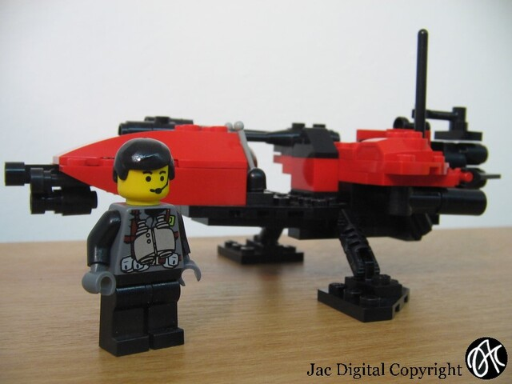
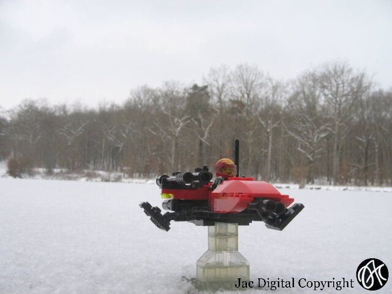
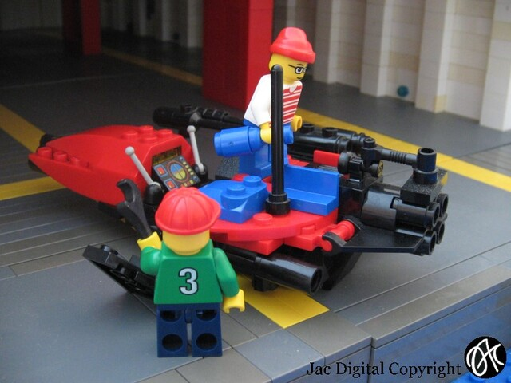
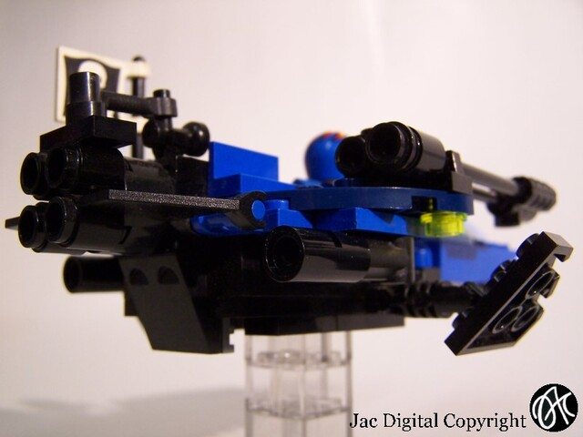
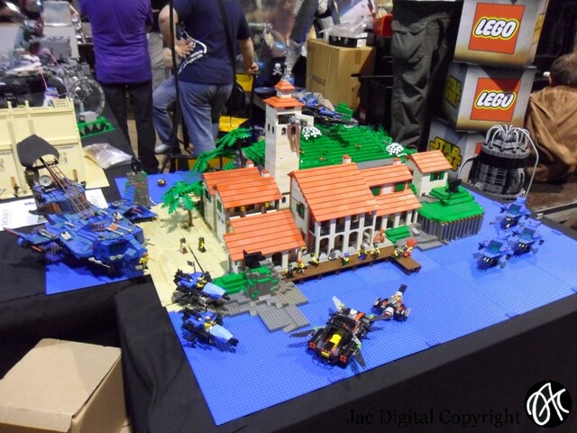
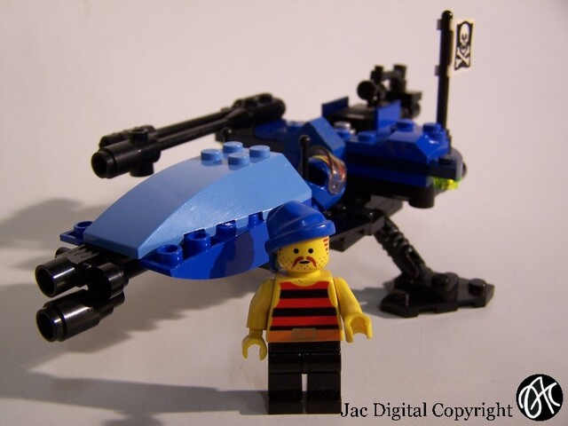

L’orbicom est né de ma décision de créer un vaisseau tout simple avec des pieds rétractables sur les côtés.

Des fois, il suffit juste de quelques pièces pour mettre en réel ce que l’on a en tête. J’avais peu de critères et du coup beaucoup de liberté pour démarrer ce petit vaisseau. Sur certaines créations, je passe beaucoup de temps à réfléchir, à mettre certains détails ou assemblages au point, même sur de petites constructions. Mais là, tout est allé très vite, le premier "jet" était le bon.

Petit tour en extérieur.........

Depuis le premier vaisseau que j’ai fait, il y a eu très peu de modification ce n’est pas dans mes habitudes. Mais le plus flagrant dans son évolution c’est surtout le changement de propriétaire, puisque mes pirates de l’espace se sont accaparé le brevet.........

Au début c’était juste de la peinture puis il y a eu le drapeau pirate et une amélioration du canon avant. Ça c’est pour la partie la plus visible....

Donc comme je tente de vous l’expliquer depuis le début, bin oui parce que je m’égare, c’est un petit vaisseau conçu pour des vols d’inspection à courte distance. Le nom "Orbicom" provient du bureau de conception. Ils sont tout de même munis d’un armement de défense conséquent. Un canon à l’avant muni de radar très puissant et un double canon laser sur un côté. Ça parait mal équilibré, mais il est assez proche du pilote et du coup, le contrôle est très aisé. C’est ce qui a séduit mes pirates. Ils en ont pris en chasse. Ils les ont récupérés, repeints, remaniés sur certains points et rebaptisés après de multiples mises au point, 17 du coup ! Ils appartiennent donc maintenant à l’unité de surveillance de la base.

Pour la propulsion nous avons un réacteur arrière, deux propulseurs orientables et deux fixes situés en bout de stabilisateurs.

Sur ma base pirate, ils servent à protéger la base uniquement, alors que d’autres peuvent aussi servir à escorter le "[Bluhacker](http://photos.freelug.org/main.php/v/JAC/MOC/Vaisseaux/pirate/bluhacker/)", comme les "[Renard noir](http://photos.freelug.org/main.php/v/JAC/MOC/Vaisseaux/pirate/RenardNoirV2/)" ou les "[Gourmandos](http://photos.freelug.org/main.php/v/JAC/MOC/Vaisseaux/pirate/Gourmando/)".

J’ai voulu faire une flotte suffisamment persuasive, mais j’ai pu construire seulement 2 vaisseaux. A croire qu’ils soient efficaces.

Ce vaisseau n’était pas destiné à défendre la base pirate à l’origine, d’où des caractéristiques qui ne correspondent pas à leur construction habituelle :

-   Configuration du moteur : Flux divisé à bouillon B
-   Code modèle : Pirat-1125 H17
-   Surface de stabilisation : V28
-   Système de frein : AL 112568B
-   Contrôle d’armes : ALP PRO-Arm type 3
-   Equipage : Un pilote.

Taille réelle : 15,5 cm de long, 10,3 cm de large, 8 cm de hauteur.

Liens vers la galerie de photo : [Orbicom H17](http://photos.freelug.org/main.php/v/JAC/MOC/Vaisseaux/pirate/orbicom/)

Plus tard je joindrai la notice à ce dossier.
