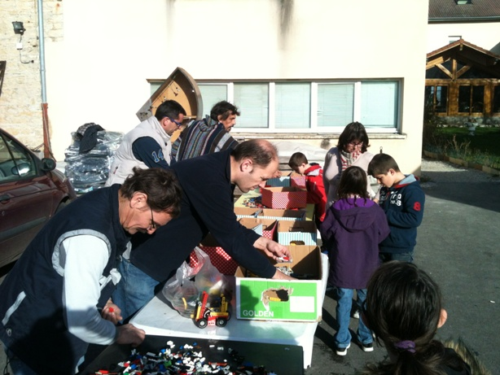

En 2013, pour la première édition de la BRIQU’Expo Diémoz, nous étions fiers d’avoir à nos côtés la [communauté d’Emmaüs](http://www.emmaus-bourgoin.org/).

Nous sommes très contents de pouvoir compter une nouvelle fois sur leur présence pour la prochaine [BRIQU’Expo Diémoz](http://chezyannoch.com/briquexpodiemoz/briquexpo_diemoz2015.php). Afin de préparer au mieux leur venue, nous avons passé une petite matinée avec eux - sous le soleil - pour les aider à trier leurs caisses de vrac qu’ils mettront en vente à Diémoz ou ailleurs.

**Des caisses à trier**

Une matinée très sympathique, avec des gens qui le sont tout autant. Une occasion de lier l’utile à l’agréable.

Nous devrions reprogrammer prochainement une autre matinée ou journée de tri. Etant donné les quantités à trier, il faudra bien cela !
