Aujourd’hui je vous propose la review du set 75077 dans la gamme _Star Wars_ : **Homing Spider Droid**.

Ce set sorti en 2015 au prix de 9,99 € est composé de 102 pièces, soit un ratio prix/pièce de 9,8 centimes d’€. Il fait parti de la _Série 2_ de la gamme _Microfighters_.

[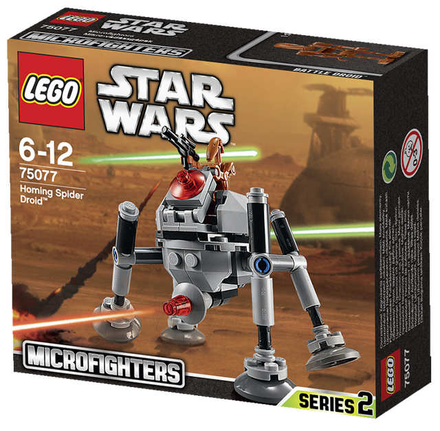](https://www.freelug.org/IMG/png/SpiderDroid_Box.png)

Le set contient deux sachets de briques et une notice de construction.

[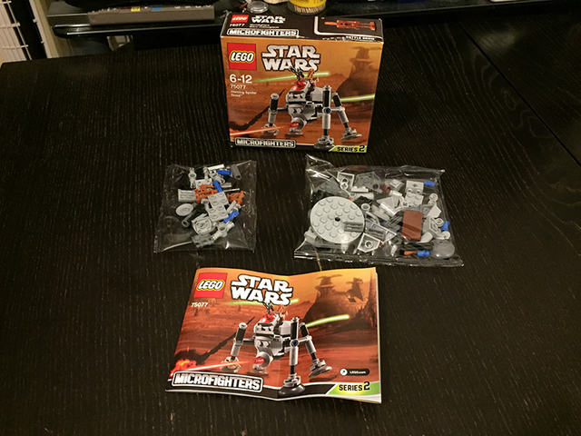](https://www.freelug.org/IMG/jpg/SpiderDroid_01_mini.jpg)

On va passer rapidement sur le [_Battle Droid Dark Orange_](http://brickset.com/minifigs/sw467/Battle-Droid-Dark-Orange-without-Back-Plate) qui est semblable à ses frères couleur tan.  
On commence donc directement par la construction du set.

[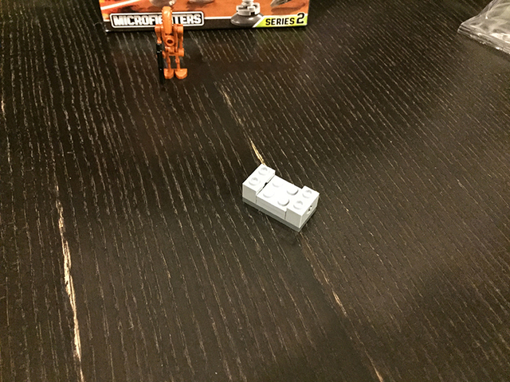](https://www.freelug.org/IMG/jpg/SpiderDroid_02_mini.jpg)

On construit les flans du bas du module.

[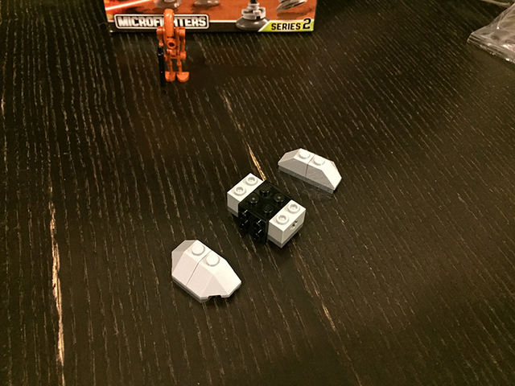](https://www.freelug.org/IMG/jpg/SpiderDroid_03_mini.jpg)

Et on les intègre à la base.

[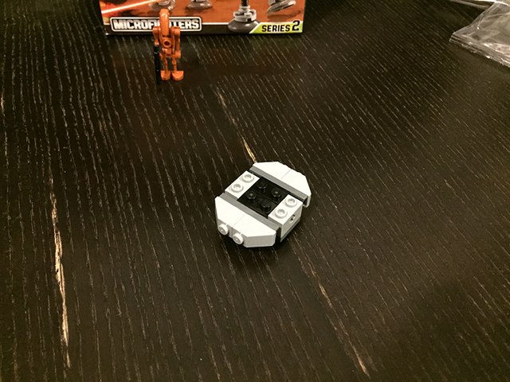](https://www.freelug.org/IMG/jpg/SpiderDroid_04_mini.jpg)

Voici les "bras" qui tiendront les pattes de l’engin.

[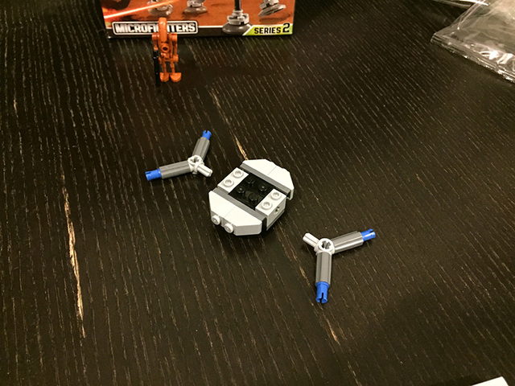](https://www.freelug.org/IMG/jpg/SpiderDroid_05_mini.jpg)

Une fois les "bras" fixés, on s’attaque à la plateforme qui composera le haut du véhicule.

[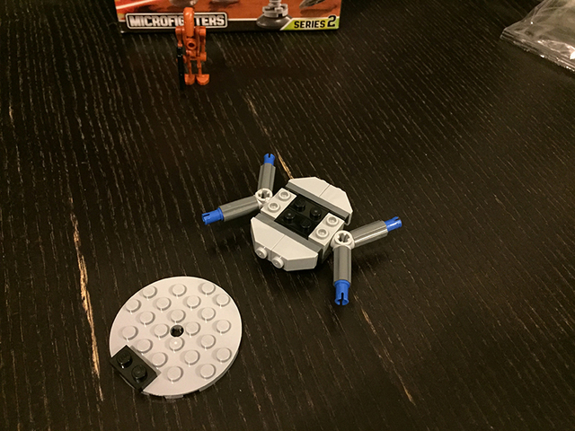](https://www.freelug.org/IMG/jpg/SpiderDroid_06_mini.jpg)

On installe les grilles de part et d’autre de la plateforme.

[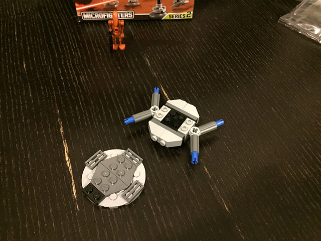](https://www.freelug.org/IMG/jpg/SpiderDroid_07_mini.jpg)

Le cockpit prend forme.

[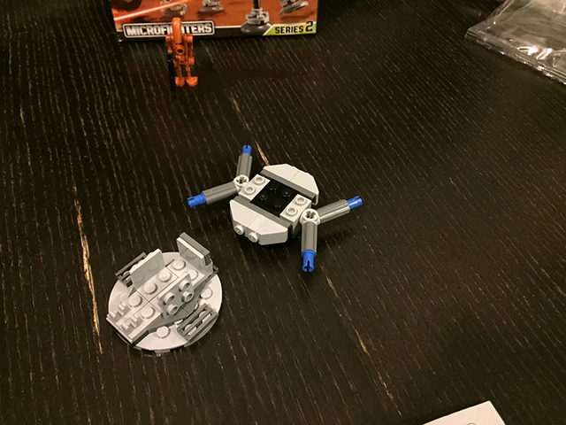](https://www.freelug.org/IMG/jpg/SpiderDroid_08_mini.jpg)

On construit les mêmes flans pour le haut du véhicule.

[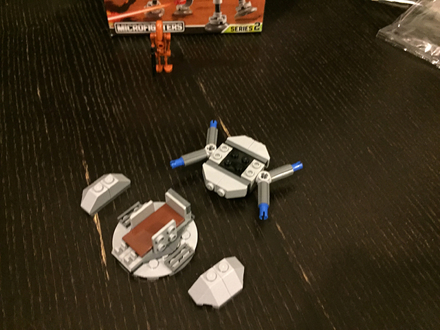](https://www.freelug.org/IMG/jpg/SpiderDroid_09_mini.jpg)

Les flans installés, voici la pièce qui permettra de fermer le cockpit.

[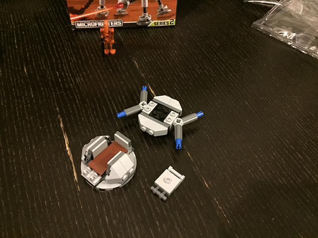](https://www.freelug.org/IMG/jpg/SpiderDroid_10_mini.jpg)

On agrémente la trappe d’un "œil".

[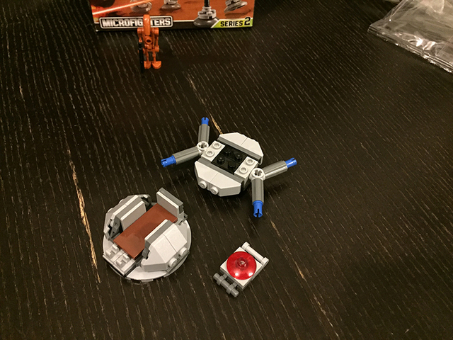](https://www.freelug.org/IMG/jpg/SpiderDroid_11_mini.jpg)

Et on la fixe à l’ensemble.

[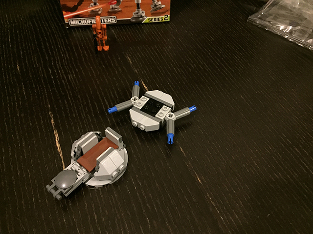](https://www.freelug.org/IMG/jpg/SpiderDroid_12_mini.jpg)

Puis on pose la plateforme sur la base.

[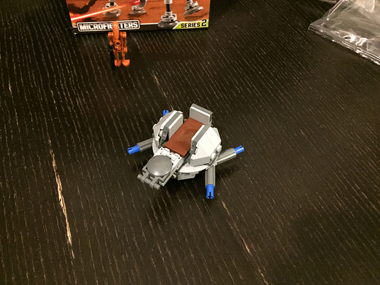](https://www.freelug.org/IMG/jpg/SpiderDroid_13_mini.jpg)

Voici les quatre pattes.

[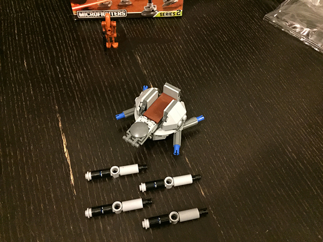](https://www.freelug.org/IMG/jpg/SpiderDroid_14_mini.jpg)

Elles sont maintenant montées sur le véhicule.

[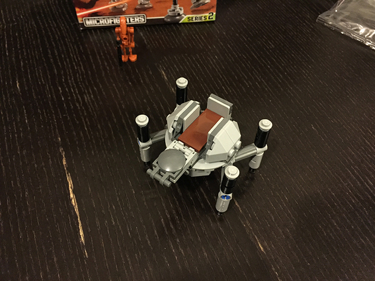](https://www.freelug.org/IMG/jpg/SpiderDroid_15_mini.jpg)

On assemble les quatre pieds.

[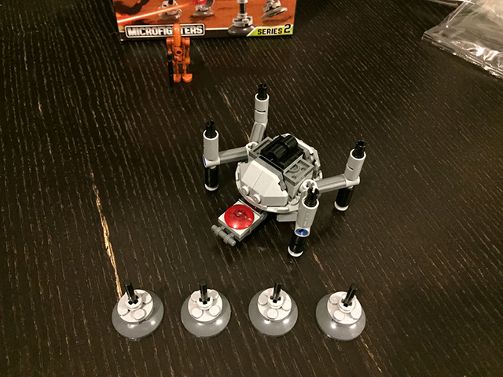](https://www.freelug.org/IMG/jpg/SpiderDroid_16_mini.jpg)

Et on les monte sur les pattes.

[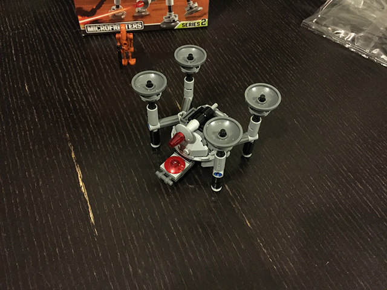](https://www.freelug.org/IMG/jpg/SpiderDroid_17_mini.jpg)

Voici le Spider Droid terminé.

[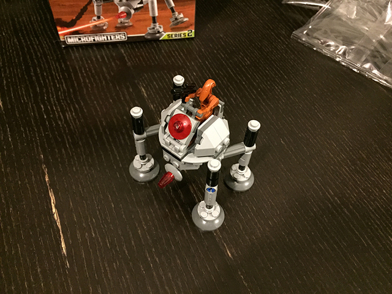](https://www.freelug.org/IMG/jpg/SpiderDroid_18_mini.jpg)

Quelques photos de plus près.

[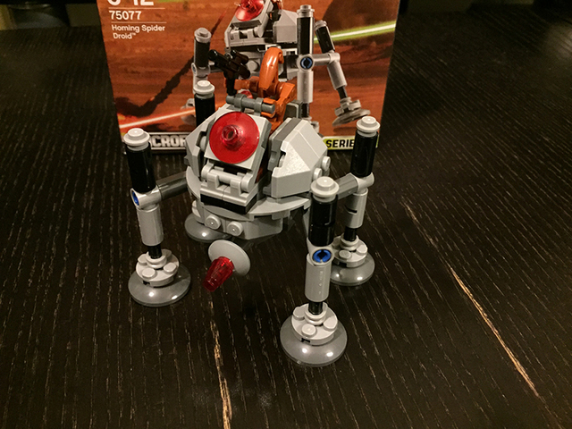](https://www.freelug.org/IMG/jpg/SpiderDroid_19_mini.jpg)

[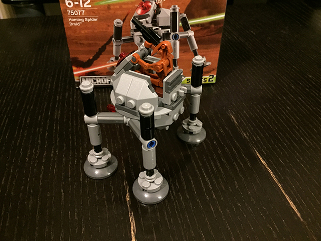](https://www.freelug.org/IMG/jpg/SpiderDroid_20_mini.jpg)

**Aavis :**

Ce petit set _Microfighter_ n’est pas le meilleur set de la _Série 2_, mais il est impératif de l’avoir pour posséder tous les modèles de la collection.

_Bonus :_

Voici un GIF animé réalisé avec les nombreuses photos prises pour cette review (désolé pour les quelques photos floues).

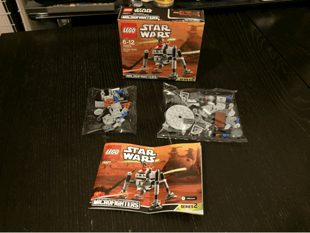
